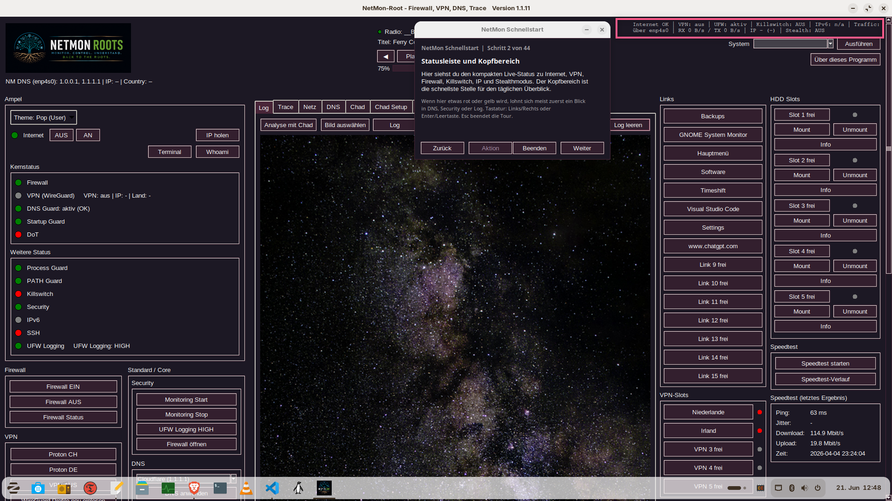
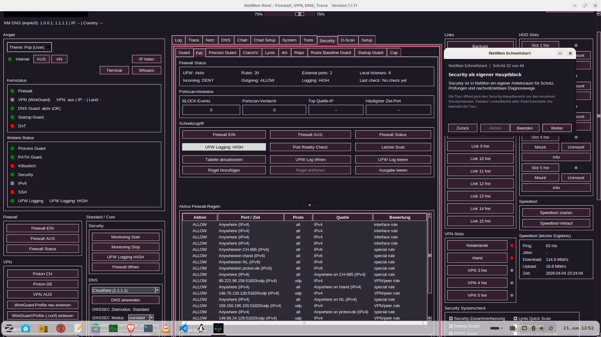
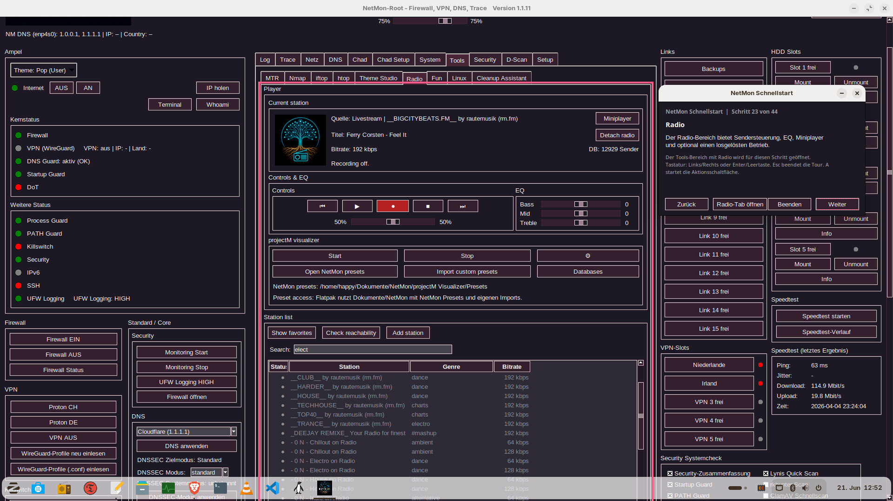

# NetMon Roots

**NetMon Roots** is an all-in-one Linux network and security toolkit that combines network diagnostics, DNS management, firewall control, VPN support, security monitoring, AI-assisted analysis, radio features, and system utilities in a single graphical application.

Designed for Linux users who want to monitor, diagnose, and secure their systems from one central interface.

---

## Features

### Network

* Network diagnostics
* Connection monitoring
* Routing information
* Trace and analysis tools
* Packet capture support

### Security

* DNS Guard
* DNS-over-TLS (DoT)
* Firewall / UFW management
* WireGuard VPN support
* Kill Switch
* Security Monitoring
* Startup Guard
* Process Guard
* Repository Guard
* Roots Baseline Guard
* ClamAV integration with configurable quick-scan paths, scan runtime display, findings and quarantine management
* Lynis integration
* RKHunter integration with deterministic finding classification and a guarded manual reference update
* Secure Browser with isolated, hardened Firefox profiles per web service

### AI Analysis

* AI-assisted log analysis
* Security report interpretation
* Diagnostic assistance

### Utilities

* Internet Radio
* Theme Studio
* Linux Help
* Cleanup Assistant
* HDD, Link and VPN Slot Management
* Support package export
* Guided Setup tours in German and English, including Secure Browser privacy guidance

---

## Screenshots

### Main Window



### Security Monitoring



### Radio Module



---

## Installation

Download the latest Debian package from:

**[https://netmonroots.com/downloads.html](https://netmonroots.com/downloads.html)**

or from the GitHub Releases page.

Install the package:

```bash
sudo dpkg -i netmon_1.1.21_all.deb
sudo apt -f install
```

For local development:

```bash
python3 -m venv .venv
./.venv/bin/pip install -r requirements.txt
./.venv/bin/python -m netmon --headless
./.venv/bin/python -m netmon
```

---

## Documentation

Repository documentation is available under `docs/`, especially:

* [docs/USER_GUIDE.md](docs/USER_GUIDE.md)
* [docs/DEVELOPER_GUIDE.md](docs/DEVELOPER_GUIDE.md)
* [docs/CONFIGURATION.md](docs/CONFIGURATION.md)
* [docs/CHANGELOG.md](docs/CHANGELOG.md)
* [docs/SECURITY.md](docs/SECURITY.md)

---

## Project Links

**Website**

[https://netmonroots.com](https://netmonroots.com/)

**Downloads**

[https://netmonroots.com/downloads.html](https://netmonroots.com/downloads.html)

**Security Audit**

[https://netmonroots.com/security-audit.html](https://netmonroots.com/security-audit.html)

---

## Supported Platforms

* Ubuntu
* Zorin OS
* Linux Mint

Additional distributions are continuously being evaluated.

---

## License

Licensed under **GPL-3.0-or-later**.

See the `LICENSE` and `THIRD_PARTY_NOTICES.md` files for details.

---

## Contact

General Information

[info@netmonroots.com](mailto:info@netmonroots.com)

Support

[support@netmonroots.com](mailto:support@netmonroots.com)
