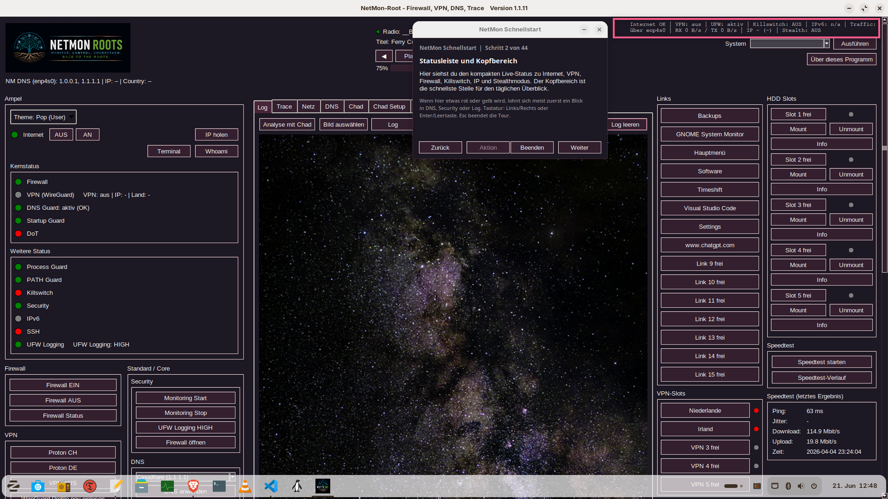
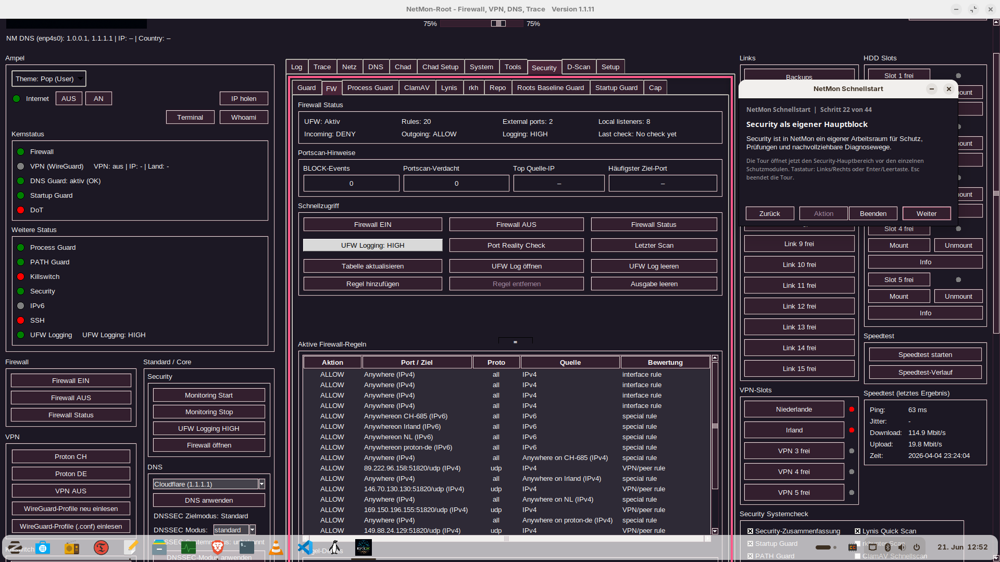
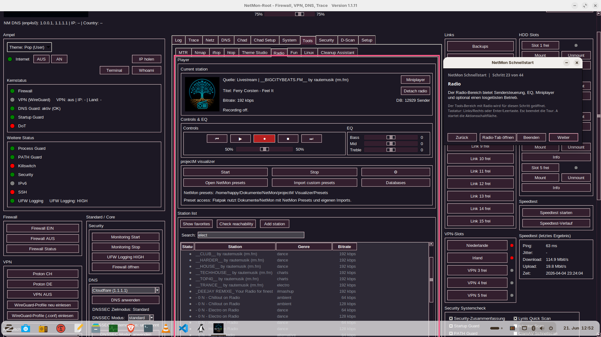

# NetMon Roots

> **Lokaler Teststand 1.1.22:** Paket `netmon_1.1.22_all.deb`, Branch `release/netmon-1.1.22-test`. Herkunft und Prüfgrenzen: [Teststand](docs/NETMON-1.1.22-TEST.md).

**NetMon Roots** is an all-in-one Linux network and security toolkit that combines network diagnostics, DNS management, firewall control, VPN support, security monitoring, AI-assisted analysis, radio features, and system utilities in a single graphical application.

Designed for Linux users who want to monitor, diagnose, and secure their systems from one central interface.

---

## Features

### Network

* Network diagnostics
* Connection monitoring
* Routing information
* Trace and analysis tools
* Packet capture support

### Security

* DNS Guard
* DNS-over-TLS (DoT)
* Firewall / UFW management
* WireGuard VPN support
* Kill Switch
* Security Monitoring
* Startup Guard
* Process Guard
* Repository Guard
* Roots Baseline Guard
* ClamAV integration with configurable quick-scan paths, scan runtime display, findings and quarantine management
* Lynis integration
* RKHunter integration with deterministic finding classification and a guarded manual reference update
* Secure Browser with isolated, hardened Firefox profiles per web service

### AI Analysis

* AI-assisted log analysis
* Security report interpretation
* Diagnostic assistance

### Utilities

* Internet Radio
* Theme Studio
* Linux Help
* Cleanup Assistant
* HDD, Link and VPN Slot Management
* Support package export
* Guided Setup tours in German and English, including Secure Browser privacy guidance

---

## Screenshots

### Main Window



### Security Monitoring



### Radio Module



---

## Installation

Download the latest Debian package from:

**[https://netmonroots.com/downloads.html](https://netmonroots.com/downloads.html)**

or from the GitHub Releases page.

Install the package:

```bash
sudo dpkg -i netmon_1.1.21_all.deb
sudo apt -f install
```

For local development:

```bash
python3 -m venv .venv
./.venv/bin/pip install -r requirements.txt
./.venv/bin/python -m netmon --headless
./.venv/bin/python -m netmon
```

For the NetMon Tk source version, install its separate Python feature profile:

```bash
./.venv/bin/python -m pip install -r requirements-netmon.txt
./.venv/bin/python -B scripts/check_netmon_dependencies.py
./.venv/bin/python -B -m netmon.main
```

The check lists Python modules and external tools without importing NetMon,
starting tools/services or accessing stored credentials. A found module is not a
runtime test. In particular, Keyring also needs an accessible desktop Secret
Service; installing the Python package does not unlock the desktop keyring.
Missing external tools must be assessed for the desired feature, separately from
the Python environment. No system-wide packages are installed by the check.

The Analysemodus (Analysis mode) menu choice opens a focused workspace with Terminal on the left and Chad
on the right, both fitted to the visible NetMon window. The normal header, status
column and action columns are temporarily hidden. The outer page does not scroll;
chat and terminal histories retain their own scrollbars and the composer stays
visible. Drag the divider to resize. Closing or undocking restores the original
controls, page layout and previous page scroll position.
The Log image overlay is centered and fitted without cropping in Analysis mode,
preserving its aspect ratio; unused space can remain around the picture.
The ▾ menu next to Terminal selects Analysis mode or a separate window and remembers
the last successful choice. Without an active session, the separate-window choice
starts the existing external system terminal. With an active docked session,
Abdocken (Undock) or the menu moves the same terminal into its own window, keeping
the Bash process, working directory and scrollback. Select Analysis mode again to move
that session back. The main Terminal button brings an active session into view.
NetMon-owned sessions, including undocked ones, close with NetMon; independently
started external system terminals keep their normal lifecycle.
Embedding uses system Python with `python3-gi` and `gir1.2-vte-2.91` under
X11/XWayland. It starts a separate interactive Bash without profile/rc scripts;
commands are entered or pasted by the user, and terminal output is not sent to Chad.

---

## Documentation

Repository documentation is available under `docs/`, especially:

* [docs/USER_GUIDE.md](docs/USER_GUIDE.md)
* [docs/DEVELOPER_GUIDE.md](docs/DEVELOPER_GUIDE.md)
* [docs/CONFIGURATION.md](docs/CONFIGURATION.md)
* [docs/CHANGELOG.md](docs/CHANGELOG.md)
* [docs/SECURITY.md](docs/SECURITY.md)

---

## Project Links

**Website**

[https://netmonroots.com](https://netmonroots.com/)

**Downloads**

[https://netmonroots.com/downloads.html](https://netmonroots.com/downloads.html)

**Security Audit**

[https://netmonroots.com/security-audit.html](https://netmonroots.com/security-audit.html)

---

## Supported Platforms

* Ubuntu
* Zorin OS
* Linux Mint

Additional distributions are continuously being evaluated.

---

## License

Licensed under **GPL-3.0-or-later**.

See the `LICENSE` and `THIRD_PARTY_NOTICES.md` files for details.

---

## Contact

General Information

[info@netmonroots.com](mailto:info@netmonroots.com)

Support

[support@netmonroots.com](mailto:support@netmonroots.com)
