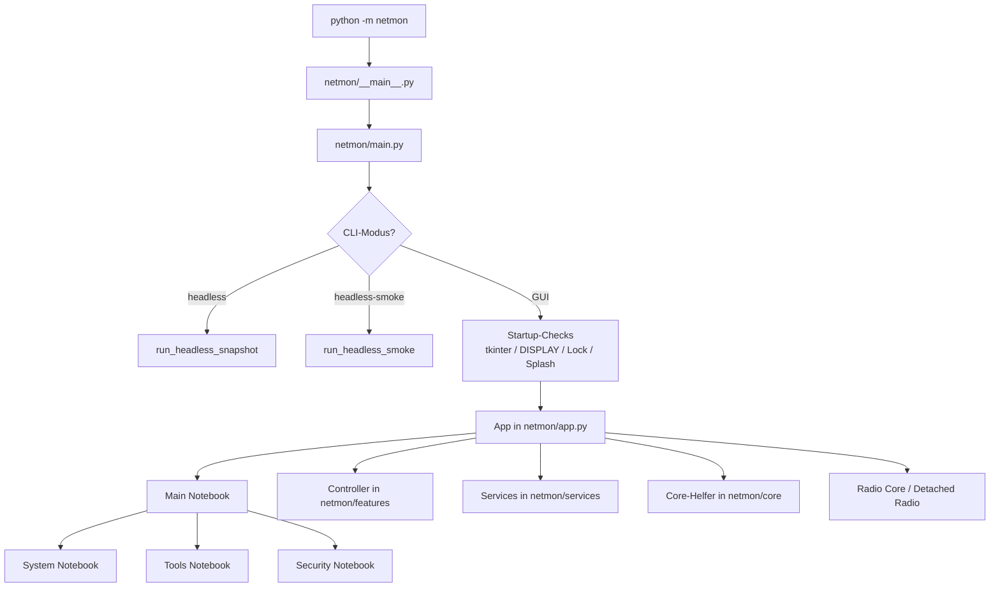
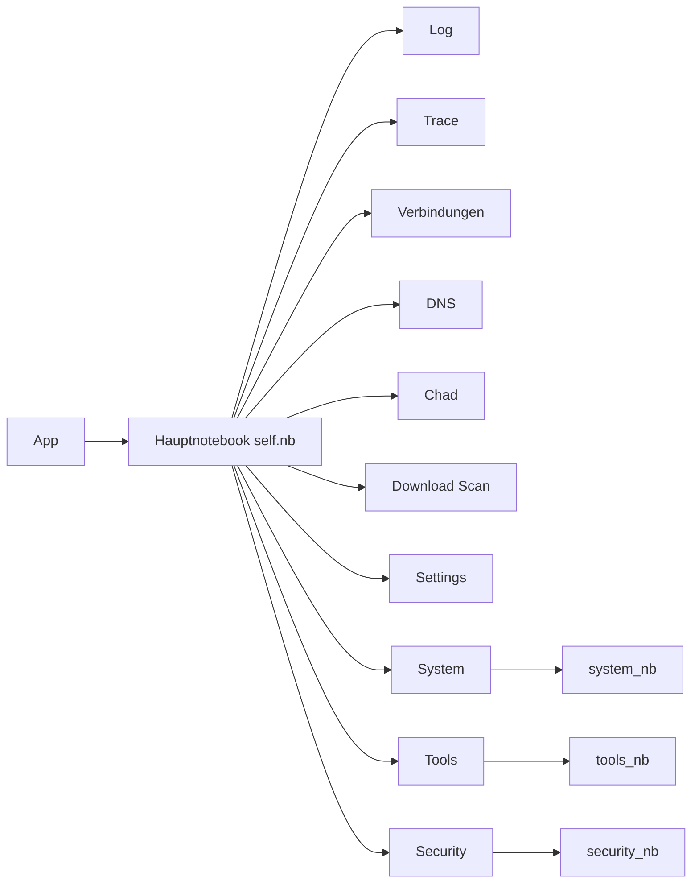
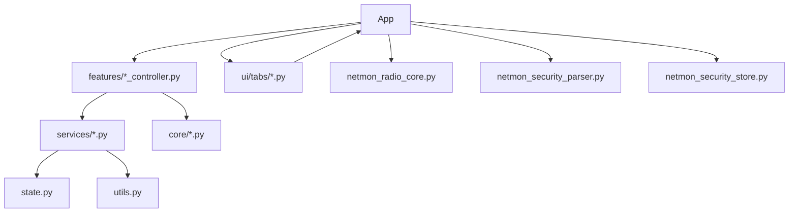
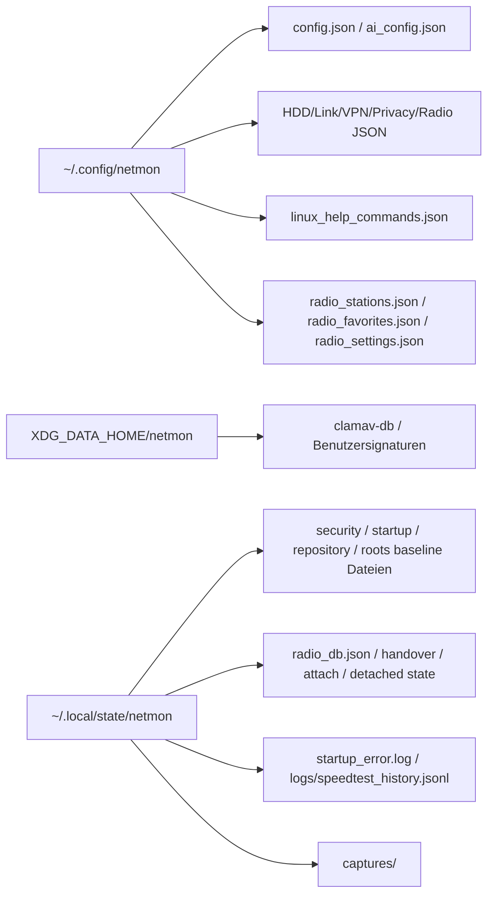
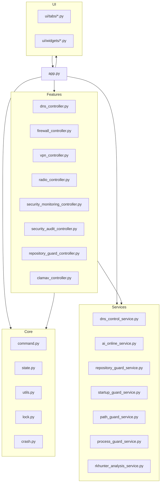

# Architektur NetMon

## Systemarchitektur

NetMon ist eine monolithische Tk-/ttk-Desktop-Anwendung mit einer grossen zentralen `App`-Klasse und ausgelagerter Fachlogik in Controllern, Services, Core-Helfern und UI-Tab-Builders.

### Architekturueberblick

## GUI-Architektur

## Backend-Architektur

## Konfigurations- und Laufzeitdaten

## GUI

- Tk-Basis ueber `tkinter`/`ttk`.
- Hauptnavigation ueber drei Ebenen: Haupttabs, verschachtelte System-/Tools-/Security-Notebooks und bereichsspezifische Widgets.
- Theme-System in `app.py` mit Light, Dark, Beige und Pop sowie Theme Studio fuer das Pop-Profil.

## Backend

- Controller-Module in `netmon/features/` kapseln UI-nahe Aktionen und Dateipfade.
- Services in `netmon/services/` kapseln Parser, Policies, Guards oder Onlinezugriffe.
- Core-Helfer in `netmon/core/` kapseln Basiskommandos, Locking, Crash-Handling, Pfad- und Formatierungslogik.
- `clamav_controller.py` verwaltet Scanarten, Schnellscan-Konfiguration, Fortschrittsanzeige, Signaturauswahl, Befunde und Quarantaene.
- `security_audit_controller.py` orchestriert RKHunter-Scans und Referenzupdates; `rkhunter_analysis_service.py` klassifiziert die Ausgabe und liefert die Gate-Evidenz.

## Netzwerkmodule

- `NetmonNetworkService`: `sudo`-nahe Adapter fuer WireGuard und UFW.
- `DNSControlService`: Resolver-/VPN-/DoT-/DNSSEC-Evaluation und Reparaturen.
- `port_analysis.py`, `speedtest.py`, Trace-/MTR-/Nmap-/iftop-/htop-Tabs: klassische Netzwerkanalyse.
- Packet-Capture-Controller: tcpdump/Wireshark/tshark-nahe Integration.

## Logging

- Startfehler werden in eine dedizierte State-Datei geschrieben.
- Laufende Aktionen landen im Log-Tab.
- Mehrere Bereiche schreiben JSON- oder JSONL-Dateien fuer Persistenz, Baselines, History oder Handover.

## Konfiguration

- XDG-basierte Config-/State-Verzeichnisse ueber `netmon/core/state.py`.
- Dateinamen zentral in `netmon/config/constants.py`.
- Viele Features bekommen ihre Pfade zentral in `App.__init__`.

## Moduldiagramm nach Codebereichen

## Unklar / Nicht dokumentiert

- Es existiert keine separate Architektur-Dokumentation im Quellcode; die hier gezeigte Architektur ist aus Importen, Buildern und Aufrufpfaden abgeleitet.
- Einzelne UI-Texte beschreiben noch Platzhalter oder spaetere Integrationsschritte; sie spiegeln nicht immer den aktuellen Implementierungsstand 1:1 wider.
