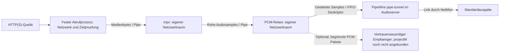
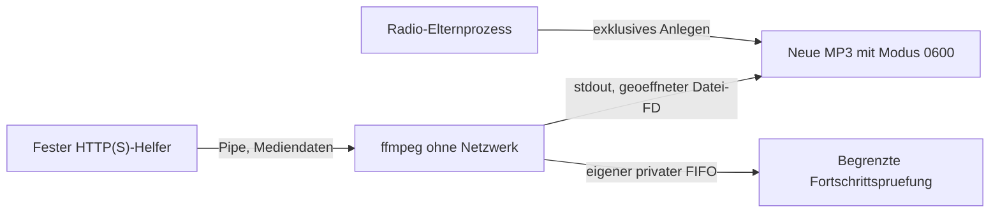

# Radio Smoke Test

Kurzer Praxis-Check fuer den NetMon-Radio-Flow mit `embedded`, `standalone`,
Detach, Reattach und Desktop-Launcher.

## Aktueller Entwicklungsstand: geschützte FIFO-Tonausgabe (G-pacat, H1)

Stand 2026-11-09, uncommittierter Arbeitsbaum. Die Radio-Wiedergabe startet
**kein pacat mehr**. Der Ton geht vom netzlosen PCM-Relais über eine anonyme
Pipe an einen begrenzten Schreiber auf der vertrauenswürdigen NetMon-Seite.
Nur dieser hält die FIFO zum PipeWire-Server des Benutzers, und zwar zu
`libpipewire-module-pipe-tunnel` (`tunnel.mode=playback`, `remote.name=internal`,
`node.autoconnect=false`, `flags = [ nofail ]`). Keine Sandbox erhält für die
Wiedergabe einen Pulse- oder PipeWire-Socket. NetMon selbst verbindet den
Tunnel mit der aktuellen Standardausgabe (`pw-link`) und trennt die Verbindung
bei jedem Stopp zuerst. Einen Rückfall auf pacat gibt es nicht.

- Einrichtung nur über den Knopf im Player-Bereich unter „Radio lösen“
  (**„Ton einrichten…“**, eingerichtet: **„✓ Ton geschützt“**), nach
  ausdrücklicher Bestätigung. Angelegt werden nur
  `~/.config/pipewire/pipewire.conf.d/50-netmon-radio-fifo.conf` und
  `~/.local/state/netmon/radio-output/` (0700). Kein root, keine Systemdateien,
  kein postinst. Wirksam erst nach einem Neustart der Audiodienste des
  Benutzers: NetMon fragt danach und führt bei „Ja“ selbst
  `systemctl --user restart pipewire pipewire-pulse wireplumber` aus (Radio wird
  vorher gestoppt, der Ton aller Programme setzt kurz aus). Ein Ab- und Anmelden
  genügt nicht zuverlässig, weil der Benutzerdienst weiterlaufen kann. Derselbe
  Knopf entfernt beides wieder, ebenfalls mit Rückfrage zum Neustart.
- Ohne Einrichtung, bei nicht unterstützter PipeWire-Version (nur 1.0.x) oder
  socketbasiertem PipeWire-Zugriff meldet das Radio „Geschützte Radioausgabe
  nicht bereit: …“ und startet nicht.
- Das Relais taktet auf Echtzeit (höchstens 200 ms Vorlauf, kein Aufholen nach
  Aussetzern). Ein Wächter prüft alle 2 s Tunnel-Generation und Verbindungen.
  Bei Verlust stoppt er mit „geschützte Ausgabe verloren“, ohne neu zu verbinden.
- F3-Einbau: Der externe Schreiber begrenzt neue FIFO-Bytes auf 192.000 Byte/s
  mit höchstens 38.400 Byte Reserve und hält maximal einen 4096-Byte-Block vor.
  Der FIFO-Deskriptor und sein Pfad werden keiner Kapsel freigegeben. Stopp
  trennt zuerst die Links und fordert danach den Abbruch des Schreibers an;
  nur der Besitzer wartet auf dessen Ende. Ein natürliches Ende darf begrenzt
  auslaufen. Kein angesammeltes Zeitguthaben während eines Schreibaufrufs.
  Dies ist eine Datenflussgrenze, keine CPU-/PID-/Gesamtspeicherquote und keine
  Begrenzung bereits im Tunnel gepufferter Tondaten. Private Nachweise und
  Grenzen: `backups/netmon-gpacat-f3-integration-20261109-codex/`.
- Bekannt: ≈ 0,5 s Nachlauf des vorherigen Senders beim nächsten Start (F5).
  Der erste 20-ms-Block geht beim Anlauf verloren.
- Belege: `backups/netmon-gpacat-*-20261109-claude/` (privater PipeWire-Server,
  kein Host). Keine Host-Abnahme, keine Sicherheits-, Gesamt- oder
  Produktivfreigabe. G-pacat bleibt bis zur unabhängigen Gegenprüfung offen.

### Ressourcengrenzen der Radio-Kapseln (G-Quota, Stand 2026-11-10)

Abruf, Decoder (mpv) und PCM-Relais starten jeweils über
`systemd-run --user --scope … -- prlimit … -- bwrap …` in einer eigenen
kurzlebigen Benutzer-Scope (cgroup v2, kein root). Der gestartete Prozess bleibt
bwrap, Besitz und Stopp funktionieren wie bisher. Grenzen (gemessener Verbrauch:
mpv ≈ 70 MiB/10 Threads, Abruf ≈ 26 MiB, Relais ≈ 18 MiB, CPU < 0,3 %):

| Kapsel | Speicher (ohne Swap) | Tasks | CPU | `/tmp` | offene Dateien | Dateigröße |
|---|---|---|---|---|---|---|
| Decoder | 512 MiB | 64 | 100 % | 16 MiB | 256 | 16 MiB |
| Abruf | 128 MiB | 16 | 50 % | 16 MiB | 64 | 1 MiB |
| Relais | 128 MiB | 16 | 50 % | 16 MiB | 64 | 1 MiB |

Speicherüberschreitung beendet die betroffene Kapsel (OOM nur in ihrer Scope),
damit endet die Wiedergabe mit Fehler. Ohne erreichbaren Benutzer-Dienstmanager
startet das Radio nicht („Ressourcengrenzen nicht verfügbar“, D-Q1).

Aufnahme (Stand 2026-11-10): Abruf wie oben, Encoder (ffmpeg) mit 256 MiB, 32 Tasks,
100 % CPU, 16 MiB `/tmp`, 64 offenen Dateien und **höchstens 2 GiB je Aufnahmedatei**
(`RLIMIT_FSIZE`, gilt auch für die vom Elternprozess geöffnete Zieldatei). Beim
Erreichen endet die Aufnahme mit „Aufnahme beendet: Höchstgröße 2 GB erreicht“.
Gemessen: ffmpeg ≈ 54 MiB, 4 Threads.

Kurzlebige Helfer (Titel/ICY, Erreichbarkeit, Katalog, Logo, Presets) laufen ohne
eigene systemd-Scope, weil z. B. die Titelabfrage alle 5 s startet und jede Scope
eine Journalzeile erzeugt. Sie haben stattdessen ein auf 16 MiB begrenztes `/tmp`
und feste Selbstgrenzen vor der ersten Fremdeingabe: der Abrufhelfer AS 256 MiB,
64 Dateien, Dateigröße 1 MiB, keine Core-Dumps, keine neuen Prozesse/Threads
(`RLIMIT_NPROC 0`), CPU 30 s (Presets 120 s, Live-Streams unbegrenzt, dort greift
die Scope-Quote); Katalog-, Logo- und ZIP-Helfer behalten ihre vorhandenen Grenzen.
projectM im CPU-Weg (Stand 2026-11-10): alle vier Kapseln (PCM-Zulieferer,
internes Xvfb, nativer Renderer, Pixelleser) starten ebenfalls über
`systemd-run … prlimit … bwrap`: Zulieferer 256 MiB/32 Tasks/50 %, Xvfb 256 MiB/16/50 %,
Renderer 1 GiB/64/**200 % im Standardprofil, 300 % bei „Mehr Leistung“**,
Pixelleser 512 MiB/32/50 %; je 16 MiB `/tmp`,
Dateigröße 16 MiB, NOFILE 128 bzw. 256 (damit G1: Xvfb ohne FSIZE/NOFILE geschlossen).
Ohne Benutzer-Dienstmanager startet projectM nicht. Gemessen mit synthetischem Preset:
Renderer ≈ 122 MiB, 9 Threads, ≈ 24 % CPU bei 30 Bildern/s, mit Grenzen unverändert
30 Bilder/s. Schwere Presets werden bei 2 Kernen langsamer, nicht unbegrenzt teurer. Keine Begrenzung der Plattenlast (`io` nicht delegiert).

### Auflösung der Visualisierung (2026-11-10)

Im Visualisierungsfenster: Rechtsklick → „Auflösung“. Vier feste Renderprofile:
640 × 480 (Standard), 960 × 540, 1280 × 720 und 1920 × 1080 (Full HD).
Das ändert die tatsächliche Render- und Erfassungsauflösung; „Darstellung“ steuert
weiterhin Originalformat, beschnittenes Ausfüllen oder Strecken im Fenster.
Die erste Stufe hat das Seitenverhältnis 4:3, die höheren Stufen 16:9.

Beim Wechsel startet nur die Visualisierung neu; Radio und Tonausgabe laufen weiter.
Fenstergröße, Vollbild und Darstellungsmodus bleiben erhalten. Eine manuelle
Presetauswahl wird im neuen privaten Snapshot über ihren exakten Namen erneut
zugeordnet; fehlt sie dort inzwischen, startet die Automatik. Die Auflösung bleibt
für die laufende App gewählt, wird aber nicht dauerhaft gespeichert.

Alle Kapselquoten bleiben wie oben begrenzt. Der Pixelleser akzeptiert pro Sitzung
nur die exakte Framegröße des gewählten Profils, hält ein neuestes Vollbild und
einen begrenzten Teilbildpuffer. Die Vollbildfrist bleibt 5 s. Die Standardstufe
behält ihr bisheriges Bytebudget (16 Frames Burst, 120 Frames/s Nachfüllung),
die drei höheren Stufen erlauben höchstens 4 Frames Burst und 45 Frames/s
Nachfüllung. Das sind Schutzgrenzen, keine Anzeige-FPS-Zusage.
Der Renderer läuft je nach CPU-Profil mit nominal 25 oder 30 FPS, die Erfassung
bleibt bei 30 FPS.

Praxistest: Während der Wiedergabe alle vier Stufen auswählen, auch schnell
mehrfach wechseln; Vollbild, Preset und Ton kontrollieren. Hohe Auflösungen und
komplexe Presets können unter den unveränderten CPU-Grenzen weniger Bilder liefern.
Private Entwicklertests ersetzen weder diesen Praxistest noch eine Gesamtfreigabe.

### CPU-Leistung der Visualisierung (2026-11-10)

Rechtsklick im Visualisierungsfenster → „CPU-Leistung“:

| Profil | Renderziel | Render-Threads | maximale Renderer-CPU |
|---|---:|---:|---:|
| Standard (Voreinstellung) | 25 FPS | 2 | 200 % |
| Mehr Leistung | 30 FPS | 4 | 300 % |

Beim Wechsel startet nur die Visualisierung neu. Radio, Fenster, Vollbild,
Darstellung und manuelle Presetauswahl bleiben erhalten; die Auflösung bleibt
gewählt. Die Profilwahl gilt für die laufende App, auch nach Schließen und
erneutem Öffnen der Visualisierung; keine dauerhafte Speicherung.
Beide CPU-Profile verwenden Software-Rendering. Die Renderauswahl ist im
folgenden Abschnitt beschrieben; während GPU-Rendering ist „CPU-Leistung“ deaktiviert.

Das Renderziel ist keine Garantie für jedes Preset und jede CPU. „Mehr Leistung“
kann mehr CPU und Energie benötigen; die übrigen Quotas und Pixelgrenzen bleiben
gleich. Die privaten früheren Messungen erreichten bei schwerem Full HD ungefähr
18 neue angezeigte Bilder/s statt 12, keine durchgehenden 30 FPS.
Praxistest: beide Profile bei laufendem Sender wechseln, mit Auflösungswechseln
kombinieren und Fenster, Preset, Vollbild und Ton kontrollieren.
Entwicklerbelege: `backups/netmon-projectm-cpu-profiles-20261110-codex/`.
Keine unabhängige Abnahme oder Gesamtfreigabe; `runtime_verified=false`.

### GPU-Rendering und Automatik (2026-11-10)

Rechtsklick → „Rendern“ → **Automatisch / CPU / GPU**. Neue Starts verwenden
Automatisch: genau eine unterstützte GPU wird versucht, bei einem vollständig
bereinigten Startfehler startet der bestehende CPU-Weg. Der Fenstertitel zeigt
den tatsächlich aktiven Weg, beim Rückfall „CPU (GPU nicht verfügbar)“.
Explizites GPU führt bei einem Startfehler nicht auf einen anderen Weg zurück.
Die Auswahl bleibt für die laufende App erhalten; Radio, Fenster, Vollbild,
Darstellung, Auflösung und manuelle Presetwahl bleiben beim Wechsel erhalten.

GPU verwendet EGL/Desktop-OpenGL ohne Host-Desktop-Verbindung, genau einen
zugeordneten DRM-Render-Knoten und dessen lesende Sysfs-Metadaten. Keine
pauschale `/dev/dri`-Freigabe. Der Renderer sendet nach festem Profilmarker
direkt feste RGBA-Frames an den vorhandenen begrenzten Leser; Xvfb und
FFmpeg-Bilderfassung entfallen im GPU-Weg. CPU bleibt eigenständig erhalten.
GPU: 30 FPS als Ziel und wieder Mesh 220×125; keine Garantie für jedes Preset.
Nur die Hauptoberfläche zeigt die Bilder; das GPU-Bildpostfach wird alle 5 ms
abgefragt, gezeichnet wird nur bei einem neuen Bild/Scaler-Ergebnis.

Lokal mit AMD/amdgpu/Mesa tatsächlich erprobt. Gemeinsame Mesa-Profile für
Intel i915/xe (iris) und NVIDIA nouveau sind Kandidaten, keine Hardwareabnahme.
Ein proprietäres NVIDIA-Profil ist noch nicht implementiert; Automatik verwendet
dort CPU, wenn keine andere eindeutige unterstützte GPU vorhanden ist. Mehrere
unterstützte GPUs werden ohne explizite Gerätewahl als uneindeutig abgelehnt.
Es werden keine Treiber installiert oder Rechte/Gruppen geändert.

Der Renderer behält 1 GiB RAM, Swap 0, 64 Tasks, 200 % CPU, 16 MiB tmpfs/FSIZE
und NOFILE 256. Das sind **keine harten GPU-Zeit-/VRAM-Quoten**. Sven hat das
Restrisiko der GPU-Anbindung ausdrücklich akzeptiert; keine Host-Delegation
oder Dienstkonfiguration geändert. Die frühere Behauptung „kein GPU-Zugriff“
gilt weiterhin für CPU und die historischen Schritte, nicht für diesen GPU-Weg.
Der gemessene PCM-Paketverlust und der ungeklärte Fünf-Sekunden-Bildruckler
werden durch diese GPU-Integration nicht als erledigt behandelt.

Adapter ausdrücklich mit `scripts/build_projectm_pcm.py` (CPU) und zusätzlich
`scripts/build_projectm_pcm.py --gpu` bauen; getrennte Hashmanifeste, kein Build
beim Start. Belege: `backups/netmon-projectm-gpu-integration-20261110-codex/`.
Entwicklertests und akzeptiertes Restrisiko sind keine unabhängige Gesamtfreigabe.

### Praxis-Check nach der Einrichtung (Sven, Schritt 5)

1. Player-Bereich → „Ton einrichten…“ → Text lesen → einrichten → Neustart der Audiodienste bestätigen.
2. Der Knopf zeigt „✓ Ton geschützt“, die Statuszeile „Radio bereit.“.
3. Einen Sender starten: Ton über die normale Standardausgabe.
4. Stopp: sofort still. Erneut starten: Ton kommt wieder (kurzer Nachlauf möglich).
5. Lokale Datei abspielen: läuft in normaler Geschwindigkeit bis zum Ende.
6. Andere Programme klingen wie vorher. Wie der Eintrag in pavucontrol heißt
   („NetMon Radio“ oder „pipewire“), ist nicht geprüft.
7. Optional: „✓ Ton geschützt“ → entfernen → Neustart bestätigen → Knopf zeigt „Ton einrichten…“, das Radio gibt keinen Ton.

### Klang für Visualisierung (2026-11-11)

Rechtsklick im Visualisierungsfenster → „Klang für Visualisierung…“ öffnet drei Regler:
**Bass** (Low-Shelf 150 Hz), **Höhen** (High-Shelf 4 kHz) und **Empfindlichkeit** (Gesamtpegel), je −12…+12 dB,
wirksam sofort ohne Neustart. Sie formen **nur die PCM-Kopie, die projectM analysiert** – der hörbare Ton, die Aufnahme und das
PCM-Ratenbudget bleiben unverändert. Die Werte gelten für die laufende App (auch über Auflösungs-/Renderwechsel), werden aber
nicht gespeichert. Technik: feste 8-Byte-Steuerdatei `/run/visual-eq` (nur lesend im Renderer, Komplementprüfung, Werte außerhalb
±12 dB beenden den Renderer). Hinweis: projectM normiert Bass/Mitten/Höhen auf ihren eigenen Durchschnitt; dauerhafte Anhebungen
wirken deshalb vor allem auf Wellenform-Größe und -Form, Beat-Variablen reagieren nur kurz auf eine Änderung.

## CPU-Entwicklungsweg: G-X11-Pixelpfad

Der GPU-Weg ist oben gesondert beschrieben und verwendet kein Xvfb/x11grab.

Stand 2026-11-08, uncommittierter Entwicklungsarbeitsbaum: Der aktive
projectM-Startweg verwendet jetzt internes Xvfb statt Xephyr. Displayserver,
Renderer und Bildleser erhalten keinen aeusseren X-Socket und kein Desktop-
Cookie. Nur das vertrauenswuerdige NetMon-Tk-Fenster spricht das UI-Display an.
Die bisherigen Xephyr-/Pixel-Vorstufen weiter unten sind historische Belege.
Die gelesene Claude-Gegenkontrolle unter
`backups/netmon-radio-gx11-integration-20261108-claude-recheck/` findet im
geprueften Umfang keinen Gegenbefund zu aeusserem X oder zur Pixelgrenze.
Eigenstaendige Laufzeitproben des Pruefers betreffen Display und Bildleser;
der Renderer wurde am echten Kapselplan und ueber erneut ausgefuehrte
Entwicklerproben bewertet, ohne eigene Renderer-Laufzeitpruefung.
`runtime_verified` bleibt `false`; keine Sicherheits-, Gesamt- oder
Produktivfreigabe. Die dort benannte Testluecke T1 wird unten getrennt beantwortet.

**Einzelschritt R09, 2026-11-08:** `open_last_radio_recording` verwendet jetzt
denselben geschuetzten lokalen Wiedergabepfad wie `play_last_radio_recording`.
Die Datei wird im Radio abgespielt und ersetzt dabei die bisherige Wiedergabe;
sie geht nicht mehr per `xdg-open` an einen Host-Player. Fehlende Aufnahmen
werden weiter abgewiesen, bei einem geschuetzten Startfehler gibt es keinen
externen Ersatzstart. Der Rueckgabewert bestaetigt nur die Auftragsannahme.
Die getrennte Funktion zum Oeffnen eines Ordners im Dateimanager bleibt bestehen.
354 gezielte Modul-/Lebensdauer-/Aufnahmegrenztests bestanden, bekannte
PyPDF2-Warnung; keine neue native Medien-/Host-Audio-Abnahme oder Gesamtsuite.
Nur dieser Dateiaufruf ist damit lokal korrigiert, andere Befunde unveraendert.
Belege: `backups/netmon-radio-r09-20261108/`. Keine zusaetzliche allgemeine
Gegenpruefung fuer diesen Einzelschritt angefordert; keine Gesamtfreigabe.
R09 in nachfolgenden historischen Restlisten beschreibt den frueheren Stand.

**Einzelschritt O1, 2026-11-08:** Der Aufnahmestopp entwertet die Generation
und setzt nur ein Abbruchsignal. Ausschliesslich der erzeugende Besitzer-Thread
ruft Prozess-Poll, Stoppen, Encoder-Abschluss und Einsammeln auf. Die Aufnahme-
UI und ihr Timer fragen nur den verwalteten Zustand ab, ohne Prozess-Wartepfad.
Der Rueckgabewert von Stopp bestaetigt die Anforderung, nicht deren Abschluss.
Bis zur Bereinigung wird ein neuer Aufnahmestart abgewiesen; alte UI-Abschluesse
duerfen einen danach gestarteten Auftrag nicht ueberschreiben. Der Besitzer ist
kein Daemon und bleibt fuer die Bereinigung auch nach dem Tk-Schliessen am Leben.
Standalone-Close fordert den Stopp einmal an; Embedded-Destroy und Host-Close
fordern den eigenen Aufnahmestopp an. Ein getrenntes Standalone-Radio bleibt
beim urspruenglichen Host-Ende unangetastet. Das ist keine Crash-/SIGKILL-Garantie.
363 gezielte Tests bestanden, darunter echte Tk-Reaktionsproben mit kontrolliert
verzoegertem Aufnahmeende, Besitzer-/Generationspruefungen und ein echter Pipe-
Encoder-Abschluss. Private Radio-GUI-Probe: 9 Pruefgruppen bestanden, 20 erfasste
Quellhashes passend. Die Probe fand zuerst eine neue Abbruchstatus-Regression;
diese ist korrigiert und durch einen zusaetzlichen gezielten Test abgesichert.
Zwischenlaeufe bleiben unter `backups/netmon-radio-o1-20261108/` erhalten.
Keine neue komplette Suite, aktive projectM-Abnahme oder Host-Audio-Abnahme.
Nur O1 bearbeitet; andere offene Punkte unveraendert. Keine Gesamtfreigabe.
O1 in nachfolgenden historischen Restlisten beschreibt den frueheren Stand.

**Einzelschritt G-PW/PCM-Integration, 2026-11-09:** Der aktive projectM-
Startweg startet keinen privaten PipeWire-/Pulse-Server mehr. Ein begrenzter,
nicht blockierender Verbraucher liest ausschliesslich NetMons PCM-Tap; ein
eigener netzloser FFmpeg-Prozess wandelt festes S16/48000-Stereo in
Float32/44100-Stereo. Der eigene, versionsgebundene C++-Renderer bekommt diese
Daten ausschliesslich ueber stdin. Kein Pulse-Socket, keine Pulse-Umgebung und
kein Rueckfall auf das alte Qt/Pulse-Frontend. Die Bildgrenze bleibt internes
Xvfb -> getrennter FFmpeg-Pixelleser -> vertrauenswuerdiges Tk/Pillow-Fenster.
Der PCM-Verbraucher fragt den geliehenen Wiedergabeprozess nicht mehr per
`poll()` ab und beendet ihn nicht. Bei Quelle-Ende schliesst deren Besitzer den
Tap; fehlender Datenfluss bzw. Rueckstau endet nach begrenzter Frist.
Ein Konverterfehler hat auch dann Fehlerstatus, wenn der Renderer wegen EOF
selbst mit 0 endet. Start meldet erst nach fester READY-Antwort und einem danach
beobachteten Vollbild Erfolg. Das ist keine unabhaengige Laufzeitabnahme.

Der Adapter muss einmal ausdruecklich lokal mit
`python3 -B -X pycache_prefix=/nonexistent scripts/build_projectm_pcm.py`
gebaut werden; NetMon kompiliert/downloadet beim Start nichts. Fehlendes oder
veraltetes Artefakt fuehrt zur Ablehnung. Quell-/Header-/Binary-Hashes und der
Hash der installierten projectM-Bibliothek werden verglichen. Details und
LGPL-Headerherkunft: `netmon/native/projectm_pcm/README.txt`. Nur der vorhandene
projectM-3.1.13-x86_64-Stack ist erprobt; kein Paketbau/Installationsnachweis.

Die bisherigen Modulrechte des privaten Pulse-Servers sind damit aus dem
aktiven Rendererpfad entfernt; der alte Serverhelfer bleibt fuer historische
Diagnosen/Tests erhalten. Eine unabhaengige Schliessung von G-PW wird daraus
nicht abgeleitet. G-pacat, G-Quota/R10 sowie N3, R06 und R07 bleiben offen.
Keine Sicherheits-/Gesamt-/Produktivfreigabe, `runtime_verified=false`.
Belege einschliesslich Zwischenlaeufen:
`backups/netmon-projectm-pcm-integration-20261109/`.


`core/projectm_display.py` erzeugt nur ein unabhaengiges versiegeltes Cookie,
ein privates 0700-Socketverzeichnis und einen begrenzt geprueften internen
X11-Bereitschaftshandshake. `_host` bleibt fuer alte Diagnose-/Testfaelle
vorhanden und wird im aktiven Start nicht aufgerufen; die native UI-Probe
verbietet diesen Aufruf explizit. Kein Start-/Pfadfehler faellt auf Xephyr,
Flatpak oder einen ungeschuetzten Renderer zurueck.

`core/projectm_pixels.py` startet das bereits vorhandene FFmpeg ueber einen
festen Python-Worker in einer separaten Kapsel. Nur privater X-Socket und
Cookie, ausgewaehlte Laufzeitdateien, kein Audio/Benutzerordner/Netzwerk/
GPU-Geraet oder NetMon-Steuerkanal. Keine Kompilierung/Installation beim Start.
Der Worker verlangt x11grab, 640x480, 30 Bilder/s, RGBA und Ausgabe nur auf
seine Pipe. Qt bekommt feste Fenstergeometrie 640x480+0+0; kein Fenster-
oder Eingabetransfer vom Renderer zum Desktop. Der Renderer bleibt nominal
auf 25 FPS eingestellt; die frueheren 30/60-FPS-Messungen anderer Probeprofile
sind keine Leistungsmessung dieses FFmpeg-/Produktpfads.

Der Empfaenger liest hoechstens 65536 Bytes pro Schritt, interpretiert keine
vom Kind gelieferten Abmessungen/Dateinamen/Bildcontainer und haelt genau
ein neuestes vollstaendiges Bild. Ueberzaehlige alte Bilder werden ersetzt.
Fuenf Sekunden ohne vollstaendiges Bild und ein Bytebudget von 120 Bildern/s
mit 16 Bildern Burst beenden den Verbund. Parserpuffer bleibt unter einem
Frame plus einem Leseblock; dies ist keine Gesamt-RAM-Quote. EOF ist fuer
diesen kontinuierlichen Strom ein Fehler. Der Bildleser hat 768 MiB
Adressraum, 128 offene Deskriptoren und 16 MiB Dateigroessenlimit, strengere
geerbte Werte bleiben erhalten. Das sind keine gemeinsamen CPU-/PID-/Tmpfs-
Quoten. Demoeinstellungen sind nicht universell fuer andere Laufzeitstacks.

`ui/projectm_pixel_window.py` zeichnet im Tk-Thread ausschliesslich feste
Rohbytes ueber `Image.frombytes`/`PhotoImage`; dieser vertrauenswuerdige
Tk/Pillow-Code ist keine Sandbox gegen seine eigene Kompromittierung.
Stopp, Schliessen, fremde/neue Generation und Widget-Destroy entwerten das
Fenster. Tk wartet nicht auf Prozessende. Bestehender projectM-Besitzer,
Stationswechsel sowie Ab-/Anheften bleiben massgeblich; jeder neue Kontext
startet explizit eine neue Generation, kein nahtloser Transfer. Es gibt hier
noch keine Eingabeweiterleitung, frei skalierbare Grafik oder Fullscreen.

Endnachweise der G-X11-Integration vor T1: 1468 gezielte normale Tests bestanden, eine bekannte
PyPDF2-Warnung. Native Original-Tk-Handler/G-X11: 6 Gruppen; Radio/projectM-
Uebergabe: 15 Gruppen; Radio-GUI/Aufnahme: 9 Gruppen; interne Grafik/GL: 6
Gruppen. UI-Probe empfing 107 und zeichnete 90 Bilder, 16 ersetzt, bei bewusst
0,5 s pausierter UI (ein Bild konnte noch im Postfach liegen). Kein physischer
Scanout-/Audio-Sync-/60-FPS-/Dauerlaufnachweis. Privater Screenshot zeigt
bewegtes projectM; kein echter Desktop/Host-Audio/Host-NetMon oder VM benutzt.
Die Uebergabe erfasst nun auch Bildleser-Root/Verzeichnis und gezeichnete
Frames. Je 15/31/20/6 erfasste Quellhashes passen zu den genannten Endlaeufen.

Die drei Rollen-Canaries nutzen echte Kapselplaene und behalten fuer internes
Xvfb/FFmpeg die Worker-Limitsetter bei. Aeusserer privater UI-X-Server,
Audio-/TCP-/abstrakte Unix-Sockets, private Datei/Authority, FD 200,
Umgebungsgeheimnis, Geraete und privilegierte Helfer blieben unerreichbar.
Renderer und Bildleser duerfen weiterhin ihr internes X sehen; Renderer
zusaetzlich nur den privaten Audio-Server. Interner Xvfb hat XKB/Shell und
sein schreibbares X-Socketverzeichnis. Die reine GL-Probe ersetzt ihren
Zeichenclient ohne dessen Limitsetter: dessen gemessener unendlicher
Adressraum ist kein Limitnachweis fuer den echten projectM-Renderer.
Canaries sind keine Exploit-/Kernel-/vollstaendige Runtime-/Task-Abnahme.

Erhaltene Zwischenlaeufe: Zuerst fehlte `-screen 0` im neuen Starter; ein
gezielter Test sichert dies nun ab. Abschalten von MIT-SHM im internen
Xvfb fuehrte bei diesem Stack zu null Pixelbytes und einem geschlossenen
Startabbruch. Die Erweiterung bleibt wie in der funktionierenden Vorprobe
aktiv; die IPC-Namespaces bleiben getrennt. FFmpeg kann seinen nicht
erreichbaren SHM-Pfad ablehnen und innerhalb derselben Kapsel per XCB weiter
kopieren. Das ist kein ungeschuetzter Prozess-/Desktop-Ersatzweg. Ein weiterer
Canary-Zwischenlauf hatte Loopback im privaten Test-Netz noch nicht aktiviert;
das wurde nur dort vor Cap-Drop korrigiert. Alle Fehlerbelege bleiben getrennt.

Uebergabe: `backups/netmon-radio-gx11-integration-20261108/` mit Manifest,
Delta zur Pixel-UI-Vorstufe, Quellen und Rohbelegen. Kein Commit/Push,
Paketbau oder Installation. Das alte 1.1.22-Deb enthaelt diese Aenderungen
nicht. G-PW, G-pacat, G-Quota, N3, O1, R06, R07, R09 und R10 bleiben offen.
R05 bleibt zurueckgezogen; `-iglx` bleibt erhalten. Erinnerung an den
Logdateien-Tab erst nach Abschluss des gesamten Radio-Sandboxings.

Primaere Implementierungsreferenzen:
[Qt 5.15 Fenstergeometrie](https://github.com/qt/qtbase/blob/5.15/src/gui/kernel/qguiapplication.cpp),
[FFmpeg 6.1 XCB-Kopierpfade](https://github.com/FFmpeg/FFmpeg/blob/n6.1/libavdevice/xcbgrab.c).

### Antwort auf T1: Bytebudget und Vollbildfrist

Stand 2026-11-08: Nur `tests/test_projectm_gx11.py` und diese Dokumentation
ergaenzt. Alle Produktionsmodule einschliesslich `PixelStream._read` sind
byte- und modusgleich zur G-X11-Uebergabe. Die vier neuen Faelle verwenden
den echten Leser und echte Pipe-Kindprozesse. Nur dessen Modulvariable
`time` wird durch eine kontrollierte monotone Uhr ersetzt; Pytest, Popen-Waits
und Thread-Joins behalten ihre reale Uhr. Dies prueft Grenzentscheidungen
deterministisch, keine tatsaechliche 5-s-Wandzeit oder 150-FPS-Leistung.

| Fall | Erwartetes Verhalten |
| --- | --- |
| Endlicher Burst von 18 Frames ohne Zeitfortschritt/Nachfuellung | Abbruch nach Ueberschreiten des initialen 16-Frame-Bytebudgets; hoechstens ein Leseblock darueber, nur 16 vollstaendige Frames akzeptiert |
| Genau 16 Frames ohne Zeitfortschritt | Erlaubt, kein Fehler; Grenzwert 0 bleibt gueltig |
| Je 4 KiB bei virtuellen Zeiten 0/2/4 s, nie ein ganzes Bild | Bei 5,5 s Fehler; Teilbytes verlaengern die Vollbildfrist nicht |
| Ganze Bilder bei 0/4 s, Teilbytes bei 8 s | Nach vier Sekunden ohne neues Vollbild noch erlaubt; bei 9,5 s Fehler, Teilbytes setzen die Frist nicht zurueck |

Zwei zusaetzliche isolierte Pytest-Gegenproben veraendern ausschliesslich die
Methode im Speicher: einmal ohne Budgetpruefung, einmal mit falschem Reset
bei beliebigen Bytes. Der jeweilige neue Test scheitert wie erwartet (Exit 1).
Die Produzenten senden nur endliche Bursts bzw. kontrollierte kleine Stuecke;
auch ohne Schutzpruefung entstehen weder endlose Flut noch unbegrenzte Daten.
Eigene Popen werden im Fixture-Abschluss immer beendet und eingesammelt.
Das sind eigene normale Test-/Mutationslaeufe, keine neue native Kapselabnahme.

22 G-X11-Tests und die breitere gezielte Auswahl mit 1472 Tests bestanden;
weiterhin eine bekannte PyPDF2-Warnung. Keine neue Gesamtsuite und keine
erneute native Verbundprobe: Produktivcode und dessen Freigaben blieben
unveraendert. Uebergabe und erwartete Rotlaeufe:
`backups/netmon-radio-review-response-gx11-t1-20261108/`.

**G1 bleibt Teil von G-Quota:** `projectm_display_worker.limits` begrenzt
weiterhin nur den Adressraum des Xvfb auf 2 GiB. Die gelesene externe Probe
meldet unbegrenzte Dateigroesse und 1048576 offene Dateien bei schreibbarem
Host-Arbeitsverzeichnis `x11/`. Das wurde hier nicht neu vermessen oder gehaertet.
Ein kompromittierter Xvfb koennte diesen Bereich fuellen; ein dafuer notwendiger
X-Server-Exploit ist nicht nachgewiesen. Einzelne Dateigroessen-/FD-Limits
waeren zudem keine Gesamtquote fuer Dateien, Speicher oder Prozesse.
H1 (Stoerung des Lesers durch einen Renderer mit demselben internen Cookie)
bleibt eine ungepruefte Hypothese. Keine neue Schliessung dieser Punkte und
keine Sicherheits-/Gesamt-/Produktivfreigabe; alle weiteren offenen Punkte bleiben.

## Wiedergabe-Sandbox: Prototyp

Senderwiedergabe und lokale Dateien verwenden denselben Bubblewrap-Starter
in `netmon/core/radio_sandbox.py`. Fehlendes Bubblewrap/mpv/pacat/System-Python,
ein fehlender Abrufbaustein oder fehlender lokaler
PulseAudio-Socket, ein unvollstaendiger Bibliotheksplan oder ein fehlgeschlagener
Start fuehren zum Abbruch. Es gibt keinen ungeschuetzten Ersatzstart.

- Einzelne mpv-/ELF-Laufzeitdateien statt eines kompletten `/usr`-Baums.
  Abruf-/ICY-/PCM-Helfer und der getrennte Katalogparser bekommen zusaetzlich die schreibgeschuetzte
  Python-Standardbibliothek des Systeminterpreters; keine Site-Packages oder
  weiteren NetMon-Module. Der Logo-Decoder bekommt zusaetzlich ausschliesslich
  das installierte System-Pillow-Paket und zwei feste Icon-Pruefmodule;
  kein kompletter Site-Packages- oder NetMon-Baum. Die Laufzeitbaeume sind
  noch nicht weiter auf einzelne Python-Module verkleinert. Der getrennte
  ZIP-Helfer bekommt ebenfalls System-Python/Stdlib und vier feste
  Archiv-/Importpruefmodule, keinen gesamten NetMon-Baum.
- Keine Freigabe von Home, NetMon-Daten, SSH, WireGuard-Konfigurationen,
  Keyring, D-Bus-, Desktop- oder privilegierten Helferpfaden.
- Eigenes temporaeres Home und Arbeitsverzeichnis; eigener privater
  Steuerkanal pro Wiedergabe. Keine geerbten Umgebungsvariablen oder offenen
  Dateideskriptoren ausser den gezielt gesetzten Standardkanaelen: eine
  Eingabepipe vom Abruf zum Decoder, PCM-Pipes vom Decoder ueber ein festes
  Relais zur Ausgabe,
  sonst `/dev/null`.
- Lokale Dateien: nur die gewaehlte regulaere Datei, schreibgeschuetzt und
  unter einem festen Sandboxpfad; eigener Netzwerk-Namespace.
- Sender: Der Decoder hat ebenfalls einen eigenen Netzwerkraum. Nur der
  feste HTTP(S)-Abrufprozess erbt den Netzwerkzugang. Er prueft Zieladressen
  einschliesslich jeder Weiterleitung und gibt ausschliesslich den Antwort-
  Datenstrom an mpv weiter. Keine vom Decoder waehlbaren Abrufauftraege.
- Audio (Stand 2026-11-09: siehe Abschnitt „geschützte FIFO-Tonausgabe“ oben;
  der folgende pacat-Text ist historisch): mpv bekommt keinen Audio-Socket und keine PulseAudio-Umgebung.
  Es schreibt rohe 16-Bit-Stereosamples mit 48 kHz in eine Pipe. Ein eigener
  netzloser PCM-Helfer leitete diese Bytes bisher unveraendert an einen separaten
  Bubblewrap-Prozess mit festem `pacat --playback --raw` weiter. Er kann
  zusaetzlich eine begrenzte verlustbehaftete Kopie fuer den spaeteren
  Visualisierer abgeben. Nur der feste Ausgabeprozess bekommt einen lokalen
  PulseAudio-Socket; er hat einen eigenen Netzwerkraum, keine Mediendatei,
  keinen Steuerkanal, keine NetMon-Daten und keine Stream-URL.
  Kein Cookie, kein Autospawn und kein direktes `/dev/snd`. Der Ausgabeprozess
  gehoert zur vertrauten Basis; sein Socketzugang ist weiterhin keine vom
  Server erzwungene reine Wiedergabeberechtigung. Host-Audio und
  Authentifizierung sind noch praktisch zu pruefen; ALSA-only-Systeme werden
  durch diesen Prototyp nicht unterstuetzt.
- `--no-config`, `--load-scripts=no`, `--no-ytdl` und der Optionsabschluss `--`
  bleiben explizit. Benutzerdefinierte mpv-Konfigurationen und yt-dlp-Hooks
  werden in dieser Wiedergabe nicht geladen.

Die Werkzeugpruefung bedeutet nur *verfuegbar*. Ein erfolgreicher, begrenzter
IPC-Handshake bedeutet *gestartet*, nicht *Schutzwirkung unabhaengig geprueft*.
Der Zustand wird intern getrennt gefuehrt; die Oberflaeche behauptet keine
allgemeine Meldung "Sandbox aktiv". Start- und Bibliotheksfehler duerfen fuer
Diagnosen keine Stream-URLs oder Umgebungsinhalte protokollieren.

ZIP-Pruefung und Entpackung laufen in einem eigenen netzlosen Helfer;
Preset-Dateien schreibt weiterhin der Elternprozess nach eigener Pfad-/Budgetpruefung.
Der projectM-Visualisierer ist noch nicht durch diese Sandbox geschuetzt.
Es gibt keine vollstaendige Radio-Isolation,
keinen Nachweis gegen Kernelangriffe und keine allgemeine CPU-/Speicherquote.

Grundlagen: [Bubblewrap-Sicherheitsmodell](https://github.com/containers/bubblewrap/blob/main/README.md#sandbox-security),
[mpv-Optionen fuer 0.37.0](https://github.com/mpv-player/mpv/blob/v0.37.0/DOCS/man/options.rst)
und [dokumentierte Grenzen von Netzwerk-/PulseAudio-Freigaben](https://docs.flatpak.org/en/latest/sandbox-permissions.html#standard-permissions).
Die rohe Ausgabe verwendet die dokumentierten Optionen von
[mpv PCM](https://github.com/mpv-player/mpv/blob/v0.37.0/DOCS/man/ao.rst)
und [pacat](https://github.com/pulseaudio/pulseaudio/blob/v16.1/man/pacat.1.xml.in).

Der PCM-Treiber von mpv 0.37 schreibt Bloecke von 65536 Frames (bei 48 kHz
etwa 1,37 Sekunden). Pipe-Rueckstau kann deshalb Steuerantworten und
Lautstaerke-/EQ-Aenderungen verzoegern; sofortige Reaktion wird nicht
behauptet. Native Testabfragen und der vorhandene Hintergrund-Worker fuer
Metadaten warten dafuer bis 2,5 Sekunden. Das bisherige 1-Sekunden-Warten auf
eine optionale Bestaetigung von Steuerbefehlen bleibt erhalten; deren
tatsaechliche Wirkung kann sich trotzdem verzoegern.
Stoppen signalisiert Decoder, Ausgabe und gegebenenfalls Abruf direkt.
Fehlende Ausgabe oder ein fehlgeschlagener Abruf beendet auch
den Decoder. Nach regulaerem Decoderende darf die Ausgabe hoechstens fuenf
Sekunden nachlaufen; danach wird sie beendet. Es gibt keinen stillen
Rueckfall auf direkten PulseAudio-Zugriff durch mpv.

### Netzwerkgrenze fuer HTTP(S)-Direktstreams



`netmon/core/radio_fetch.py` laeuft als eigener eingeschraenkter Prozess mit
dem festen System-Python (`-I -S -B` und leerem alternativen Pycachepfad).
Nur dieser Prozess bekommt Resolver-/Hosts-Datei und CA-Buendel. Die vom
Elternprozess ausgewaehlte URL steht in einer privaten schreibgeschuetzten
Anfragedatei, nicht in den Prozessargumenten. Der Decoder bekommt weder
diese Datei noch den Abrufcode, Resolver oder Netzwerkverbindungen.

Die Quelle muss HTTP oder HTTPS ohne Zugangsdaten und Fragment sein.
Die Eingabeadresse ist schon vor Laufzeitvorbereitung und Anfragedatei auf
8192 Zeichen begrenzt, sowohl fuer Wiedergabe als auch fuer ICY.
Alle DNS-Antworten muessen oeffentliche Unicast-Adressen ergeben; private,
Loopback-, Link-Local-, Multicast-, Dokumentations- und ausgewaehlte IPv6-
Uebergangsbereiche werden abgewiesen. Bei gemischten Antworten wird der
ganze Plan verworfen. Der Verbindungsaufbau verwendet unmittelbar die
geprueften Socketadressen, ohne zweite Namensaufloesung. Es gibt hoechstens
zwei Verbindungsversuche mit je fuenf Sekunden Timeout. TLS prueft weiterhin
Vertrauen und die urspruengliche Gegenstellenidentitaet.

Hoechstens fuenf HTTP-Weiterleitungen werden angenommen; jede neue URL und
ihr neuer Adressplan werden erneut geprueft. HTTPS darf nicht auf HTTP
herabgestuft werden. Keine Proxyumgebung, Cookies, Authorization-Header,
Datei-URLs oder automatischen Wiederholungen. Nur Status 200 wird als
Medienantwort weitergereicht. Header, Anfragedatei und Lesebloecke sind
begrenzt; der Live-Datenstrom wird nicht als ganze Datei gepuffert.
Abgebrochene Antworten mit noch ausstehender Content-Length sind Fehler.

**Bewusste Prototypgrenze:** RTSP/RTMP, HLS/DASH, entfernte M3U-/PLS-Dateien,
geschuetzte Quellen mit Zugangsdaten, komprimierte HTTP-Antworten und alte
Server mit einer `ICY`-Statuszeile werden hier nicht unterstuetzt. Lokale
Netzwerkquellen werden ebenfalls abgewiesen. Bestehende Sendereintraege
bleiben gespeichert, werden damit aber nicht alle abspielbar. Es gibt
keinen Rueckfall auf den frueheren direkten Netzwerkstart. Referenzen aus
dem Medieninhalt werden zusaetzlich mit `--access-references=no` begrenzt;
die eigentliche Netzwerkgrenze bleibt der separate Namespace.

Der Abrufprozess, Resolver und TLS-Bausteine gehoeren zur vertrauten Basis.
Er hat keine Medien-/Audio-/Steuerkanalfreigaben und bekommt keine privaten
Benutzerdaten. Die Zielpruefung ist keine Radiosender-Allowlist und keine
allgemeine Netzwerkauthentifizierung: oeffentliche Adressen koennen andere
Dienste hosten oder durch Routing/NAT anders zugestellt werden. Die
notwendigen DNS-Anfragen laufen ueber die vorhandene Resolverkonfiguration;
Host-DNS-/Firewall-/VPN-Einstellungen werden nicht geaendert.

Grundlagen: [HTTP-Client](https://docs.python.org/3.12/library/http.client.html),
[Adressklassifikation](https://docs.python.org/3.12/library/ipaddress.html)
und [mpv-Eingabe ueber Dateideskriptoren](https://github.com/mpv-player/mpv/blob/v0.37.0/DOCS/man/mpv.rst).

### Weitere Zugriffe und ICY-Metadaten

Der Radio-Prozess ist entweder NetMon mit eingebettetem Tab oder das
Standalone-Radio. Ein Hintergrund-Thread trennt seinen Zugriff nicht von
den Daten und Berechtigungen dieses Prozesses. Die folgende Bestandsaufnahme
beruht auf gelesenem Code, nicht auf einer Abnahme aller genannten Wege:

| Zugriff | Datei/Funktion | Verarbeitung und bestehende Grenzen | Stand |
| --- | --- | --- | --- |
| Lokale Sendersuche | `radio_controller.search_radio` | Suche in der vorhandenen lokalen Datenbank | Kein eigener Netzwerkabruf an dieser Stelle |
| Katalogimport | `_download_radio_source_payload` / `_download_radio_db_payload` -> `radio_sandbox.fetch_catalog` | Getrennter Abruf und netzloser Parser; begrenzte Antwort, Schema-/Importgrenzen im Elternprozess; kein Teilersatz bei Quellenfehlern | In diesem Schritt ausgelagert |
| Quellen-/Sender-Erreichbarkeit | `_probe_radio_database_source_reachability`, `_probe_radio_station_reachability` -> `radio_sandbox.probe_reachability` | Fester HTTP(S)-Helfer, nur Status/Kopfzeilen, begrenzte Dreiwertantwort; keine Zusicherung geschuetzter Abspielbarkeit | In diesem Schritt ausgelagert |
| ICY-Titel | `_fetch_icy_stream_title` -> `radio_sandbox.fetch_icy_title` | Eigener Abrufprozess, dieselbe Ziel-/TLS-/Redirectpruefung wie beim Stream; begrenzte Titelantwort | In diesem Schritt ausgelagert |
| Senderlogos | `NetMonRadioApp._download_station_logo` -> `radio_sandbox.fetch_logo` / `decode_logo` | Getrennter HTTP-Abruf mit bisheriger Icon-Policy, netzloser Pillow-Decoder; UI und Cache erhalten begrenzte rohe RGBA-Bilder | In diesem Schritt ausgelagert |
| projectM-Preset-Download | `projectm_archive.download_protected_preset_archive` -> `radio_sandbox.fetch_preset_archive` | Gemeinsamer begrenzter HTTP-Helfer fuer Radio-UI und Komponentenimport, keine ZIP-Verarbeitung im Abrufprozess | Download ausgelagert |
| ZIP-Pruefung und Preset-Import | `projectm_zip.prepared_archive` / `encode_archive`, `install_projectm_preset_archive` | Netzloser ZIP-Helfer mit bisherigen Archivgrenzen; Elternprozess prueft begrenzte Rohantwort, Importplan und Schreibziele selbst | ZIP-Verarbeitung ausgelagert; Dateischreiber bleibt vertraut |
| Private projectM-Audioquelle | `projectm_audio.start` / `AudioSession.socket_binding` | Eigene PipeWire-/WirePlumber-Kapsel, nur NetMon-PCM als Eingang; gepruefter Socket-Inode statt veraenderlichem Pfad | Separat, im Frontend-Verbund und mit Tk-Handlern geprueft |
| Privates projectM-Display | `projectm_display.start` / `DisplaySession.display_binding` | Vertrauenswuerdige Xephyr-Bruecke mit ausgewaehltem aeusseren X-Zugang; Clients erhalten nur privaten Socket und eigenes Cookie | Software-GL, Frontend-Verbund und Tk-Handler geprueft |
| Privates projectM-Frontend | `projectm_frontend.start` / `FrontendSession` | Echte Qt5-/PulseAudio-Anwendung mit privater NetMon-Quelle, eigenem Display und begrenzter Presetkopie | UI-Start auf asynchronen privaten Auftrag umgestellt |
| projectM-Start und Stop | `launch_projectm_sidecar` / `stop_projectm_sidecar`, `_ProjectMRequest` | Langlebiger Besitzer-Thread, Startgeneration und Wiedergabeidentitaet; kein direkter Binary-/Flatpak-Ersatzweg | Bisherige pidfd-Objekte bleiben ausschliesslich fuer eigenen Altprozess-Stop zulaessig |
| Aufnahme | `radio_controller.start_radio_recording` -> `radio_sandbox.start_recording` | HTTP-Helfer vor netzlosem ffmpeg, nur Pipe-Eingabe, Ausgabe-FD und eigener Fortschritts-FIFO; keine Ordnerfreigabe | In diesem Schritt ausgelagert |
| Visualisierung | `netmon_projectm_sidecar.launch_projectm_sidecar` | Asynchroner Start ausschliesslich ueber die private Frontend-Kapsel | Vertrauensgrenzen von Xephyr und privatem Pulse-Server bleiben offen |

Das ist eine Zugriffsliste, keine vollstaendige Liste historisch
zurueckgestellter Radiofehler und kein Nachweis eines ausgenutzten Fehlers.

Der ICY-Fallback verwendet keinen direkten `urlopen`-Ersatz mehr. Ein
kurzlebiger eigener Abrufprozess verlangt `Icy-MetaData: 1`, prueft erneut
Ziel und Weiterleitungen und liest hoechstens das erste Metadatenpaket:
ein Intervall bis 1 MiB, ein Laengenbyte und hoechstens 4080 Metadatenbytes.
Fragmentierte Antworten werden zusammengesetzt, unvollstaendige Pakete
abgewiesen. Diese Intervallgrenze ist eine lokale Prototypregel, keine
behauptete allgemeine ICY-Protokollgrenze.

Zurueck kommt ausschliesslich JSON mit einem druckbaren Titel bis 512 Zeichen.
Der Elternprozess begrenzt die ganze Antwort auf 8192 Bytes und wartet
standardmaessig hoechstens vier Sekunden auf den gestarteten Helfer; die
vorherige Laufzeitplan-Vorbereitung kommt hinzu. Auch bei Zeitlimit,
Ausgabeflut, fehlerhaftem JSON oder Fehlerstatus wird der Helfer beendet und
eingesammelt. Unbekannte Antwortfelder oder nichttextuelle Titel sind
ungueltig. Bei Fehlschlag bleibt der Titel leer; kein ungeschuetzter Abruf.
Ohne ICY-Header ist ein leerer Titel eine regulaere Antwort.

Ein Lauf mit echtem mpv zeigte `media-title: "0"` fuer `fd://0`.
Dieser technische Name wird nur bei der neuen Eingabepipe als Fallbacktitel
uebersprungen. Ein wirklicher Metadatentitel `"0"` bleibt gueltig. Nach dem
Abruf und unmittelbar vor einer eingeplanten Anzeige wird ausserdem die
Identitaet des Wiedergabeprozesses abgeglichen; alte Antworten duerfen nach
Stoppen oder Senderwechsel keinen neuen Titel setzen.

Die Parser-/Elternprozessgrenzen und alte Rueckrufe werden isoliert geprueft.
Die native Probe verwendet fragmentierte synthetische ICY-Pakete, zu grosse
Intervalle, abgeschnittene Pakete, ausbleibende Daten und eine private
Weiterleitung. Der Tk-Pruefling prueft auch den tatsaechlich angezeigten Titel
und erfasst die zusaetzlichen Helfer fuer die Beendigungspruefung.
Protokollgrundlage: [FFmpeg-HTTP/ICY-Verarbeitung](https://github.com/FFmpeg/FFmpeg/blob/n6.1/libavformat/http.c).

### Katalogimport mit getrenntem Parser


Der vorhandene Katalogabruf verwendet jetzt den festen HTTP(S)-Baustein.
Der Netzwerkprozess verarbeitet HTTP/TLS, jedoch weder das entfernte JSON
noch XML. Ein zweiter Bubblewrap-Prozess startet ausschliesslich
`radio_catalog.py --json` oder `--xml`, ohne Netzwerkzugang, Audio-Socket,
Steuerverzeichnis, Anfragedatei oder private NetMon-/Benutzerdateien.
Er bekommt die Antwortbytes ueber stdin. Das Katalogmodul wird im
Elternprozess nur fuer die Antwortschema-Pruefung benutzt; dort wird die
begrenzte Helferantwort als JSON gelesen, nicht die urspruengliche Netzdaten-
Antwort als JSON/XML geparst. Der aeltere lokale Hilfsparser
`_parse_icecast_entries_from_xml` bleibt fuer bestehende Aufrufer/Tests
definiert, wird vom neuen Netzwerk-Importpfad aber nicht aufgerufen.

Die bisherigen Radio-Browser-Endpunkte und ihre GET-/POST-Auswahl bleiben
erhalten. Der POST-Body ist fest auf `hidebroken=true`, `limit=5000`,
`offset=0` begrenzt. Keine frei waehlbaren Methoden, Header oder Nutzdaten.
POST bleibt bei Weiterleitung POST; eine 303-Methodenumstellung wird
abgewiesen. Zielpruefung, feste Socketadressen und TLS-Verifikation stammen
aus dem bestehenden Abrufpfad. Es gibt keinen direkten `urlopen`-Ersatzstart.

Die Grenzen sind:

- 16 MiB fuer die urspruengliche Antwort und 16 MiB fuer die Parserantwort.
  Unvollstaendige Content-Length-Antworten werden vor Weitergabe abgewiesen.
- Bis 50000 Datensaetze pro Quelle; feste Feldnamen, begrenzte Textfelder,
  bis 64 Tags mit je 128 Zeichen und begrenzte Ganzzahlen/echte Booleanwerte.
  Eine Zeile hat zusaetzlich ein gemeinsames Zeichenbudget.
- UTF-8/UTF-8-BOM. XML erlaubt keine DTD-/Entity-Deklarationen oder NUL-Zeichen;
  maximal 32 Verschachtelungsebenen und 600000 Knoten.
- Parser: hoechstens 384 MiB Adressraum und acht CPU-Sekunden, weiteres
  Forken wird ueber `RLIMIT_NPROC=0` verweigert. Vorhandene niedrigere weiche
  oder harte Limits bleiben wirksam. Diese Limits werden nur im Parserkind
  gesetzt; keine Host-Konfiguration oder Limits anderer Prozesse werden
  geaendert. Die Tests lesen die Grenzen aus und pruefen Fork-Verweigerung,
  erzwingen aber keine echte Adressraum- oder CPU-Erschoepfung.
- Gemeinsame Frist fuer die gestarteten Abruf-/Parserhelfer: hoechstens
  30 Sekunden je Quelle; vorherige Laufzeitplan-Vorbereitung kommt hinzu.
  Beide Helfer muessen erfolgreich enden. Bei Fehler/Timeout werden sie
  eingesammelt und die privaten Sitzungsdaten bereinigt.
- Im gesamten Import hoechstens 32 Quellen, 50000 uebernommene Zeilen vor
  Deduplizierung und 32 MiB serialisierte normalisierte Datensaetze.

**Geaendertes Fehlerverhalten:** Frueher konnten erfolgreiche Teilquellen
den bisherigen Katalog ersetzen, waehrend fehlerhafte Quellen uebersprungen
wurden. Jetzt beendet bereits ein Quellen-/Parser-/Limitfehler den Import.
Katalogdatei und Metadatendatei werden davor nicht beschrieben. Die bisherige
Normalisierung bleibt erhalten; nach Erfolg aller ausgewaehlten Quellen
folgen Zusammenfuehrung/Deduplizierung und Speicherung. Das ist kein neuer Nachweis
fuer Stromausfall- oder Dateisystemfehler waehrend mehrerer Schreibvorgaenge.

Zu grosse, anders codierte oder nicht schemaentsprechende reale Kataloge
koennen dadurch abgewiesen werden; es gibt keine stille Kuerzung. Die
Antwortpruefung bestaetigt Typen und Groessengrenzen, nicht die inhaltliche
Richtigkeit oder Vertrauenswuerdigkeit der Sender. Sender-URLs werden damit
nicht pauschal fuer weitere Netzwerkzugriffe freigegeben. Die separaten
Erreichbarkeitsproben verwenden dieselbe Zieladresspruefung im Abrufhelfer.

Die native Probe verwendet synthetisches JSON-POST und XML sowie fehlerhafte,
zu grosse, abgeschnittene, verzoegerte und privat weitergeleitete Antworten.
Ein kontrollierter Parser-Pruefling ersetzt nur den Scriptinhalt und
uebernimmt die echte Limitvorbereitung: Namespace- und Pfadfreigaben bleiben
unveraendert. Er prueft TCP-/abstrakte Unix-Sockets, private Dateien,
Steuer-/Audio-/Anfragepfade und Fork-Verweigerung. Das ist ein Modell fuer
Codeausfuehrung im Parser, kein nachgewiesener XML-Exploit.
Reale Internet-Kataloge und ein vollstaendiger GUI-Katalogimport wurden
damit nicht abgenommen. Die Import-/Dateierhaltung wird separat mit
isolierten Tests des echten Controller-Workers geprueft.

### Quellen- und Sender-Erreichbarkeit

Der Radio-Elternprozess ruft fuer diese Pruefungen kein `urlopen` mehr auf.
Ein eigener kurzer Aufruf des festen HTTP(S)-Helfers verwendet dieselben
Dateifreigaben, oeffentlichen angehefteten Zieladressen, TLS-Pruefungen und
maximal fuenf erneut geprueften Weiterleitungen wie der Streamabruf. Er hat
keinen Audio-/Steuerkanal und keine privaten NetMon-Dateien. Der Helfer erbt
den Netzwerkraum; dies ist weiterhin keine Kernel-Beschraenkung auf Radiosender.

Es gibt nur feste Modi: Quellen-GET, Sender-GET mit `Range: bytes=0-0` und
`Icy-MetaData: 1`, sowie einfacher Sender-GET als bisheriger Wiederholversuch.
Zuerst wird `url_resolved`, danach bei Bedarf `url` versucht; doppelte URLs
werden ausgelassen. Nach den Kopfzeilen endet der Abruf, ohne den Antwortinhalt
zu lesen oder zu interpretieren. Auch eine Playlist-Adresse darf auf diese
Weise geprueft werden; damit wird keine Playlist-Wiedergabe eingefuehrt.

Die Rueckgabe ist ausschliesslich `{"reachable": true|false|null}`, begrenzt
auf 512 Bytes, mit exakter Schluessel-/Typpruefung im Elternprozess. Die
bisherigen Zeitlimits bleiben sechs Sekunden fuer Quellen und vier Sekunden
je Sender-Versuch; der Starter erlaubt hoechstens zehn Sekunden. Das Limit
gilt fuer den Helferlauf nach der lokalen Laufzeitvorbereitung. Bei Fehler,
Fristablauf, nicht erfolgreichem Prozessende oder ungueltiger Antwort werden
Prozess und private Anfrage bereinigt. Es gibt keinen direkten Ersatzabruf.

- 2xx sowie 401/403/405/406 bedeuten einen antwortenden HTTP-Dienst; 416 wird
  wie bisher nur bei Sendern als erreichbar gewertet. Andere abschliessende
  HTTP-Fehler und normale DNS-/Verbindungs-/TLS-Fehler gelten als nicht erreichbar.
- Private/spezielle Ziele, ungueltige oder nicht unterstuetzte URLs,
  unzulaessige Weiterleitungen und fehlgeschlagener Schutz bleiben unklar.
- Ein alter `ICY NNN ...`-Status wird nur fuer Sender und nur mit gueltiger
  vollstaendiger Statuszeile ausgewertet. Ein blosses `ICY`-/`HTTP/`-Praefix
  gilt anders als zuvor nicht mehr als Erreichbarkeitsbeleg.
- Bei mehreren Versuchen gewinnt ein bestaetigtes erreichbar; ohne einen
  solchen Erfolg bleibt das Gesamtergebnis unklar, sobald ein Versuch unklar war.

**Geaendertes Anzeigeverhalten:** Eine unklare aktuelle Senderpruefung wird
nicht mehr durch `lastcheckok` aus dem Katalog ersetzt oder pauschal auf offline
gesetzt. Der graue Status bleibt erhalten und die Abschlussmeldung nennt die
Zahl unklarer Ergebnisse. Auch die Quellenmeldung zaehlt unklare Ergebnisse.
Erreichbarkeit bestaetigt weder decodierbaren Inhalt noch Zugangsberechtigung
oder Unterstuetzung durch den geschuetzten Wiedergabepfad.

Die native Probe prueft synthetische HTTP-Statuscodes, gueltige/ungueltige
alte ICY-Zeilen, blockierten Antwortinhalt, Range-/ICY-Kopfzeilen, private
Weiterleitungen, Redirect-Schleifen, Fristablauf und Bereinigung sowie TLS
mit synthetischer Vertrauenskette und falscher Gegenstellenidentitaet.
Alle Server bleiben im privaten Test-Netzwerkraum. Reale Internet-Sender
und Host-Netzwerkkonfiguration werden dadurch nicht abgenommen.

### Geschuetzter Preset-Download

Radio-UI und Komponentenimport verwenden jetzt
`projectm_archive.download_protected_preset_archive`. Die beiden produktiven
Aufrufstellen sind `NetMonRadioApp.download_projectm_preset_pack` und
`App._import_projectm_preset_pack_from_url`. Sie starten den festen
HTTP-Helfer im Modus `preset`; es gibt keinen direkten Transport-Ersatz,
wenn Bubblewrap, Laufzeit oder der Download fehlschlagen.

Der vorhandene Low-Level-Aufruf `download_preset_archive` und
`projectm_transport` bleiben unveraendert als direkt testbare Transportbasis
im Repository. Sie sind **keine Sandbox-API** und werden von den genannten
Produktwegen nicht mehr direkt aufgerufen. Die alten Transporttests pruefen
diese Basis weiterhin; deren UI-Fixture ersetzt die Prozessgrenze ausdruecklich
durch einen Stub. Der neue Standardweg wird separat mit realem Helfer geprueft.

Im Kindprozess sind nur System-Python/Stdlib, feste Abrufdatei, individuelle
ELF-Abhaengigkeiten, erforderliche System-Netzwerkdateien und die private
Anfragedatei lesbar. Keine Preset-Verzeichnisse, NetMon-Daten, Schluessel,
Audio-/Steuerpfade oder Host-Schreibziele. Der Abruf erbt wie die anderen
HTTP-Helfer den Netzwerkraum und prueft oeffentliche Zieladressen vor jedem
angehefteten Verbindungsaufbau; das ist weiterhin keine vom Kernel erzwungene
Beschraenkung auf bestimmte Herausgeber oder Radiosender.

Die bisherigen Obergrenzen bleiben erhalten: 256 MiB Rohdownload, maximal
fuenf Weiterleitungen und 300 Sekunden Gesamtbudget. Die zwei Aufrufstellen
verwenden weiterhin 30 bzw. 45 Sekunden Zeitlimit. Zusaetzlich ueberwacht
der Elternprozess diese Frist als Inaktivitaetsgrenze bis zum ersten und
zwischen weiteren Datenbloecken; eine lange Redirect-Kette kann deshalb
frueher abbrechen als beim alten Transport. Kleine regelmaessige Antworten
verlaengern die absolute Gesamtfrist nicht. Die lokale Laufzeitvorbereitung
liegt vor dieser Downloadfrist.

Frische GET-Anfragen verwenden `Accept: application/zip`, unveraenderte
TLS-Gegenstellenpruefung und keine Umgebungs-Proxys, Cookies oder URL-
Anmeldedaten. Anders als der alte allgemeine Transport weist dieser Weg
private/spezielle Ziele, HTTPS-Downgrades, mehrdeutige Laengen-/Transfer-
Header, komprimierte HTTP-Antworten und zu grosse Angaben frueh zurueck.
Redirect-Bodies werden nicht gelesen; Schleifen werden beim ersten
wiederholten normalisierten Ziel abgewiesen. Ein zu kurzer Body mit
bekannter Restlaenge gilt als Fehler. Dies kann bisher akzeptierte interne
Quellen und ungewoehnliche Serverantworten ablehnen; kein stiller Ersatzweg.

Das Kind sendet nur Rohbytes ueber stdout, ohne ZIP-Parser oder Entpacken.
Der Elternprozess liest hoechstens 64 KiB je Block, zaehlt die realen Bytes
erneut und behandelt kurze oder fehlgeschlagene Dateischreibvorgaenge.
Nur Exitcode 0 und vollstaendiges EOF lassen den Download abschliessen.
Beide Einstiegspunkte erhalten danach eine geschlossene temporaere Datei
`pack.zip` mit Modus 0600 in einem privaten Verzeichnis. Bei Netzwerk-,
Frist-, Byte-, Schreib- oder spaeterem Importfehler werden Helfer eingesammelt
und temporaere Dateien bereinigt; vorhandene Presets bleiben erhalten.

Nach dem Download folgt jetzt der unten beschriebene netzlose ZIP-Helfer.
Die vorhandenen Archiv-, Pfad-, Objekt- und Ressourcenpruefungen werden
nicht durch blosses Vertrauen in den Download ersetzt. Der eigentliche
Visualisierer samt Grafik-/Audiofreigaben bleibt offen. Der Abrufprozess
selbst verarbeitet weiterhin ausschliesslich Rohbytes.

Native Belege verwenden synthetische ZIP-Antworten mit exaktem Byte-/SHA-
Vergleich, private/zyklische Redirects, groesse/falsche/mehrdeutige Laengen,
Encoding-Ablehnung, Verzoegerung, Eltern-Bytebudget und synthetisches TLS
einschliesslich Downgrade-Ablehnung. Die echte Radio-UI laedt und importiert
ein synthetisches Preset ausschliesslich in den privaten Test-Home-Pfad;
kein projectM-Start, keine reale Internet-Pack- oder GPU-Abnahme.

### Netzlose ZIP-Pruefung und Entpackung

Alle Aufrufer von `install_projectm_preset_archive`, einschliesslich lokaler
ZIP-Dateien, verwenden `projectm_zip.prepared_archive`. Der Elternprozess
oeffnet die gewaehlte Datei mit `O_NOFOLLOW`, prueft per `fstat` eine regulaere
Datei und kopiert hoechstens 256 MiB unverarbeitete Bytes in eine eigene
private Datei mit Modus 0600. Nur diese Kopie wird schreibgeschuetzt nach
`/media/archive.zip` eingebunden. Das Original wird weder eingebunden noch
als Dateideskriptor vererbt. Auch ein erneutes Oeffnen ueber `/proc` darf
die Kopie nicht beschreibbar machen.

Der feste System-Python-Helfer laeuft in einem eigenen Netzwerkraum mit
einzelnen ELF-Dateien, Stdlib und vier festen Pruefmodulen. Er bekommt keine
Preset-Zielordner, privaten Daten, Anfrage-, Audio-, Steuer- oder
Resolverdateien. stdin ist `/dev/null`; stdout ist ausschliesslich die vom
Elternprozess angelegte private Ausgabedatei. Es gibt keinen direkten
ZIP-Ersatzweg bei fehlendem Helfer oder fehlgeschlagener Sandbox.

Im Kind bleiben die bisherigen Pruefungen erhalten: ZIP-Huelle vor
`ZipFile`, Zentralverzeichnis bis 16 MiB, hoechstens 50.000 Eintraege,
64 MiB pro Datei, 1 GiB deklarierte/entpackte Gesamtbytes, Kompressionsfaktor
200 sowie die bisherigen Pfad-, Link-, Methoden- und Importplanpruefungen.
Nur ausgewaehlte Presets und Assets werden entpackt; dabei prueft der
bisherige Kopierweg auch CRC, reale Laenge und gemeinsames Bytebudget.
Wie bisher wird der Inhalt ignorierter Dateitypen nicht entpackt oder per
CRC geprueft; ihre deklarierten Groessen zaehlen weiter zum Archivbudget.

Die Antwort enthaelt `NMPZ1`, begrenzte JSON-Zeilen fuer hoechstens 50.000
Dateien und anschliessend ausschliesslich rohe ausgewaehlte Dateiinhalte.
Eine Zeile darf 8192 Bytes und die gesamte Metadatenliste 32 MiB umfassen.
Ein Abschlussmarker und die exakte Gesamtlaenge muessen stimmen. Der
Elternprozess verwendet dafuer keinen ZIP- oder Medienparser: Er prueft
Schema, Typen, Pfade, Groessen, Methoden und Bytebudgets erneut und berechnet
den unveraenderten Importplan selbst. Erst nach Exitcode 0 und gueltiger
vollstaendiger Antwort legt er den neuen Pack-Ordner an. Der vorhandene
Dateischreiber, die kollisionsfreie Benennung, Migration, Flat-Scan-/Playlist-
Synchronisierung und Rueckabwicklung bleiben erhalten. Die Objektgrenzen
bleiben 100.003 Objekte und 2048 Verzeichnisse.

Der Helfer begrenzt seinen Adressraum auf 512 MiB, CPU-Zeit auf 30 Sekunden,
Prozesszahl auf 0 und Ausgabedateigroesse auf 1.107.296.265 Bytes. Bereits
strengere geerbte Ressourcenlimits bleiben erhalten. Der Elternprozess
begrenzt die Laufzeit auf 120 Sekunden nach lokaler Laufzeitvorbereitung und
Archivkopie und sammelt das Kind auch bei Fehlern ein. Die private Kopie
und Rohantwort werden nach Erfolg oder Fehler entfernt. Das zusaetzliche
Staging kann bis zu 256 MiB plus rund 1,03 GiB Plattenplatz beanspruchen;
Zielpaket und bisheriger Flat-Cache kommen innerhalb ihrer bisherigen
Budgets hinzu. Es gibt keine globale Platten-/CPU-Quote. Neue Fristen,
Adressraum- und Metadatenlimits koennen ungewoehnliche bisher gueltige
Archive ablehnen; keine stillschweigende Kuerzung oder ungeschuetzte Wiederholung.

Alte Archiv-/Ressourcen-Fixtures verwenden ausdruecklich einen lokalen
Legacy-Worker-Stub, damit ihre bisherigen Fehler-Injektionen fuer Lesen,
Schreiben und Rueckabwicklung unveraendert pruefbar bleiben. Das ist keine
Produkt-Ausweichroute und kein Prozessgrenzenbeweis. Neue Tests verbieten
`ZipFile` im Elternprozess und pruefen Antwortschema, Snapshot, Fehlerende,
Bytegrenzen und Bereinigung getrennt. Die nativen Laeufe verwenden den
echten ZIP-Helfer, ein gueltiges Deflate-Archiv sowie CRC-, Traversal-, Link-,
Kompressionsverhaeltnis- und Objektlimitfehler. Die Kapazitaetsprobe plant
50.000 leere Presets, veroeffentlicht aber nicht 50.000 Dateien.

Ein weiterer nativer Pruefling ersetzt ausschliesslich den Helferinhalt
unter denselben Freigaben und realen Ressourcenlimits. Er prueft den Zugriff
auf Original, Archivkopie, private Dateien, Netzwerk, abstrakte Unix-Sockets,
geerbte Geheimnis-FDs/-Umgebung und Prozessstart. Das modelliert ein
kompromittiertes Kind, keinen nachgewiesenen ZIP-Exploit: Ein solches Kind
kann weiter Preset-Inhalte innerhalb der geprueften Antwortgrenzen liefern.
Der Eltern-Dateischreiber und spaeter der Visualisierer gehoeren weiterhin
zur vertrauten Basis. projectM-Start und Grafik-/Audiofreigaben werden durch
diese Pruefung nicht abgenommen.

### NetMon-PCM als kuenftige projectM-Audioquelle

Die am 2026-11-08 ausdruecklich gewaehlte Zielgrenze ist **nur NetMon-Audio**:
das gerade abgespielte Radio oder die lokale Musikdatei. Andere System-
Audioquellen und Mikrofone gehoeren nicht zum projectM-Zielumfang.
Die bestehende projectM-Oberflaeche wird hier noch nicht an diesen Kanal
angeschlossen; ihr alter externer Teststart ist weiterhin keine neue
Grafik-/Audio-Sandbox. Der folgende PCM-Ausgang ist die Vorbereitung fuer
einen getrennten Audioadapter ohne Host-PulseAudio-Zugang.

`radio_pcm.py` wird jetzt bei beiden geschuetzten Wiedergabewegen als fester
System-Python-Helfer gestartet. Er liest ausschliesslich Decoder-stdout und
schreibt alle Bytes vollstaendig und unveraendert in die bisherige Pipe zur
festen Audioausgabe. Keine Medienparser, Audio-Aufnahme, URL, Anfrage oder
vom Empfaenger waehlbare Quelle. Es gibt keine direkte Wiedergabe ohne das
Relais, falls dessen Vorbereitung oder Start scheitern.

Das Relais bekommt einen eigenen Netzwerkraum, einzelne Laufzeitdateien,
Stdlib und sein festes Skript. Es sieht weder Host-Audio-Socket noch
Wiedergabe-Steuerkanal, Resolver, ausgewaehlte Mediendatei, NetMon-Daten oder
geerbte Geheimnisse/Dateideskriptoren. Nur das separate private `tap`-
Verzeichnis wird lesend eingebunden; es ist kein Teil des dem Decoder
freigegebenen Steuerverzeichnisses. Der Helfer begrenzt seinen Adressraum
auf 128 MiB und Prozesszahl auf 0, jeweils unter Erhalt strengerer
geerbter Limits. Eine CPU-Gesamtfrist waere fuer lange Wiedergabe ungeeignet
und wird hier nicht gesetzt; dies ist keine allgemeine Ressourcenquote.

`SandboxProcess.open_pcm_tap()` erlaubt genau einen vertrauenswuerdigen
Eltern-Empfaenger pro laufender Wiedergabe. Er bindet einen Unix-Datagramm-
Socket mit Modus 0600 im privaten Verzeichnis mit Modus 0700. Der Empfaenger
erhaelt keine Decoder-Steuerfaehigkeit und antwortet nicht. Der feste
Absender liest auch keine Kommandos: Er versucht nur nichtblockierendes
Senden an `/run/tap/pcm.sock`. Fehlt der Empfaenger oder ist seine Kernel-
Warteschlange voll, entfaellt diese optionale Kopie sofort; kein Retry,
keine Python-Warteschlange und kein Rueckstau in den normalen Audioweg.
Die Wiedergabepipe selbst behaelt ihren bisherigen Audio-Rueckstau.

Ein Paket hat den festen 14-Byte-Kopf `NMRP1` mit 64-Bit-Sequenznummer und
hoechstens 4096 rohe PCM-Bytes. Das Format bleibt 16 Bit in nativer
Bytefolge, Stereo, 48 kHz; nur ganze Vier-Byte-Frames werden kopiert.
Der Helfer behaelt hoechstens drei unvollstaendige Frame-Bytes zwischen
Lesebloecken. Der Empfaenger begrenzt Paketgroesse und Lesefrist, prueft
Kennung/Ausrichtung und erkennt Wiederholungen oder Sequenzluecken. Der
optionale Kanal ist absichtlich verlustbehaftet und nicht als lueckenlose
Aufnahme oder bereits fluessige/synchrone Visualisierung nachgewiesen.

Ein verlorenes Relais beendet Decoder, Ausgabe und Quelle. Bei normalem
EOF darf es nur innerhalb derselben begrenzten Nachlauffrist wie die
Audioausgabe auslaufen. Stop/Kill erfassen jetzt bis zu vier Prozesse;
Ende und Bereinigung schliessen auch den Empfaenger und entfernen seinen
Socket. Die erzeugenden Wiedergabe-Worker bleiben weiterhin bis zum
Prozessende aktiv, damit die Eltern-Tod-Sicherung nicht vorzeitig ausloest.
Der alte Decoder-Spawnfehlertest erfasst jetzt beide PCM-Pipes und die
Bereinigung von Audioausgabe und Relais; sein urspruengliches Fehlerziel
bleibt erhalten.

Ein nativer Kompromiss-Pruefling ersetzt nur den Relais-Skriptinhalt unter
denselben Freigaben und realen Limits. Er darf ueber den absichtlich
freigegebenen Kanal schreiben und stdout befuellen, aber keine privaten
Dateien, Steuer-/Audio-/Anfragepfade, TCP-/abstrakten Unix-Sockets,
Geheimnisumgebung oder vererbte Test-FDs erreichen. Dateierstellung im
lesenden Tap-Verzeichnis und `fork` scheitern ebenfalls. Das prueft
Freigaben, keinen nachgewiesenen Exploit und keine Authentifizierung
gegen gleichberechtigte Prozesse. Ein kompromittiertes Relais koennte
PCM-Inhalte veraendern; es gehoert wie die feste Audioausgabe zur
vertrauten Basis. Deren bisherige PulseAudio-Berechtigungsgrenze bleibt
separat dokumentiert. Der inzwischen vorhandene private Audioadapter
ist im naechsten Abschnitt beschrieben. projectM-Frontend und Grafik
bleiben noch anzuschliessen und praktisch zu pruefen.

### Private Pulse-kompatible Audioquelle fuer projectM

`netmon/core/projectm_audio.py` stellt eine optionale Quelle bereit, deren
einziger Eingang der PCM-Tap der aktuellen NetMon-Wiedergabe ist. Ein
vertrauenswuerdiger Eltern-Thread prueft die begrenzten PCM-Pakete und
uebergibt sie nichtblockierend ueber eine Pipe. Ist die Pipe voll, entfaellt
nur die optionale Kopie. Es gibt keinen Zugriff auf andere System-
Audioquellen und keine automatische Host-PulseAudio-Ausweichroute.

Eine eigene Bubblewrap-Kapsel startet einen privaten PipeWire-Core,
WirePlumber und den Pulse-kompatiblen Server. `module-pipe-source` liest
die Samples aus einer privaten FIFO und stellt anfangs genau die Quelle
`netmon_pcm` bereit: 48 kHz, 16 Bit in nativer Bytefolge, Stereo. Der Adapter
ist derzeit auf die vorhandene WirePlumber-ABI 0.4 begrenzt; abweichende
ABIs oder fehlende Laufzeitdateien werden vor dem Serverstart abgewiesen.
Es gibt keine Installation oder Aenderung bestehender Dienste.

Die Kapsel erhaelt nur einzelne feste Programme, deren ELF-Abhaengigkeiten,
die System-Python-Stdlib, fest ausgewaehlte PipeWire-/SPA-/WirePlumber-
Module und drei benoetigte Policy-Skripte. Kein ganzer `/usr`-Baum und
keine Hardware-, Bluetooth-, Kamera- oder Portal-Policy. Ein eigenes
Konfigurationsverzeichnis ist lesend, ausschliesslich das eigene neue
Laufzeitverzeichnis schreibbar eingebunden. Home und Cache sind privat.
Netzwerk-/PID-/IPC-Raum sind getrennt; CapEff ist 0, NoNewPrivs ist 1.
Host-Audiosocket, `/dev/snd`, Host-D-Bus, Host-Benutzerlaufzeit,
NetMon-Daten, Root-Helfer und geerbte Geheimnisse/Fremd-FDs fehlen.

Die JSON-Bereitschaftsmeldung ist auf 1024 Bytes und eine feste Frist
begrenzt. Nur boolesches `ready: true` und der feste Quellenname werden
angenommen. Zusaetzlich muss ein echter eigener Unix-Socket vorliegen.
Der Server kontrolliert sein Laufzeitverzeichnis; deshalb werden alle
darin liegenden Pfadkomponenten mit Verzeichnis-FDs und `O_NOFOLLOW`
geoeffnet. Der eigentliche Socket wird als `O_PATH`-Handle festgehalten.
Ein veraendertes `pulse`-Verzeichnis darf keinen fremden Socket autorisieren.

Kuenftige Clients muessen `AudioSession.socket_binding()` verwenden und
nur den dabei duplizierten Deskriptor an Bubblewrap vererben. Die lesende
Einbindung ueber `/proc/self/fd/N` verweist so auf den bereits geprueften
Socket-Inode. Ein spaeter ausgetauschter Dateiname oder Symlink fuehrt
nicht zu einer neuen Hostfreigabe. `socket_path` dient der Diagnose und
ist ausdruecklich kein sicherer Mount-Auftrag. Die native Probe ersetzt
den Socketnamen durch einen Verweis auf eine private Canary-Datei und
empfaengt trotzdem die urspruengliche PCM-Quelle ueber das feste Handle.

**Offene Serverrechte:** Das installierte PipeWire 1.0.5 ignoriert
`pulse.allow-module-loading = false`. Das wurde durch einen tatsaechlich
erfolgreichen `pactl load-module module-null-sink` innerhalb der Kapsel
nachgewiesen; der [versionsgenaue Handler](https://github.com/PipeWire/pipewire/blob/1.0.5/src/modules/module-protocol-pulse/pulse-server.c#L4685)
enthaelt die heutige Sperre noch nicht. Die Eigenschaft wird daher im
Adapterprofil nicht als Schutz gesetzt oder behauptet. Clients koennen
den privaten Server administrieren, etwa eigene leere Quellen/Senken
erzeugen oder die NetMon-Quelle stoeren. Die Probe misst diese Moeglichkeit,
entfernt ihr Probe-Modul wieder und behauptet keine Modul-Sperre.
Dateisystem-, Geraete- und Netzwerkgrenzen bleiben davon getrennte
Kapselgrenzen. Eine auf Aufnahme beschraenkte Pulse-Berechtigung ist
damit weiterhin offen und muss bei der Gegenkontrolle bewertet werden.

Der Worker setzt 512 MiB Adressraum pro Prozess unter Erhalt strengerer
geerbter Grenzen. Er muss fuer seine privaten Dienste Prozesse starten
koennen; eine allgemeine Prozesszahl-, CPU- oder Gesamt-RAM-Quote wird
nicht behauptet. PipeWire, WirePlumber und die Glue-Logik gehoeren zur
vertrauten Basis. Ein Kompromiss-Pruefling ersetzt den Workerinhalt unter
denselben Freigaben und prueft private Dateien, fremden Audio-Canary,
TCP-/abstrakte Unix-Sockets, Geraete, D-Bus, Helfer und Geheimnis-FDs.
Nur das eigene Laufzeitverzeichnis bleibt absichtlich schreibbar.
Dies ist kein nachgewiesener Server-Exploit und keine unabhaengige Abnahme.

Stoppen, Serververlust und Wiedergabeende beenden die privaten Prozesse
und geben Tap, Socket-Handle und temporaere Dateien frei. Ein Ausfall des
optionalen Adapters beendet die normale Radio-Wiedergabe nicht. Die
Prozessnamen anderer Anwendungen werden nicht fuer die Bereinigung genutzt.
`sandbox_state` bedeutet nur gestartet; `runtime_verified` bleibt `false`.
Der folgende Grafik-/Frontend-Verbund ist separat geprueft; die UI ist noch nicht angebunden.
Auch der Abgleich bei Stationswechsel/Detach und eine umfassende projectM-
Darstellung sind damit noch nicht abgenommen. Der vorhandene externe
projectM-Teststart ist weiterhin keine neue Renderer-Sandbox.

### Historische Xephyr-Vorstufe als separater Grafikbaustein

Die folgende Beschreibung dokumentiert die Vorstufe; sie ist durch den
oben beschriebenen aktiven internen Xvfb-/Pixelpfad ersetzt.

`core/projectm_display.py` startet einen festen Xephyr ueber Bubblewrap und
`projectm_display_worker.py`. Der Baustein wird vom bisherigen projectM-
Frontend noch nicht aufgerufen. Seine Probe verwendet ausschliesslich einen
eigenen abgeschotteten aeusseren Xvfb; der echte Desktop wurde nicht benutzt.

Die Freigaben sind ausdruecklich verschieden:

| Rolle | X-Zugang | Weitere Freigaben |
| --- | --- | --- |
| Vertrauenswuerdige Xephyr-Bruecke | Genau ein ausgewaehlter aeusserer Socket und das zugehoerige MIT-Cookie; innen als `:0` abgebildet | Ausgewaehlte System-Binaries/ELF-Bibliotheken, Python-Stdlib und XKB-Daten lesend; eigenes X-Socket-Verzeichnis schreibbar; `xkbcomp` und Shell fuer dessen Start |
| Abgeschotteter Zeichenclient | Nur privater `X1`-Socket und unabhaengiges privates Cookie | Ausgewaehlte GL-/ELF-Dateien lesend, eigene temporaere Dateien; keine Shell oder aeusseren X-Rechte |

**Offene Vertrauensgrenze:** Xephyr ist kein Pixel-only-Proxy. Ein kompromittierter
Xephyr besitzt weiterhin die Rechte des ausgewaehlten aeusseren X-Zugangs.
Die Trennung schuetzt vor direktem Host-X-Zugriff durch den Client, nicht vor
einem zusaetzlichen Ausbruch durch den Displayserver. Auch im privaten Display
koennen X-Clients dessen gesamten Inhalt beeinflussen; dort sollen deshalb
keine vertraulichen Fenster laufen. Keine allgemeine Desktop-Sicherheitsfreigabe.

Der Prototyp verlangt ein ausdrueckliches lokales `DISPLAY` und `XAUTHORITY`.
Remote-/TCP-Displays, mehrdeutige oder unvollstaendige Authority-Dateien und
unpassende Cookies werden abgewiesen. Er liest hoechstens 256 KiB und kopiert
nur das passende einzelne 16-Byte-Cookie. Die urspruengliche Authority-Datei
wird nicht eingebunden. Der ausgewertete Socket wird mit `O_PATH`/
`O_NOFOLLOW` festgehalten; Cookiekopien liegen in versiegelten memfds.
Jeder Client bekommt einen neuen Cookie-Deskriptor mit eigenem Leseoffset.
Ein Dateinamen-Austausch aendert den bereits geprueften Socket-Inode nicht.
Ein privater X11-Setup-Abgleich prueft Bereitschaft mit begrenzter Antwort
und absoluter Frist. Fehler starten keinen direkten Ersatzprozess.

Netzwerk, IPC, PID-/User-Namespace und Dateisystem sind getrennt. Es gibt
keine Hardware-GPU-/Audiogeraete, Host-Audio-, D-Bus-, Keyring-, NetMon-
Steuerkanal- oder Benutzerlaufzeit-Freigabe. `XEPHYR_NO_SHM=1` vermeidet
gemeinsamen Host-IPC; Mesa llvmpipe zeichnet ohne `/dev/dri`.
Der feste Bruecken-Worker setzt 2 GiB Adressraum pro Prozess und erhaelt
strengere geerbte Grenzen. Das ist keine CPU-, Prozesszahl- oder
Gesamt-RAM-Quote. Der reine native Zeichenclient hat noch kein eigenes
Adressraumlimit; Ressourcenregeln des echten Frontends bleiben separat.

Die Laufzeit ist bewusst ein Prototyp fuer den vorhandenen x86_64-Linux-
Software-GL-Stack. Wayland ohne nutzbares lokales Xwayland, andere
Display-/Authority-Pfade, Hardwarebeschleunigung und andere Plattformen
sind nicht nachgewiesen. Es gibt keine Paketinstallation als Ersatz.
`sandbox_state` bedeutet gestartet; `runtime_verified` bleibt `false`.
Die native Probe belegt zwei tatsaechlich gezeichnete, zurueckgelesene
Farbframes und den Abbruch des aktiven Clients bei Displayverlust.
Sie ist kein projectM-/Preset-/GPU-Test und keine unabhaengige Gegenkontrolle.

Die gemeinsame Frontend-Kapsel ist im folgenden Abschnitt beschrieben.
Die UI-Anbindung mit Entwertung alter Starts ist unten beschrieben.
Der unten dokumentierte private Detach/Attach-Verbundtest umfasst jetzt
auch das aktive Frontend. Die zuvor gemessenen administrativen Rechte auf dem
privaten Pulse-Server bleiben offen. Claudes abschliessende Gegenkontrolle
erfolgt nach Abschluss dieser Arbeit, nicht als bereits erteilte Freigabe.

### Echter projectM-Frontend-Verbund im privaten Testbetrieb

`core/projectm_frontend.py` verbindet die private NetMon-PCM-Quelle und das
private Xephyr-Display mit dem vorhandenen projectM 3.1.13/Qt5-Frontend.
Der feste `projectm_frontend_worker.py` startet nur
`/app/bin/projectM-pulseaudio`; kein `flatpak run` und kein direkter Ersatzweg.
Die projectM-UI-Tasten verwenden diesen Baustein jetzt ueber einen
asynchronen Besitzerauftrag. Der direkte bisherige Binary-/Flatpak-Start
wurde aus `launch_projectm_sidecar` entfernt; es gibt keinen stillen Ersatzweg.

Der erste unterstuetzte Paketpfad ist das vorhandene System-Flatpak-Deployment
`net.sourceforge.projectM/x86_64/stable` mit Quellcommit
`521eff97a5b9603ef9db58fcef4e8f1c87fae2b6`. Paketpfad und begrenztes Manifest
werden geprueft. Diese Paketangaben sind keine unabhaengige Binaerattestierung.
Es werden nur die feste Anwendung, libprojectM und zwei Fonts als einzelne
Dateien eingebunden. Der lesend ermittelte ELF-Plan verwendet die vorhandenen
Host-Qt5-/Pulse-/Mesa-Bibliotheken und drei ausgewaehlte Qt-Plugins. Kein
vollstaendiges Flatpak-/Host-`/usr`, keine Host-Konfiguration, Helfer oder
privaten Benutzerverzeichnisse. Unaufgeloeste/unbekannte Bibliothekspfade
oder Paketbibliotheks-Symlinks nach ausserhalb werden abgewiesen.
Andere Paketversionen, System-Binaries und Distributionen sind damit noch
nicht als kompatibel nachgewiesen; es wird nichts nachinstalliert.

Eine eigene Konfiguration setzt ausschliesslich `netmon_pcm` und deaktiviert
die Suche nach dem ersten Wiedergabe-Monitor. Das entspricht dem gelesenen
[versionsgenauen Quellenwaehler](https://github.com/projectM-visualizer/projectm/blob/521eff97a5b9603ef9db58fcef4e8f1c87fae2b6/src/projectM-pulseaudio/QPulseAudioThread.cpp#L81).
Der [Konfigurationsstart](https://github.com/projectM-visualizer/projectm/blob/521eff97a5b9603ef9db58fcef4e8f1c87fae2b6/src/projectM-pulseaudio/qprojectM-pulseaudio.cpp#L170)
liest die generierte Datei im privaten Home statt Benutzereinstellungen.
Der Client bekommt nur die festgehaltenen privaten X-/Audio-Socket-Inodes
und sein eigenes X-Cookie; keine aeusseren X- oder Host-Audio-Daten.

Presets und erlaubte Texturdateien werden ueber `O_NOFOLLOW`-Verzeichnishandles
in eine neue private Kopie uebertragen. Symlinks, Hardlinks und spezielle
Mediendateien werden abgewiesen; der alte Flat-Scan-Cache wird uebersprungen.
Die bisherigen Datei-/Gesamtbyte-/Mitglieder- und Objektgrenzen bleiben
erhalten. Zusaetzlich gilt fuer diese Vorbereitung eine Tiefe von 32.
Die neue flache Playlist enthaelt ausschliesslich selbst erzeugte Links
innerhalb der privaten Kopie; auch sie zaehlen zum Objektbudget.
Der Renderer sieht Kopie, Playlist und neue Konfiguration nur lesend.
Das begrenzt Zugriff und Schreibrechte, beweist aber noch keine vollstaendige
Kompatibilitaet aller Preset-/Texturpakete. Private Fontconfig-Daten ersetzen
die anfangs fehlende Fontkonfiguration ohne Freigabe von Host-Schriftenordnern.

Der Worker begrenzt pro Prozess den Adressraum auf 2 GiB, Dateigroesse auf
16 MiB und offene Deskriptoren auf 256; niedrigere geerbte Grenzen bleiben.
Dies sind keine Prozesszahl-/CPU-/Gesamt-RAM- oder Tmpfs-Gesamtquoten.
Ein Beobachtungsthread beendet bei Renderer-, Audio- oder Displayverlust
alle zu diesem Verbund gehoerenden Kapseln und temporaeren Kopien. Das Ende
der urspruenglichen Wiedergabe entwertet auch deren Visualisierung.
Die optionale Visualisierung beendet bei eigenem Fehler nicht die normale
Wiedergabe. `sandbox_state` bedeutet gestartet, `runtime_verified` bleibt
`false`; ein lebender Prozess ist keine Sicherheitsabnahme.

Xephyrs aeusseres X-Recht und die bereits gemessene private Pulse-
Administration bleiben offen. Auch ein manipuliertes Preset darf den
privaten Server weiterhin administrieren; es erhaelt dadurch keinen
Host-Audio-Socket. Vor einer Freigabe sind diese Vertrauensgrenzen weiter
zu bewerten. Der private Detach/Attach-Verbundtest mit aktivem Frontend
ist unten belegt; Claudes abschliessende Gegenkontrolle bleibt offen.

Die Frontend-Vorbereitung selbst ist synchron. Wegen Bubblewrap
`--die-with-parent` bleibt der aufrufende Besitzer-Thread bis zum Ende der
Kapseln am Leben. Die UI-Anbindung unten erfuellt diese Lebensdauer;
der Tk-Callback kehrt bereits nach Annahme des Auftrags zurueck.

### Asynchrone projectM-UI und Entwertung alter Starts

`launch_projectm_sidecar` nimmt nur einen Auftrag fuer ein typisiertes
NetMon-`SandboxProcess` an. `_ProjectMRequest` bindet ihn an genau diese
Wiedergabe und die aktuelle Auftragsidentitaet. Nur sein dauerhafter
Worker ruft `projectm_frontend.start`, dessen Statuspruefung und Bereinigung
auf. Die Oberflaeche liest einen kurzen, gesperrten Status-Snapshot;
sie wartet weder auf Startvorbereitung noch auf Kapselbereinigung.

Stop entwertet den Auftrag sofort. Die Vorbereitung prueft Entwertung
zwischen Laufzeitplan, Presetkopie, Audio, Display und Rendererstart sowie
vor Rueckgabe. Eine schon laufende einzelne Vorbereitungsphase darf noch
zu Ende gehen; danach wird aufgeraeumt statt ein veraltetes Resultat zu
uebernehmen. Vorbereitete Resultate werden nur als `FrontendSession`
akzeptiert und vor Statusuebernahme nochmals auf Leben geprueft.
Unbekannte Resultate verleihen keine Befugnis, fremde Prozesse zu stoppen.

Schnelle Stop/Start-Folgen warten auch bei mehreren entwerteten
Zwischenauftraegen auf noch laufende aeltere Bereinigungen. Damit startet
kein zweiter PCM-Tap vor Freigabe des ersten. Ein alter Abschluss darf
weder einen neueren Auftrag entfernen noch dessen Status ueberschreiben.
`stop_radio_playback` entwertet vor dem Teardown synchron; der natuerliche
Wiedergabeabschluss entwertet ausserhalb des Tk-Callbacks nur seinen eigenen
Wiedergabebezug. Auch ein ersetztes `radio_proc` macht den Auftrag ungueltig.
Es erfolgt keine automatische Wiederaufnahme auf einer neuen Quelle;
eine neue Visualisierung wird ausdruecklich gestartet.

Die Tk-Handler unterscheiden angenommen/vorbereitet von tatsaechlich
gestartet. Startzeit wird erst nach Uebernahme der laufenden Generation
angezeigt. Ein einzelner Tk-Timer liest stets den aktuellen Auftrag und
wird beim Zerstoeren des Widgets abgebrochen. Paketmetadaten werden
ebenfalls im Hintergrund gelesen, mit Frist und Cache; Statuspolling
synchronisiert keine Presetdateien. Fehler bei Threadstart oder Metadaten
werden angezeigt und loesen keine endlose Neuanlage aus.

Die alte globale Flatpak-Playlist-Konfiguration wird beim Vorbereiten oder
Import nicht mehr geschrieben. Die bestehende begrenzte Flat-Scan-
Vorbereitung beim Import bleibt erhalten. Die zugehoerige alte Fixture
prueft weiterhin genau einen budgetierten Scan und jetzt zusaetzlich,
dass eine vorhandene Flatpak-Konfiguration bytegleich erhalten bleibt.
Die bisherigen synchronen Startfaelle wurden durch asynchrone
Besitzer-/Abbruch-/Fehlerfaelle ersetzt; die eigenstaendigen pidfd-Kerntests
und der Schutz gleichnamiger fremder Prozesse bleiben erhalten.

**Neue Pruefluecke behoben:** Die Teststarter hatten bisher nur `-B` bzw.
`PYTHONDONTWRITEBYTECODE`, was Lesen vorhandener Bytecode-Caches nicht
ausdruecklich sperrt. Vor Projektimporten setzen Starter und native
Koordinatoren nun `sys.pycache_prefix` bzw. `PYTHONPYCACHEPREFIX` auf
`/nonexistent`; die normale Testkapsel und GUI-Unterprozesse bekommen
diese Einstellung ebenfalls. Bestehende `.pyc` werden weder geloescht noch
als aktueller Quellbeweis gewertet. Eine kontrollierte, inerte und
absichtlich veraltete Cache-Fixture im privaten Testverzeichnis bestaetigt,
dass der neue Quelltext gelesen wird. Die unten genannten Endlaeufe wurden
nach dieser Korrektur wiederholt. Fruehere Laeufe bleiben Zwischenbelege.

### projectM: Eigene Prozesse vor weiteren Freigaben

Die Bestandsaufnahme am 2026-11-08 zeigt zwei verschiedene Startwege:
System-Binaries aus `PROJECTM_COMMAND_CANDIDATES` und den optionalen
Flatpak-Aufruf. Im vorhandenen Flatpak-Deployment nennt `metadata` X11,
PulseAudio, DRI, `xdg-config/kdeglobals:ro` sowie drei Desktop-Busnamen.
Der bisherige NetMon-Starter ergaenzt den eigenen Preset-Ordner mit
`:create` und vorhandene System-Preset-Ordner lesend. Das sind gelesene
Paket-/Codeangaben, keine dynamisch vermessenen effektiven Berechtigungen;
Benutzer-Overrides und Portale sind damit nicht abgeglichen. Der alte
GPU-Plan beschreibt eine andere, spaetere Rendereridee und ersetzt diese
Bestandsaufnahme nicht.

Ein konkreter Codebefund wurde vor der Grafik-/Audio-Freigabe korrigiert:
Der alte Stop-Pfad suchte global nach Prozessnamen wie `projectm` und
signalisierte auch diese Treffer. Zusaetzlich konnte `flatpak kill` mit der
gemeinsamen App-ID aufgerufen werden. Ein solcher Stop war nicht auf den
eigenen Start begrenzt. Flatpak dokumentiert App-ID und numerische Instanz-ID
als verschiedene Ziele fuer [flatpak kill](https://github.com/flatpak/flatpak/blob/main/doc/flatpak-kill.xml).
Eine eigene Instanzzuordnung oder ein neuer Container bleibt fuer den
spaeteren Flatpak-Start zu bewerten; hier wird kein neues Flatpak gestartet.

`projectm_process.OwnedProcess` erfasst jetzt unmittelbar nach `Popen` einen
Linux-pidfd fuer das eigene Kind. Vor der Uebernahme eines Nachkommen wird
seine Abstammung nach dem Oeffnen des Handles erneut geprueft, solange der
urspruengliche Starter nachweislich lebt. Nur diese Handles werden spaeter
signalisiert; eine wiederverwendete PID-Nummer kann das Signal nicht auf
einen anderen Prozess umlenken. Alte PID-Caches und rohe alte Popen-Objekte
werden nicht als Signalberechtigung uebernommen. Es gibt weder globale
Namenssuche, Gruppen-Signale noch einen `flatpak kill`-Ersatz nach App-ID.

Start, Stop und Statusbereinigung sind gegeneinander gesperrt. Ohne
App-Eigentuemer oder Python-pidfd-Unterstuetzung wird vor dem Start
abgebrochen. Scheitert die Handle-Erfassung nach dem Start, wird das direkt
gestartete Kind beendet und eingesammelt. `close_fds=True` ist explizit.
Beim Stop erhalten beobachtete eigene Tasks zuerst TERM und nach zwei
Sekunden gegebenenfalls KILL; die Nachpruefung ist ebenfalls begrenzt.
Erst nach ihrem Ende werden Handles und Eigentuemereintrag freigegeben;
bei einem Stopfehler bleibt der Eintrag fuer einen erneuten Versuch erhalten.
Ein bereits erfasster Nachkomme bleibt auch nach Ende des Starters zugeordnet.

**Grenze:** Dies ist Prozesseigentuemerschaft, keine Visualisierer-Sandbox.
Zwischen den Beobachtungen gestartete und bereits umgehaengte/detachierte
Kinder oder ueber fremde Dienste gestartete Tasks koennen fehlen. Ein
kompromittierter Visualisierer kann damit nicht vollstaendig eingeschlossen
werden; dafuer braucht der folgende Schritt eine eigene Container-/Instanz-
Lebensdauer. Ein erfolgreicher Stop bezieht sich auf die erfassten Tasks.
Der echte System-/Flatpak-Visualizer, Grafik, Audioaufnahme, GPU und effektive
Portal-/Busrechte wurden in diesem Schritt nicht gestartet oder abgenommen.
Die produktiven Startbefehle sind dadurch noch nicht zusaetzlich abgeschottet.

### Aufnahme mit getrenntem Abruf und Encoder



Aufnahmen verwenden jetzt denselben festen HTTP(S)-Direktstream-Helfer wie
die Wiedergabe. Oeffentliche Zielpruefung, angeheftete Adressen, TLS und
erneute Pruefung jeder Weiterleitung bleiben dort; der Encoder bekommt
keine Senderadresse und keine DNS-/Netzwerkdateien. Die bisherigen Grenzen
fuer Authentifizierung, alte ICY-Statuszeilen, entfernte Playlists/HLS/DASH
und andere Protokolle gelten damit auch fuer die geschuetzte Aufnahme.
Es gibt keinen direkten ffmpeg-Netzwerkstart als Ersatz.

ffmpeg erhaelt seinen eigenen Netzwerk-/PID-/IPC-/Benutzerraum, abgelegte
Capabilities, gesperrte weitere Benutzerraeume und einzelne ELF-Laufzeitdateien.
Keine Home-/NetMon-/Schluessel-/SSH-/WireGuard-/Helferpfade, keine Audio-
Sockets, Geraete oder Wiedergabe-Steuerpfade. Die einzige Mediendatenquelle
ist `pipe:0`; die Eingabe-Protokollliste enthaelt ausschliesslich `pipe`,
kein `file`, HTTP oder anderes Netzwerkprotokoll. Eingabeverweise sollen
dadurch keinen neuen Datei-/Netzwerkzugriff erhalten. ffmpeg sieht weder
das Aufnahmeverzeichnis noch den ausgewaehlten Host-Dateipfad als Argument.

Der Elternprozess oeffnet ausschliesslich eine neue regulaere MP3-Ausgabe
mit `O_CREAT|O_EXCL|O_NOFOLLOW`, Modus 0600, relativ zu einem geoeffneten
Aufnahmeverzeichnis. Nur dieser Datei-FD wird als stdout uebergeben;
andere geerbte FDs und Umgebungsinhalte bleiben geschlossen bzw. entfernt.
Bei bereits vorhandenem Namen (auch Symlink/FIFO/Verzeichnis) wird jetzt
`-001.mp3` usw. verwendet, hoechstens 1000 Namensversuche. **Geaendertes
Verhalten:** Das fruehere `-y`-Ueberschreiben entfaellt; bestehende Aufnahmen
bleiben erhalten und die UI zeigt den tatsaechlich neu gewaehlten Namen.

Es bleibt `libmp3lame` mit angeforderten 192 kbit/s. Quellenrate und Kanaele
werden wie bisher nicht zwangsweise umgestellt; der Encoder kann deshalb
die effektive Bitrate anpassen. Die native synthetische 8-kHz-Monoquelle
ergibt laut Fortschrittslog etwa 64 kbit/s, keinen gemessenen 192-kbit/s-
Nachweis. Die Ausgabe enthaelt nur die erste Audiospur, keine kopierten
Metadaten, Kapitel, Videos oder Untertitel. Wegen der Pipe-Ausgabe werden
kein Xing- und kein ID3v2-Header geschrieben; das ist keine allgemeine
Dauer-/Tag-/Abspielkompatibilitaetsabnahme fuer fremde Player.

Die Fortschrittsmeldung verwendet einen eigenen FIFO mit Modus 0600,
als einzigem zusaetzlichen Host-Pfad unter `/run/record-progress` eingebunden.
Kein ganzes Steuerverzeichnis wird freigegeben. stderr ist im normalen
Start `/dev/null`; Fehlertexte sind keine Statusantworten. Der Elternprozess
liest nichtblockierend begrenzte Bloecke und positive numerische Werte fuer
Ausgabegroesse und Audiozeit mit einem abgeschlossenen Fortschrittsblock.
Bis zu dieser Meldung bleibt die UI in Vorbereitung. Das Startlimit von
fuenf Sekunden beginnt nach der lokalen Laufzeitvorbereitung und dem Start
der beiden Helfer. Ein Start-/Fortschrittsfehler beendet und erntet beide
Prozesse und bereinigt das private Arbeitsverzeichnis.

Der Aufnahme-Worker bleibt als erzeugender Thread bis Prozessende aktiv.
Ein eigener Lock, Startkennung und Generation verhindern Doppelstarts,
verspaetetes Aktivieren nach Abbruch und Statusueberschreiben durch alte
Rueckrufe. Abbruch waehrend der Vorbereitung bleibt bis zur Helferbereinigung
als ausstehend markiert; anschliessend werden die Schaltflaechen aktualisiert,
ohne den Stop-Status zu ersetzen. Beim normalen Stop endet zuerst der Abruf;
EOF laesst ffmpeg den Encoder leeren. Warten ist begrenzt, danach folgt Kill
mit erneutem Einsammeln. Quellenfehler werden nicht zu erfolgreichem EOF.
Ein haengender Encoder darf nach Quellenende nicht unbegrenzt weiterlaufen.

Eine abgebrochene oder fehlgeschlagene Aufnahme kann eine leere bzw.
teilweise neue Datei hinterlassen; sie wird nicht automatisch entfernt und
nicht als erfolgreich gespeichert gemeldet. Der gewaehrte Ausgabe-FD erlaubt
dem Encoder das Schreiben und Veraendern dieser Aufnahme. Es gibt weiterhin
keine globale Platten-/CPU-/Speicherquote fuer laufende Aufnahmen und keinen
Nachweis gegen Kernelangriffe oder SIGKILL/Stromausfall. Die Aufnahme braucht
keinen laufenden Audio-Server. Ab-/Anheften uebertraegt keine aktive Aufnahme:
wie bisher wird sie beim Schliessen des alten Panels beendet; die normale
Radio-Wiedergabe wird in der anderen Ansicht fortgesetzt.

Die native Probe verwendet echtes ffmpeg, prueft die entstandene MP3 mit
geschuetzter mpv-Wiedergabe am privaten Audio-Sink und modelliert zusaetzlich
Codeausfuehrung im Encoder mit einem kompilierten Pruefling. Nur der Inhalt
des ffmpeg-Executables wird fuer diesen Fall ersetzt; Bibliotheken muessen
eine Teilmenge seiner echten Laufzeit sein. Pfadfreigaben und Namespaces
bleiben gleich. Das ist kein nachgewiesener Codec-Exploit und keine
unabhaengige Sicherheitsabnahme oder reale Internet-/Host-Audiopruefung.

### Senderlogos und Cache

`radio_logo.py` hat zwei feste Kindmodi: `--fetch` und `--decode`.
Der Abruf verwendet die vorhandene `icon_http.fetch`-Policy unveraendert:
oeffentliche angeheftete Zieladressen mit Gegenstellenvergleich, TLS,
Standardports 80/443, hoechstens drei gepruefte Weiterleitungen, kein
HTTPS-Downgrade, keine Umgebung-Proxys/Cookies/Anmeldedaten, begrenzte
HTTP-Kopfzeilen und eindeutige unkomprimierte Antworten. Es bleiben ein MiB
Bilddaten, 4096 URL-Zeichen und acht Sekunden Abrufbudget.

Die Antwort gelangt ueber eine Pipe in einen eigenen netzlosen Decoder.
Er bekommt keinen Anfrage-, Cache-, Audio- oder Steuerpfad und keine
privaten NetMon-Daten. Lesbar sind System-Stdlib, das feste System-Pillow
unter `/usr/lib/python3/dist-packages/PIL`, seine ELF-Abhaengigkeiten sowie
die beiden bisherigen Icon-Pruefmodule. Es wird kein gesamtes `/usr`,
Site-Packages oder NetMon freigegeben. Fehlende System-Pillow-Laufzeit
fuehrt zum Platzhalter, nicht zu einer Decodierung im Elternprozess.

Der Decoder verwendet weiterhin `sanitize_icon(..., allow_svg=False)`:
statische PNG/JPEG/GIF/WebP/ICO, bisherige Header-/CRC-/Dimensionspruefungen,
hoechstens 2048 je Kante und vier Megapixel; keine SVG/Animationen.
Vor Import und Decodierung setzt er hoechstens 384 MiB Adressraum,
acht CPU-Sekunden und `RLIMIT_NPROC=0`; bereits niedrigere Limits bleiben
erhalten. Der Abrufprozess hat dieselben Adressraum-/CPU-Grenzen, aber
keine NPROC-Sperre, da die bisherige DNS-Policy einen begrenzten Thread nutzt.

Der Decoder liefert drei RGBA-Pixelbilder mit maximal 110, 170 und 88 Pixeln
je Kante; keine Vergroesserung kleiner Logos. Das feste Format `NMRL1`
enthaelt nur drei Breiten/Hoehen und exakt passende RGBA-Bytes, hoechstens
194994 Bytes. Der Elternprozess prueft Kennung, positive Abmessungen,
Groessen und exaktes Dateiende. Er interpretiert kein geliefertes PNG,
JPEG, GIF, WebP oder ICO. Pillow/Tk im Elternprozess dienen nur der Anzeige
des geprueften rohen Puffers. Der Tk-Weg ohne Eltern-Pillow setzt rohe
RGB-Farben; Alpha unter 128 wird transparent, Teiltransparenz wird dort
gerundet. Mit Pillow bleibt der Alphakanal erhalten. Bekannte lokale
Platzhalter-Assets haben weiterhin ihren bisherigen lokalen Ladeweg.

Das gemeinsame Helferlimit betraegt acht Sekunden nach Vorbereitung der
Decoder-Laufzeit, einschliesslich Decodierung (Starter hoechstens zehn).
Eine noch nicht zwischengespeicherte Abruf-Laufzeitvorbereitung faellt
ebenfalls in dieses gemeinsame Limit.
Fehler, zu grosse/ungueltige Antworten und Fristablauf beenden und ernten
beide Kinder. Es gibt keinen direkten HTTP- oder Codec-Ersatzweg.

Neue Cachedateien heissen `<URL-Hash>.pixels` und enthalten nur dieses
Pixelformat. Wie bisher erfolgen begrenztes Lesen mit `O_NOFOLLOW`,
`O_NONBLOCK` und regulaerer-Datei-Pruefung sowie Schreiben in eine private
Temporaerdatei mit Modus 0600 und atomarem Ersetzen. Alte gleichnamige
PNG-Cacheeintraege werden bei Bedarf in einem der hoechstens zwei Logo-Worker
ohne Netzwerk ueber den Decoder migriert; die alte Datei bleibt erhalten.
Fehler erhalten den bisherigen Cache und verwenden den Platzhalter.
Veraltete Rueckrufe duerfen die aktuelle Senderanzeige nicht ersetzen.

Die native Probe verwendet nur synthetische Logos und ersetzt fuer eine
zusaetzliche Zugriffsprobe ausschliesslich den Decoder-Scriptinhalt unter
unveraenderten Freigaben und echter Limitvorbereitung. Das modelliert
Codeausfuehrung im Decoder, keinen nachgewiesenen Bild-Exploit.
Die Serverports 80/443 werden nur im neu erstellten und geprueften privaten
Test-Netzwerkraum ermoeglicht (`ip_unprivileged_port_start=0` dort); die
Host-Einstellung wird nicht geaendert. Reale Internet-Logos, Host-Tk und
eine unabhaengige Sicherheitsabnahme bleiben ausserhalb dieses Nachweises.

Grundlagen: [Radio-Browser API](https://docs.radio-browser.info/),
[Python-XML-Grenzen](https://docs.python.org/3.12/library/xml.html#xml-vulnerabilities)
und [prozessbezogene Ressourcenlimits](https://docs.python.org/3.12/library/resource.html).

### Automatische, isolierte Pruefungen

```sh
.venv/bin/python -B tests/run_isolated_suite.py -q --tb=short tests/test_projectm_ui.py tests/test_projectm_frontend.py tests/test_projectm_display.py tests/test_projectm_audio.py tests/test_radio_pcm.py tests/test_projectm_process_ownership.py tests/test_projectm_zip_boundary.py tests/test_projectm_download_boundary.py tests/test_radio_recording_boundary.py tests/test_radio_logo_boundary.py tests/test_icon_metadata_security.py tests/test_icon_http_security.py tests/test_radio_reachability_boundary.py tests/test_radio_catalog_boundary.py tests/test_radio_metadata_boundary.py tests/test_radio_fetch.py tests/test_radio_host_liveness.py tests/test_radio_stream_probe.py tests/test_radio_sandbox.py tests/test_netmon_radio_module.py tests/test_radio_tab.py tests/test_projectm_archive_security.py tests/test_projectm_resource_limits.py
.venv/bin/python -B tests/run_isolated_suite.py --projectm-ui-probe
.venv/bin/python -B tests/run_isolated_suite.py --projectm-frontend-probe
.venv/bin/python -B tests/run_isolated_suite.py --projectm-display-probe
.venv/bin/python -B tests/run_isolated_suite.py --projectm-audio-probe
.venv/bin/python -B tests/run_isolated_suite.py --radio-sandbox-probe
.venv/bin/python -B tests/run_isolated_suite.py --radio-stream-probe
.venv/bin/python -B tests/run_isolated_suite.py --radio-gui-probe
.venv/bin/python -B tests/run_isolated_suite.py --radio-security-probe
```

Die separaten nativen Modi pruefen direkt die echten Bubblewrap-Regeln, ohne eine weitere
Sandbox darum zu verschachteln. Dies ist noetig, wenn verschachtelte
User-Namespaces im normalen Teststarter abgewiesen werden. Vertrauenswuerdiger
Startercode bereitet synthetische Dateien und den Laufzeitplan vor; jeder
Pruefling laeuft in der getesteten Sandbox. Kein unisoliertes pytest.
Host-Netz ist gesperrt, Audio verwendet einen Testsocket und mpv `--ao=null`.
Der separate Ausgabeverbraucher ist hier ein isoliertes `cat`, das die Pipe
leert; diese Offlineprobe ist kein Test von pacat oder einem Audioserver.
Ein Test-Shellprogramm wird nur fuer die Zugriffsproben zusaetzlich eingeblendet,
nicht fuer die eigentliche Wiedergabe. JSON-Ergebnis und Rohlog liegen im vom
Starter ausgegebenen temporaeren Belegverzeichnis.

Der dritte Modus prueft HTTP-Streams und einen echten PulseAudio-kompatiblen
Testserver (PipeWire-Pulse) mit virtuellem Audioausgang. Der vertrauenswuerdige
Testkoordinator legt zuerst einen privaten User-/Netzwerk-Namespace an und
prueft dessen Unterschied zum Elternraum sowie das Fehlen anderer Interfaces
als `lo`. Erst dann aktiviert er dieses private Loopback-Interface und weist
ihm die oeffentlich klassifizierten Testadressen `93.184.216.34/32` und
`93.184.216.35/32` zu. Das geschieht ausschliesslich im gerade verifizierten
privaten Namespace; es entsteht kein Weg zum Internet oder Host-Netz.
Danach gibt er seine temporaeren Namespace-Rechte vollstaendig ab.
Sender, PipeWire-Pulse und WirePlumber laufen in einer eigenen Bubblewrap-
Testumgebung. Der normale Abrufprozess erbt das private Testnetz; Decoder
und Audioausgabe erhalten ihre eigenen weiteren Netzwerkraeume.
Es werden keine Host-Netzwerkregeln,
Host-Interfaces oder Host-Dienste geaendert.

Der Test verwendet den echten mpv-Befehlsbauer, den echten lokalen
PulseAudio-Socket-Check und die normale Kette `mpv --ao=pcm` zu `pacat`.
Testhardware-,
Bluetooth- und Portal-Monitore des separaten WirePlumber sind ausgeschaltet.
Nur stderr von mpv wird in ein Testlog umgeleitet; stdout bleibt die PCM-Pipe.
Ein internes Decoderlog liegt im ohnehin freigegebenen Steuerverzeichnis und
wird fuer die Probe kopiert. Die Pfadfreigaben bleiben erhalten. Vorhandene Werkzeuge
werden verwendet, fehlende Werkzeuge werden nicht automatisch installiert.
Das Testprofil verwendet dabei die vorhandene WirePlumber-0.4-Konfiguration;
Kompatibilitaet des Testaufbaus mit WirePlumber 0.5 ist nicht nachgewiesen.

Geprueft werden fortschreitende Dekodierung und ein nicht pausierter,
tatsaechlich einem virtuellen Ausgang zugeordneter Pulse-Audiostream sowie
dessen Freigabe beim Stoppen. Auch lokale Mediendateien, Verlust des laufenden
Ausgabeprozesses und gemeinsames hartes Beenden werden geprueft.
HTTP 503, ein vorzeitig geschlossener Stream,
ausstehende HTTP-Header und fehlender Test-Audioserver werden provoziert;
anschliessend wird jeweils ein neuer geschuetzter Start geprueft. Ein schneller
HTTP-Fehler darf bereits vor dem IPC-Handshake zum Startabbruch fuehren.
Der neue Abrufprozess meldet den provozierten Content-Length-Abbruch mit
Fehlercode 2; der fruehere direkte mpv-Abruf hatte ihn als EOF/0 eingeordnet.
Zusaetzlich werden relative Weiterleitung, gesperrte private Weiterleitung,
begrenzte Weiterleitungsschleife und Verlust des laufenden Abrufs geprueft.

Fuer HTTPS erzeugt der Koordinator einen temporaeren selbstsignierten
Testschluessel mit IP-SAN. Ohne Vertrauen scheitert der Start. Nur fuer den
positiven TLS-Test ersetzt die Probe das CA-Buendel durch dieses Zertifikat;
die produktive TLS-Pruefung bleibt unveraendert. Die erste Testadresse spielt,
die zweite Adresse mit demselben Zertifikat scheitert an der Identitaet.

Die Ergebnisse stehen in `radio-stream-result.json`, mit Hashes von
Sandboxquelle, Abrufcode, Controller und Testprobe; Rohlogs liegen daneben.
Dieser Nachweis betrifft HTTP/HTTPS per IP im privaten Loopback-Netz und
einen virtuellen Test-Ausgang. Echte DNS-Integration und SNI-Namen wurden
nicht praktisch abgenommen; Resolverbindung und urspruenglicher TLS-Name
werden zusaetzlich mit netzlosen Tests geprueft.
Er beweist keine hoerbare Ausgabe oder allgemeine Senderkompatibilitaet,
keine Mikrofon-Abschottung und keine Funktion am echten Host-Audioserver.
Die GUI-Uebergaenge werden dadurch ebenfalls nicht praktisch abgenommen.

### Gezielte Sicherheitsprobe der Wiedergabegrenzen

`--radio-security-probe` verwendet das private Testnetz und den virtuellen
Audioserver der Streamprobe. Ein kleines, lokal kompiliertes C-Programm
ersetzt fuer diesen Test ausschliesslich den Inhalt der mpv-Programmdatei.
Mountziele, Namespaces, Umgebung und der normale `start_playback`-Pfad bleiben
erhalten; seine Bibliotheken muessen eine Teilmenge der mpv-Laufzeit sein.
Die Messung schreibt in den bestehenden privaten Steuerordner und wird vor
dessen normaler Bereinigung kopiert; stdout bleibt die echte PCM-Pipe.
Das modelliert ausgefuehrten
Angreifercode im Decoder, keinen nachgewiesenen mpv-Exploit. Vorhandene
C-/PulseAudio-Entwicklungswerkzeuge werden vorausgesetzt, nicht installiert.

Die Probe prueft synthetische private Dateien direkt, durch einen Symlink
und ueber `/proc/1/root`, einen absichtlich vererbbaren Dateideskriptor sowie
eine synthetische geheime Umgebungsvariable. Sie prueft ausserdem den
schreibgeschuetzten Zugriff auf die ausgewaehlte lokale Datei, fehlende
Capabilities, `NoNewPrivs` und das Verbot weiterer User-Namespaces. Das
Testprogramm meldet keinen mpv-Steuerkanal; der normale Starter muss es daher
als Wiedergabestart ablehnen und das Sitzungsverzeichnis bereinigen.

Der fruehere Lauf mit direkter Audiofreigabe hatte in beiden Profilen einen
Aufnahmekanal zum virtuellen Monitor zugelassen (`PA_STREAM_READY`), dabei
aber keine Audiodaten empfangen. Die getrennte Ausgabe beseitigt diesen
konkreten Decoderzugriff: Die neue Probe verbindet sich ausdruecklich mit
`unix:/run/audio/pulse`, findet dort keinen Socket und kann weder eine
PulseAudio-Verbindung noch einen Aufnahmekanal aufbauen. Ihre Standardausgabe
ist das schreibende Pipe-Ende. Das ist keine allgemeine Mikrofon-Abnahme.

Der fruehere Online-Zugriff auf den abstrakten Unix-Testsocket ist ebenfalls
getrennt. In beiden Decoderprofilen scheitern jetzt dieser Zugriff und eine
direkte TCP-Verbindung zum vorhandenen Testsender. Anfragedatei und Resolver
sind im Decoder nicht sichtbar.

Offen bleiben:

- Der feste Abrufprozess besitzt weiterhin Netzwerkzugang. Seine
  Kompromittierung wird mit der Decoderprobe nicht ausgeschlossen.
- Der vertraute rohe Ausgabeprozess besitzt weiterhin die PulseAudio-
  Berechtigung. Eine eigene Kompromittierung dieses Prozesses ist durch
  diese Decoderprobe nicht ausgeschlossen. Kein Host-Audioserver oder
  Mikrofon wird fuer die Probe angesprochen.

Ergebnis und Quellhashes stehen ebenfalls in `radio-stream-result.json`, die
Einzelmessungen in `security-local.log` und `security-online.log`. Ein
`status: passed` bestaetigt die erwarteten Messungen einschliesslich der
offenen Freigaben; `security_acceptance` bleibt ausdruecklich `false`.
Diese Befunde muessen vor einer Sicherheitsfreigabe enger begrenzt werden.
Die Probe ist eine eigene gezielte Pruefung, keine unabhaengige Gegenkontrolle
und keine vollstaendige Sicherheitsanalyse.

### Historische G-X11-Pixel-Machbarkeitsprobe ohne UI-Umstellung

Stand 2026-11-08: `--projectm-pixel-probe` im bestehenden isolierten Starter
prueft einen alternativen Anzeigeweg ausschliesslich unter `tests/`.
Keine Datei unter `netmon/` wurde dafuer geaendert. Die produktiven Startwege
verwenden weiterhin die bisherige Xephyr-Kapsel; G-X11 bleibt dort offen.
Quellen und Belege: `backups/netmon-projectm-pixel-prototype-20261108/`.

Der Prototyp startet ein internes Xvfb ohne aeusseren X-Socket oder Host-Cookie.
Das unveraenderte vorhandene projectM-Frontend und seine private NetMon-PCM-
Quelle erhalten dieses interne Display. Die Quelle ist in dieser Probe ein
kontrollierter synthetischer PCM-Ton, keine HTTP-/mpv- oder Host-Audio-Abnahme.
Eine ausschliesslich probenlokale Ersetzung des Display-Starters und der
Preset-Zeit laesst die vorhandenen Kapsel-/Frontend-Bausteine unveraendert.
Ein Aufruf der bisherigen Host-X-Erkennung ist in der Probe explizit verboten.

Ein eigener netzloser C-Bildleser erhaelt nur den privaten X-Socket, sein Cookie
und die ausgewaehlten Xlib-/ELF-Dateien. Er liest das interne Display und
schreibt feste RGBA-Pixel auf eine Pipe. Zum Positionieren der Testdarstellung
verschiebt er einmal ausschliesslich das private projectM-Fenster. Kein
aeusseres Fenster oder Host-Eingabekanal wird angesprochen.
Die vertrauenswuerdige Empfangsseite interpretiert weder X11 noch XWD/PNG/JPEG.
`FrameDecoder` verlangt die feste Kennung und laufende Sequenznummern, exakt
640x480x4 Bytes pro Bild und in dieser endlichen Probe genau 24 Frames.
Zusatzdaten und unvollstaendiges EOF werden abgelehnt. Reads sind auf 65536
Bytes begrenzt, der Strom hat eine absolute Frist; Fehler fuehren zur eigenen
Prozessbereinigung. Das ist noch kein unbegrenzter produktiver Livestream.

Der native Endlauf lieferte 24 wechselnde Bilder mit etwa 9,70 Bildern/s bei
eingestellten 10 Bildern/s. Der erfasste Parserpuffer-Peak war 1.228.804 Bytes;
das ist kein Gesamt-RAM-Messwert. Debug-Hashes/Bildexport kommen hinzu.
Zwei gepruefte RGB-Snapshots wurden als PPM und fuer die visuelle Kontrolle
verlustfrei als PNG gespeichert. Die Visualisierung ist in diesen Bildern
sichtbar; keine neue Tk-Ausgabe oder volle Fensterbedienung wurde getestet.

Drei Rollen wurden mit kontrollierten Ersatzprogrammen unter ihren
Freigabeplaenen geprueft: internes Display, Bildleser und Renderer. Live
Canaries fuer aeusseres X, fremdes Audio, TCP/abstraktes Unix, private Datei,
Original-Authority, Umgebungsgeheimnis und absichtlich vererbten FD blieben
unerreichbar. Das sind synthetische Canaries, keine Versuche am echten Desktop
oder Host-Audio. Die Ersatzprogramme fuer Display/Leser umgehen deren fixe
Worker-Limitsetter; ihre Limits sind daher ausdruecklich NICHT die gemessenen
Limits der echten Worker. Serverlimits sind im Code/Unit-Test geprueft, die
echten Leser-Limitaufrufe muessen fuer erfolgreichen Frameexport gelingen.
Keine vollstaendige Runtime-, Ressourcen- oder Ausbruchsabnahme ableiten.

Bei provoziertem internem Displayverlust endet der unvollstaendige Pixelstrom;
Leser und Frontend/privates Audio werden beendet, die synthetische PCM-
Wiedergabe bleibt aktiv. Alle erfassten eigenen Wrapper sind anschliessend
beendet. Fremde PIDs/Prozessnamen dienen nicht als Signalautoritaet.

Eigene Endnachweise: 1415 gezielte normale Tests bestanden, eine bekannte
PyPDF2-Warnung (`/tmp/user/1000/netmon-isolation-j3ql0xjw`); darin 31 neue
Protokoll-/Frist-/Bereinigungs-/CLI-/Policy-Faelle. Vier native Pixelgruppen
bestanden (`/tmp/user/1000/netmon-isolation-foah5_at`). Black/Ruff/AST fuer
fuenf betroffene Python-Dateien und `git diff --check` bestanden.
13 erfasste native Quellhashes und ausgewaehlte ELF-/Payload-Hashes grenzen
die Probe ein; kein vollstaendiges Stdlib-/XKB-/Abhaengigkeitsmanifest.
Keine neue Gesamtsuite oder erneute native Radio-9/15-Abnahme in diesem Schritt.

Zwischenlaeufe bleiben erhalten: `kmbs_f2w` bestand die ersten 25 Unit-Faelle.
`6ox84xi3` startete internes Xvfb/projectM, aber der unter `/tmp` gebundene
Bildleser war durch das private Tmpfs verdeckt. Sein fester Kapselpfad liegt
nun unter `/run`. `pa2k7yct` lieferte danach 24 Frames, anfangs mit angeschnittener
privater Fensterposition. `2_r2_wue` bestand bereits alle vier Gruppen vor den
letzten Audio-Audit-/Timeout-/Formatanpassungen; der obige Endlauf ersetzt ihn.

Vor produktiver Nutzung fehlen insbesondere vertrauenswuerdiges Anzeigefenster,
kontinuierlicher Transport mit Rate/Backpressure, Eingaben/Bedienung,
Resize/Fullscreen, Start/Stop-/An-/Abheften-Integration und deren Gegenkontrolle.
G-X11 bleibt im bestehenden Produktpfad freigabeblockierend. G-PW, G-pacat,
G-Quota sowie N3/O1/R06/R07/R09/R10 bleiben ebenfalls offen. Keine Sicherheits-,
Gesamt- oder Produktivfreigabe. Logdateien-Tab-Idee weiter fuer danach vorgemerkt.

### Historischer Pixel-Prototyp: endliche 30-/60-FPS-Messung

Am 2026-11-08 zusaetzlich ueber `--projectm-pixel-benchmark` gemessen:
je ein 30-Sekunden-Lauf mit 640x480 RGBA, internem Xvfb und Software-GL.
Der fruehere 10-FPS-Wert war eine eingebaute Probenbegrenzung, keine gemessene
Leistungsgrenze. Nur Testcode und diese Dokumentation wurden erweitert.

| Angefordert | Uebertragen | Ausgelassene Slots | Inhalt wechselte | CPU der Testkette | Aufnahme bis Empfang p50 / p95 |
| --- | --- | --- | --- | --- | --- |
| 30 FPS | 900 / 30 s | 0 | 899 aufeinanderfolgende Uebergaenge | ca. 207 % eines Kerns | 3,08 / 13,26 ms |
| 60 FPS | 1800 / 30 s | 0 | 1799 aufeinanderfolgende Uebergaenge | ca. 223 % eines Kerns | 2,96 / 4,21 ms |

Die private Renderer-Konfiguration verlangt in BEIDEN Laeufen 60 FPS; hier
wurde die Transportfrequenz verglichen, nicht ein auf 30 FPS gedrosselter
Renderer. Die CPU-Stichproben umfassen eigene Nachkommen und den messenden
Koordinator einschliesslich Debug-Hashes. 100 % entspricht einem logischen
CPU-Kern; kurzlebige Prozesse/letzte CPU-Anteile zwischen Stichproben koennen
fehlen. projectM beanspruchte selbst etwa 1,79 Kerne in beiden Laeufen.

Die Latenz beginnt direkt vor XGetImage und endet beim vollstaendig geparsten
RGBA-Bild. Sie umfasst Kopieren/Konvertieren/Pipe/Empfang, keine Audio-Synchronitaet,
Renderer-Framezeit oder sichtbare Tk-Ausgabe. Unterschiedliche Bildhashes sind
keine instrumentierte Render-FPS-Messung und beweisen keine vollstaendigen,
zerreissfreien Renderframes. Dies sind einzelne Laeufe mit einem synthetischen
Preset und PCM-Ton, keine breite Hardware-/Preset- oder Dauerlauf-Abnahme.

Der separate feste Messstrom erlaubt nur 900/1800 Slots mit monotonen
Sequenzen/Zeitstempeln, festem Pixelformat und ausdruecklichem Abschlussmarker.
Absolute Termine vermeiden eine kuenstliche Addition von Arbeitszeit und
Wartezeit; verspaetete Slots werden uebersprungen statt nachgeliefert.
40 Sekunden Empfangsfrist und 90 Sekunden Koordinatorfrist bleiben endlich.
Nur das CPU-Budget des laengeren Test-Lesers wird von 12 auf 45 CPU-Sekunden
skaliert; Freigaben, Adressraum-/FD-/Dateilimits und Server bleiben gleich.

49 gezielte Tests bestanden; beide nativen Profile bestanden einschliesslich
Rollen-Canaries, provoziertem Displayverlust und eigener Wrapper-Bereinigung.
14 erfasste Quellhashes passen je Profil. Rohbelege und Quellenabgleich:
`backups/netmon-projectm-pixel-benchmark-20261108/`.
Keine neue Gesamtsuite, produktive UI-Umstellung oder Schliessung von G-X11.
Alle oben genannten offenen Sicherheits-/Integrationsgrenzen bleiben bestehen.

### Historischer Pixel-Prototyp: private Tk-Anzeige und asynchrone Lebensdauer

Am 2026-11-08 ueber `--projectm-pixel-ui-probe` erweitert, weiterhin nur unter
`tests/`: Ein vertrauenswuerdiger Tk-Empfaenger bekommt feste 640x480-RGBA-Frames
ueber eine Pipe. `Image.frombytes` und `ImageTk.PhotoImage` zeichnen Rohpixel;
kein Bilddatei-/Containerparser oder X11-Protokoll aus dem Renderer wird in
diesem Empfangsweg interpretiert. Der Backend-Prozess erbt weder DISPLAY noch
XAUTHORITY oder offene UI-/Audio-Deskriptoren. Sein internes Xvfb und die
vorhandenen Renderer-/PCM-/Audio-Kapseln bleiben vom privaten UI-Xvfb getrennt.
Die Tk-Seite ist vertraut, keine neue Sandbox gegen deren Kompromittierung.

Ein Besitzer-Thread startet und sammelt ausschliesslich seinen eigenen Popen
ein. Er liest/framed/prueft die Pipe, ohne Tk aufzurufen. Ein einzelner
Latest-Frame-Platz ersetzt alte noch nicht gezeichnete Frames. Der UI-Timer
zeichnet nur die aktuelle Generation, nie eine beliebige Warteschlange.
Stopp/Schliessen entwerten die Generation und setzen ein Abbruchereignis;
die UI wartet weder auf den Prozess noch auf den Besitzer. Der Besitzer
uebermittelt den Abbruch ueber eine eigene Kontrollpipe und sammelt den
Backend-Prozess ein. Eine zeitlich begrenzte Notbereinigung signalisiert
ausschliesslich diesen eigenen Popen, nie Prozessnamen oder fremde PIDs.

Ein neuer Besitzer wartet ausserhalb der UI auf das Ende des Vorgaengers.
Abgebrochene Zwischenstarts ueberspringen diese Kette nicht. Scheitert schon
der Startaufruf, bleibt der aeltere Besitzer als Bereinigungsvorgaenger erhalten;
dieser zusaetzliche Fehlerpfad wurde waehrend der Entwicklung korrigiert und
gezielt getestet. Schliessen/Destroy benoetigt danach keinen lebenden Tk-Thread
fuer die Prozessbereinigung. Kein produktiver NetMon-Schliesspfad wurde geaendert.

Endlauf: 900 Frames empfangen, 883 gezeichnet, 17 vor dem Zeichnen durch neuere
ersetzt. Etwa 29,52 Zeichenaktualisierungen/s einschliesslich einer absichtlichen
UI-Pause von 0,5 s. Danach maximal 21,16 ms zwischen Heartbeat-Aufrufen.
Stopp/Neustart-Aufrufe zusammen ca. 0,49 ms, Schliessen ca. 0,69 ms.
Das sind einzelne private Tk-Messwerte, keine physische Bildschirm-/Scanout-FPS
oder Audio-Synchronitaetsmessung. Screenshot ausschliesslich vom privaten
UI-Xvfb; Rohbild vor/nach Pause unterscheidet sich. Der Renderer verlangt
60 FPS, der endliche Transport weiterhin 30 FPS ueber nominell 30 Sekunden.

65 gezielte Tests bestanden; vier native Pruefgruppen bestanden einschliesslich
Startabbruch, verzoegerter UI, EOF, Stopp/Neustart mit Zwischenabbruch sowie
Schliessen/Destroy bei laufendem Backend. Alle fuenf Auftraege abgeschlossen,
keine erzwungene Popen-Notbereinigung und alle erfassten Backend-Wrapper beendet.
Die abgeschlossenen/streamenden Backend-Generationen erfassen jeweils 16
verschiedene Quellhashes einschliesslich UI-Helfern; alle passen zum Endstand.
364 gelistete Quellen/Modi vor/nach dem nativen Lauf identisch; danach nur
diesen Dokumentationsabschnitt ergaenzt. Black/Ruff/AST fuer sechs betroffene
Python-Dateien und `git diff --check` bestanden. Belege/Quellen/gezielter
Pruefauftrag: `backups/netmon-projectm-pixel-ui-prototype-20261108/`.

Ein vorheriger gruen durchgelaufener UI-Lauf mit 881/900 gezeichneten Bildern
ist als previous-stage erhalten; er liegt vor der Startfehler-Haertung und
der ergaenzten Screenshotaufnahme. Kein aktueller Quellabgleich fuer diesen
alten Endstand behauptet. Keine neue Gesamtsuite oder erneute Radio-9/15-Suite.

Dies bleibt eine endliche separate Testoberflaeche: keine originalen NetMon-
Radio-Widgets, kein kontinuierlicher Betrieb, keine 60-FPS-Tk-Abnahme, keine
Bedienung/Resize/Fullscreen oder Ein-/Ausheften-Integration. Harte Abstuerze
des gesamten GUI-Testkoordinators wurden nicht als Crash-/Stromausfallpfad
geprueft. Keine neue vollstaendige Runtime-/Task-/Ressourcenattestation.
G-X11 bleibt im produktiven Xephyr-Pfad freigabeblockierend. Die weiteren
oben genannten offenen Grenzen bleiben bestehen; keine Sicherheits-,
Gesamt- oder Produktivfreigabe und kein Abschluss des gesamten Radio-Sandboxings.

### Historische N4-Haertung: Hardlink-Annahme und Linkzahlpruefung

Aktueller Schritt am 2026-11-08. Die gelesene Nachpruefung unter
`backups/netmon-radio-review-response-r04-20261108-claude-recheck/`
bestaetigt R04 im geprueften Umfang und benennt die Hardlink-Annahme N4.
Dieser Bericht und alle frueheren Uebergaben bleiben unveraendert.
Die neue Antwort liegt unter `backups/netmon-radio-review-response-n4-20261108/`.

**Mount-Annahme:** Der Decoder sieht `/run/control` als eigenen Bind-Mount.
Er kann deshalb keinen Hardlink von einem ausserhalb dieses Mounts liegenden
Socket hineinlegen; ein solcher Link ueber die Mount-Grenze scheitert mit
`EXDEV`. Claudes eigene Probe hat diesen Fall nachgewiesen; das ist gelesene
Fremdevidenz, keine neue eigene Mountprobe. Die vorhandene Bwrap-Mountstruktur
wurde in diesem Schritt nicht geaendert. Die Annahme gehoert weiterhin zum
Bedrohungsmodell, auch nach der zusaetzlichen Pruefung.

`connect_mpv` verlangt nun vor dem Verbinden `st_nlink == 1` am festgehaltenen
Socket-Inode. Ein schon sichtbarer Hardlink mit mehreren Namen wird abgelehnt,
bevor ein Client angelegt wird. Nach connect/Peerpruefung wird die Linkzahl
am selben Deskriptor erneut geprueft, bevor ein Aufrufer JSON senden kann.
Auch Linkzahl 0 wird abgelehnt. Verzeichnis-/Symlink-/Inode-/UID-/Peerpruefung,
FD-Bereinigung und fehlender Pfad-Fallback bleiben erhalten.

Die Linkzahl authentifiziert keine Herkunft und ist keine atomare Sperre gegen
beliebige gleichberechtigte Hostprozesse. Ein ausserhalb der Kapsel bereits
handlungsfaehiger Angreifer derselben UID bleibt ausserhalb dieser Zusage.
Keine Aussage, jede denkbare spaete Host-Aenderung werde verhindert. N4 wird
damit dokumentiert und zusaetzlich gehaertet, nicht zu einer Programmidentitaets-
oder allgemeinen Host-Sicherheitsgarantie umgedeutet.

Die IPC-Auswahl umfasst nun 30 Faelle: drei neue Hardlink-Ablehnungen ueber
Steuerbefehl, Property und Start-Handshake sowie zwei gezielte Linkaenderungen
nach der ersten Stat-Sicht (zweiter Link bzw. Unlink). Die zweite Kontrolle
schliesst in diesen beiden Faellen den Client ohne JSON; FD-Anzahl unveraendert.
Die vorherige Unlink-Pfadaustausch-Fixture verlangt jetzt ebenfalls Ablehnung
wegen Linkzahl 0. Rename-/Verzeichnis-Austausch pruefen weiter die Verbindung
zum Original. Das urspruengliche Pruefziel, keine Anfrage an den fremden Socket,
bleibt erhalten. Die Linux-Mechanismusprobe ohne Produktpolicy bleibt bestehen.

Der eigene Rotlauf reproduzierte die drei Hardlink-Anfragen am fremden
Testlistener. Endlaeufe, exakte Befehle und Quellen-/Modusabgleich stehen im
separaten Antwortverzeichnis. Kein neuer Decoder-Exploitnachweis, keine neue
vollstaendige Projektsuite oder unabhaengige Nachpruefung der N4-Haertung.
N3, O1, R06, R07, R09, R10 und G-X11/G-PW/G-pacat/G-Quota bleiben offen;
G-X11 bleibt freigabeblockierend. Keine Sicherheits-/Gesamt-/Produktivfreigabe.
Die Logdateien-Tab-Idee bleibt fuer nach dem gesamten Radio-Sandboxing vorgemerkt.

### Historischer R04-Schritt: festgehaltener Steuersocket; Praezisierung zu N3

Vorheriger Schritt am 2026-11-08. Die gelesene unabhaengige Nachpruefung unter
`backups/netmon-radio-review-response-n1-n2-20261108-claude-recheck/`
bestaetigt N1/T1/N2 und meldet keine Regression von R01-R03 im geprueften
Umfang. Diese Nachpruefung und alle frueheren Uebergaben bleiben eingefroren.
Die neue Antwort liegt unter `backups/netmon-radio-review-response-r04-20261108/`.

**N3 ist eine Praezisierung, keine neue Funktionskorrektur:** `finished`
bedeutet, dass der Besitzer das Prozessende bereits erkannt hat. Stirbt der
Player davor, kann der UI-Callback ihn kurz als laufend anzeigen und einmal
die Metadatenabfrage starten. Anschliessend erscheint der richtige Endstatus.
Die absolute Zusage, es gebe nie eine Abfrage fuer einen bereits toten Player,
war zu weitgehend. Sie gilt nur fuer ein vom Besitzer vor der Veroeffentlichung
erkanntes Ende. Mit echtem Tk kann der Besitzer zuvor in `after()` warten;
die kontrollierte Queue-Fixture bildet eine festgelegte Reihenfolge ab, keine
allgemeine Haeufigkeit dieses Wettlaufs. Kein `poll()` im UI-Thread ergaenzt.
R07 und dieses kurze Restfenster bleiben offen dokumentiert.

**R04:** Start-Handshake, Steuerbefehle und Eigenschaftsabfragen verwenden
jetzt gemeinsam `radio_sandbox.connect_mpv`. Der Helfer oeffnet das private
Steuerverzeichnis und danach den Socket relativ zu dessen Deskriptor mit
Linux `O_PATH`/`O_NOFOLLOW`/`O_CLOEXEC`. Er prueft Verzeichnismodus 0700,
Eigentuemer und Socket-Dateityp. Die Verbindung geht ueber den festgehaltenen
Socket-Inode unter `/proc/self/fd/`, nicht erneut ueber den veraenderbaren
Dateinamen. Nach dem Verbinden wird die eigene UID per `SO_PEERCRED` verlangt,
bevor ein JSON-Befehl gesendet wird. Alle Hilfsdeskriptoren werden geschlossen.
Es gibt keinen Rueckfall auf eine direkte Pfadverbindung.

Dies ist Linux-/Procfs-abhaengig. Die Peerkennung authentifiziert weder ein
Programm noch die Vertrautheit eines kompromittierten Decoders. Sie verhindert
keinen Angriff durch einen bereits ausserhalb der Sandbox voll handlungsfaehigen
Prozess derselben Nutzerkennung. Der geschlossene R04-Pfad ist die Umlenkung
des Host-Clients durch einen decoderseitig ausgetauschten Socketpfad.
Keine erweiterten Datei-/Audio-/Netzwerk-/Grafikfreigaben, keine IPC-FDs an den
Decoder vererbt; `--` vor dem Medium und das private 0700-Verzeichnis bleiben.

Die drei vorherigen produktiven Verbindungspfade folgten im eigenen Rotlauf
einem kontrollierten Symlink und erreichten den fremden Testsocket.
`test_radio_ipc_boundary.py` prueft nun 25 Faelle mit echten privaten Unix-
Sockets sowie gezielten Credential-/Fehler-Fixtures: gueltige Anfragen,
Symlinks, falsche Dateitypen/Modi/Eigentuemer, unpassende Peerkennungen,
Pfadaustausch nach dem Oeffnen (auch Verzeichniswechsel), Fehler ohne
Pfad-Fallback und Deskriptorbereinigung. Zwei vorgeschaltete Linux-Proben
belegen den Zugriff auf den festgehaltenen Socket trotz Umbenennen/Loeschen.
Diese Proben sind kein nachgewiesener mpv-Exploit oder Host-Sicherheitsabnahme.
Die malformed-RPC-Fixture mockt jetzt nur die bereits separat gepruefte
Verbindung; ihre bisherigen Antwort-/Deadline-Pruefziele bleiben erhalten.

Endlaeufe und Quellen-/Modusabgleich stehen im neuen Antwortverzeichnis.
O1, R06, R07, R09, R10 sowie G-X11, G-PW, G-pacat und G-Quota bleiben offen;
G-X11 bleibt freigabeblockierend. R04 ist eine eigene Korrektur, noch keine
unabhaengig bestaetigte Schliessung. Keine Sicherheits-, Gesamt- oder
Produktivfreigabe und keine neue komplette Projektsuite. Die Logdateien-
Tab-Idee bleibt fuer nach dem gesamten Radio-Sandboxing vorgemerkt.

### Historische Nachbesserung N1 und Notstopp N2 nach Claudes Nachpruefung

Aktueller Korrekturschritt am 2026-11-08. Die unabhaengige Nachpruefung unter
`backups/netmon-radio-review-response-r01-r03-20261108-claude-recheck/`
bestaetigt R01-R03 im geprueften Umfang, zieht R05 zurueck und benennt N1,
N2, O1 und T1. Dieser Bericht und alle bisherigen Uebergaben bleiben unveraendert.
Die neue Antwort liegt getrennt unter
`backups/netmon-radio-review-response-n1-n2-20261108/`.

**N1/T1:** Ein nach dem Handshake bereits beendeter Player wird weiterhin
nicht als laufend veroeffentlicht. `_wait_for_radio_process.finalize`
behandelt nun auch den aktuellen, noch nie veroeffentlichten Auftrag, wenn
`request.process` genau dieser Player und `radio_proc` noch leer ist.
Die bestehende Generationspruefung bleibt vorgeschaltet: Ein spaeterer Stopp
oder Start gewinnt. Natuerliches EOF fuehrt zu grauer Lampe und Endstatus;
ein Fehlercode zu roter Lampe und Fehlermeldung. IPC und Startstatus werden
abgeschlossen. Hat der Besitzer das Ende bereits vor der Veroeffentlichung
erkannt, startet keine Metadatenabfrage fuer diesen Player. Das Restfenster
vor dieser Erkennung ist unter N3 im aktuellen Abschnitt praezisiert.
Der Fehler war ein haengengebliebener Anzeigestatus, kein neuer Tk-Deadlock.

Die Lifecycle-Fixture prueft acht Kombinationen aus Sender/lokaler Datei,
EOF/Fehlercode und unverzoegerter/verzoegerter Veroeffentlichung sowie zwei
Faelle mit spaeterem Stopp oder neuem Start. Vier verzoegerte Faelle zeigten
vorher reproduzierbar `starting` statt `stopped`; die vier Kontrollen und
beiden Generationsfaelle bestanden schon vor der Korrektur. Die neuen Tests
nutzen echte Controller-Funktionen und Stub-Player mit natuerlichem Ende,
aber eine kontrolliert eingereihte UI anstelle der kompletten NetMon-App.

**N2:** `App.emergency_stop_radio_mpv` verwendet jetzt ausschliesslich den
bestehenden asynchronen Stopp der eigenen Wiedergabe mit geloeschter Auswahl.
Die alte `pkill -f`-Suche ist entfernt; es gibt keine zusaetzliche namensbasierte
Notbeendigung. Die Meldung bestaetigt nur einen angenommenen Stoppauftrag,
nicht bereits beendete Prozesse. Ablehnung und Ausnahme bleiben sichtbar und
werden nicht durch einen anderen Prozessbeender ersetzt. Drei Regressionen
pruefen Annahme, Ablehnung und Ausnahme ohne externen Prozessaufruf.
Die Methode und der Einstellungsbutton bleiben kompatibel erreichbar.
Dies ist keine neue prozessuebergreifende Notabschaltung eines abgeloesten
Standalone-Radios; der vorhandene eigene Kontrollpfad bestimmt das Ziel.

Die gezielte gemeinsame Auswahl besteht mit **1354 Tests**, einer bekannten
PyPDF2-Abkuendigungswarnung und unveraendertem isoliertem Starter
(`/tmp/user/1000/netmon-isolation-vr8ekug3`). Black/Ruff/AST fuer vier betroffene
Python-Dateien sowie `git diff --check` sind bestanden. `app.py` wurde ausserhalb
des Notstopp-Handlers bytegleich erhalten. Die nativen Endlaeufe und Hashabgleiche
sind im separaten Antwortverzeichnis dokumentiert. Keine neue komplette Suite.

O1 (wartender Aufnahmestopp und doppelter Aufruf beim Standalone-Schliessen)
wurde nicht geaendert oder als akzeptiert bewertet. R04, R06, R07, R09, R10
sowie G-X11, G-PW, G-pacat und G-Quota bleiben offen. G-X11 bleibt eine
Freigabesperre. Die eigenen N1/N2-Korrekturen sind noch nicht unabhaengig
nachgeprueft. Keine Sicherheits-, Gesamt- oder Produktivfreigabe; kein neuer
Paketbau, keine Installation und keine Host-/VM-Ausfuehrung. Die Logdateien-
Tab-Idee bleibt fuer nach Abschluss des gesamten Radio-Sandboxings vorgemerkt.

### Historische erste Antwort auf die Claude-Gegenpruefung: R01 bis R03

Erster Korrekturschritt am 2026-11-08: Die unabhaengige Gegenpruefung liegt
unveraendert unter `backups/netmon-radio-sandbox-review-20261108T123619Z-claude-review/`.
Die urspruengliche Quellmomentaufnahme bleibt ebenfalls eingefroren.
Die Antwort und die neuen Belege werden separat unter
`backups/netmon-radio-review-response-r01-r03-20261108/` abgelegt.

`radio_controller.py` koppelt Sender- und lokale Starts sowie jeden Stopp
jetzt an dieselbe Generation. Stopp entwertet auch einen noch vorbereiteten
oder erst zur UI-Veroeffentlichung eingereihten Start. Verspaetete Start-,
Fehler-, EOF- und Stoppcallbacks duerfen neuere Generationen nicht veraendern.
Der Handshake veroeffentlicht selbst keinen IPC-Pfad oder App-Startstatus mehr;
erst der gueltige UI-Callback darf den neuen Player sichtbar machen.

Jeder Starter bleibt als Besitzer bis zur Beendigung seines eigenen Players
am Leben. Ein Nachfolger wartet im Hintergrund auf dessen Bereinigung;
auch abgebrochene Zwischenstarts behalten diese Reihenfolge bei. Die kurze
Wiedergabesperre schuetzt nur Python-Zustand. Unter ihr gibt es weder Tk-Aufrufe
noch Prozess-Wartezeiten. Der Tk-Thread wartet auch bei `async_mode=False`
nicht mehr auf Prozessende: Dieser Parameter wartet nur bei Aufrufen ausserhalb
des Hauptthreads synchron. Schliessen/Abheften entwertet sofort und laesst
die eigenen Besitzer im Hintergrund bereinigen. Die Oberflaeche darf das
Ende der Ressourcen nicht aus dem blossen Rueckgabewert ableiten.

Der tote namensbasierte `pkill`-Notpfad (R08) ist entfernt. Nur der erfasste
Prozessbesitzer darf terminate/kill/wait auf seinen eigenen Objekten ausfuehren.
Die privaten Sandboxobjekte bereinigen ihre eigenen Verzeichnisse; ein alter
Stopp loescht keinen global aus dem App-Zustand gelesenen fremden IPC-Pfad.

`test_radio_playback_lifecycle.py` prueft zwoelf Faelle: Sender/lokale Datei,
Stopp/Schliessen waehrend Vorbereitung, bereits eingereihtes announce,
verzoegerten alten Stopp, abgebrochene Zwischenstarts, alten Startfehler sowie
drei echte Tk-Modelle unter privatem Xvfb. Im unveraenderten Fehlerstand
reproduzierten die Modelle verlorene Stopps und zwei UI-Deadlocks; der einfache
synchrone Kontrollstopp war ebenfalls zu langsam. Das ist echte Tk-Steuerlogik
mit Prozess-/Medienhelfern als Stubs, keine neue vollstaendige NetMon-GUI-Abnahme.
Bestehende Metadatenfixtures halten den Besitzer nun bis nach der verzoegerten
UI-Veroeffentlichung am Leben. Das urspruengliche Pruefziel bleibt erhalten.

Die gezielte gemeinsame Auswahl besteht im formatierten Endstand mit
**1341 bestandenen Tests** und einer bekannten PyPDF2-Abkuendigungswarnung
(`/tmp/user/1000/netmon-isolation-pdjaurtj`). Dies ist keine neue komplette
Projektsuite. Black/Ruff/AST fuer die sechs betroffenen Python-Dateien und
`git diff --check` sind bestanden. Die nativen Endlaeufe und ihre genauen
Hashes/Ergebnisse werden im separaten Antwortverzeichnis dokumentiert.

**Korrektur zu R05:** `-iglx` verbietet indirekte GLX-Kontexte; `+iglx` erlaubt
sie. Dies ist in der installierten `Xserver(1)`-Dokumentation und im
[X.Org-Quellhandbuch](https://cgit.freedesktop.org/xorg/xserver/tree/man/Xserver.man?id=8f8ebf870b55c9875b7cfd8ef69c1df02d589b4a)
belegt. Die Option bleibt erhalten. Die gegenteilige Praemisse von R05 ist
nicht bestaetigt; ein Entfernen ist keine belegte Haertung. Xephyrs volle
aeussere X11-Rechte (G-X11) bleiben unabhaengig davon freigabeblockierend.

R04, R06, R07, R09 und R10 wurden in diesem Schritt nicht korrigiert.
Die weiteren bekannten Grenzen G-PW, G-pacat und G-Quota bleiben offen.
Keine Sicherheits-, Gesamt- oder Produktivfreigabe. Die Aenderungen sind
eigene Korrekturen nach Claudes Bericht, noch keine unabhaengig bestaetigte
Schliessung seiner Befunde. Die Logdateien-Tab-Idee bleibt fuer nach dem
gesamten Radio-Sandboxing einschliesslich Gegenkontrolle vorgemerkt.

### Historischer aktiver Radio-/projectM-Handover und Metadatenstart

Stand vor der Claude-Gegenpruefung am 2026-11-08, nur private Testdienste:

| Pruefung | Ergebnis | temporaeres Belegverzeichnis |
| --- | --- | --- |
| Gezielte gemeinsame Radio-/Preset-/Icon-/Audio-/Display-/Frontend-/UI-Auswahl | 1329 bestanden; eine bekannte PyPDF2-Abkuendigungswarnung | `/tmp/user/1000/netmon-isolation-wx63g5yb` |
| Echter HTTP/mpv/PCM/Tk/projectM-Verbund einschliesslich Uebergaben | 15 Pruefgruppen bestanden | `/tmp/user/1000/netmon-isolation-zmpleka0` |
| Bisherige Tk-Radio-/Aufnahme-/Detach-/Attach-Auswahl | 9 Pruefgruppen bestanden | `/tmp/user/1000/netmon-isolation-f9v42tic` |
| Black/Ruff/AST und `git diff --check` | bestanden fuer die sieben in diesem Schritt betroffenen Python-Dateien | lokale Quellpruefung |

Die neue Auswahl ist ueber den bestehenden isolierten Starter erreichbar:

```sh
.venv/bin/python -B tests/run_isolated_suite.py --radio-projectm-handover-probe
```

Sie verwendet das echte eingebettete Radiopanel und die Standalone-App,
ihre Original-Tasten und die unveraenderten Frontend-Kapseln. Die erkannte
Paketmetadaten-Antwort ist auf das vorhandene installierte projectM festgelegt;
Decoder, Abruf, PCM, private Pulse-Quelle, Xephyr und Renderer sind echt.
Ein lesender Audit prueft ausschliesslich `netmon_pcm` und den laufenden
projectM-Aufnahmestrom auf dieser privaten Quelle. Kein Host-Audio oder
echter Desktop wird angesprochen. Zwei kontrollierte Stationseintraege
teilen dieselbe private Test-URL; externe Senderkompatibilitaet wird dadurch
nicht nachgewiesen.

Stationswechsel entwertet die alte Visualisierergeneration. Beim Abheften
endet der eingebettete Verbund; der neue Standalone-Kontext startet projectM
auf ausdruecklichen Tastendruck. Anheften beendet dessen alte Generation.
Nach erneutem Abheften und Schliessen des urspruenglichen Hosts laufen
Standalone-Wiedergabe und derselbe gestartete Frontend-Verbund weiter.
Ein neuer Testhost kann wieder anheften; anschliessendes Schliessen beendet
die neue eingebettete Wiedergabe samt Frontend. Das ist kein unterbrechungsfreier
Visualizer-Transfer: Jeder neue Kontext erfordert einen neuen Start.
Fuer den ersten eingebetteten und den nach Host-Ende verbleibenden Verbund
wurden je drei Wurzelprozesse und zwoelf beobachtete Prozesse erfasst.
Das ist keine vollstaendige Kernel-Task-Erfassung.

Der Test deckte einen reproduzierbaren Metadaten-Startfehler auf:
`_poll_radio_metadata` lief vor der eingereihten UI-Veroeffentlichung des
neuen Players an und beendete sich wegen der noch unpassenden Playeridentitaet.
`play_radio_station` und `_play_local_audio_file` starten den Metadaten-Thread
jetzt innerhalb ihres jeweiligen `announce`-Callbacks nach der Veroeffentlichung.
Die parametrisierten Regressionen in `test_radio_metadata_boundary.py`
belegen beide Faelle mit verzogener UI-Ausfuehrung; alte Titel bleiben
weiterhin an die passende Playeridentitaet gebunden.

Die native Testbereinigung akzeptiert nur nachgewiesene Kindgenerationen
der eigenen Testhosts. Sie prueft Startzeit und Elternidentitaet vor und
nach dem Oeffnen eines pidfd und signalisiert nur darueber. Sieben isolierte
Fixtures pruefen unter anderem PID-/Elternwechsel und verschwundene Prozesse.
Es gibt keine globale Namenssuche zum Beenden von Prozessen. Nur der neue
Verbundmodus hat eine laengere aeussere Testfrist (240/270 Sekunden).

Die 28 erfassten Quellhashes des neuen nativen Endlaufs sowie die 20 der
bisherigen Tk-Auswahl wurden mit dem aktuellen Endstand abgeglichen.
Die normalen Tests verwenden weiterhin den isolierten Starter einschliesslich
der expliziten Sperre gegen alte Standard-`.pyc`-Dateien. Kein neuer kompletter
Projekttestlauf, keine Host-/VM-Ausfuehrung und keine Sicherheitsabnahme.

Zwischenlaeufe bleiben erhalten: `zmgkc1wa` zeigte zuerst den leeren ICY-Titel;
`7edgv_k9` hatte eine unvollstaendige Fixture; `1hwwx1n7` reproduzierte danach
den Radiofehler. `drxr6ek2` bestand 344 Faelle nach dessen Korrektur und
`v01br13z` den ersten Verbundlauf. `2wyvb2gs` reproduzierte den analogen
lokalen Fehler; `4u7qubet` bestand anschliessend 1325 Faelle vor den letzten
Starter-/Modusfixtures. Diese Zwischenstaende ersetzen keine Endlaeufe.

Die reviewbare Uebergabe liegt unter
`backups/netmon-radio-sandbox-review-20261108T123619Z/` und enthaelt
Quellmanifest, Momentaufnahme, Delta und ausgewaehlte Rohbelege. Claudes
unabhaengige Gegenkontrolle ist noch nicht erfolgt. Die privaten Pulse-
Administrationsrechte, der vertraute Audioausgabe-Client und Xephyrs
vollstaendiger aeusserer X-Zugang bleiben offen. Weitere Start-/Stop-
Fehlerfenster und Ressourcen-/Versionsgrenzen sind Gegenpruefpunkte.
Keine Gesamt-/Produktivfreigabe. Die Logdateien-Tab-Idee bleibt fuer nach
dem gesamten Radio-Sandboxing einschliesslich Gegenkontrolle vorgemerkt.

Historische asynchrone UI-Anbindung vor dem aktiven Verbundlauf am 2026-11-08
(Entwicklungsarbeitsbaum; Original-Handler und echtes projectM nur mit
privaten Testdiensten, kein Host-NetMon oder echter Desktop gestartet):

| Pruefung | Ergebnis | temporaeres Belegverzeichnis |
| --- | --- | --- |
| Gemeinsame gezielte Radio-/Preset-/Icon-/Prozessbesitz-/Audio-/Display-/Frontend-/UI-Auswahl | 1316 bestanden; eine bekannte PyPDF2-Abkuendigungswarnung | `/tmp/user/1000/netmon-isolation-9bhvv5y9` |
| Darin UI-/Frontend-/Prozessbesitz-Faelle | 11 UI-/Cache-Faelle, 31 Frontend-Faelle und 24 Prozessbesitz-/Auftragsfaelle | gleiches Verzeichnis; JUnit-Zaehler |
| Neue eigene native Tk-/projectM-Probe | 5 Pruefgruppen bestanden | `/tmp/user/1000/netmon-isolation-q6nz7an_` |
| Eigene native Grafik-/Frontend-Probe | 13 Pruefgruppen bestanden | `/tmp/user/1000/netmon-isolation-oxofi7g_` |
| Eigene native Audioadapter-Probe | 6 Pruefgruppen bestanden | `/tmp/user/1000/netmon-isolation-xcpwb3i7` |
| Native Radio-/HTTP-/PCM-/Aufnahme-/Preset-Auswahl | 27 Pruefgruppen bestanden | `/tmp/user/1000/netmon-isolation-ggulthwj` |
| Bisherige echte Tk-Radio-/Aufnahme-/Detach-/Attach-Faelle | 9 Pruefgruppen bestanden; in dieser Auswahl kein aktives projectM | `/tmp/user/1000/netmon-isolation-5zagqt7w` |
| Black/Ruff/AST und `git diff --check` | bestanden fuer die 13 in diesem UI-/Starter-Schritt betroffenen Python-Dateien | lokale Quellpruefung |

Alle obigen Endlaeufe wurden nach der expliziten Cache-Sperre ausgefuehrt.
`gzvgsyso` bestand davor ebenfalls 1316 Faelle nach Einfuehrung der Sperre;
die letzte Cache-Fixture erzeugt ihre inerten Testbytes nun direkt im
privaten Standard-Cachepfad, ohne die Sperre selbst kurzzeitig umzustellen.
Die normale Auswahl ist keine neue vollstaendige Projektsuite.

Die neue native Probe verwendet einen kleinen echten Tk-Host mit echten
ttk-Tasten und den direkt gebundenen Original-Methoden
`open_projectm_visualizer_test`, `close_projectm_visualizer_test` und
`_refresh_projectm_status`. Sie erzeugt nicht die vollstaendige NetMon-App
oder deren komplettes Radiopanel. Paketmetadaten werden fuer diese Probe
kontrolliert vorgegeben; die Hintergrund-Erkennung ist separat mit
langsamen/fehlschlagenden Unit-Fixtures geprueft. Alle eigentlichen Kapseln
und die installierte Qt-Anwendung bleiben echt und benutzen ihr normales
Profil. Nur Testgates halten Vorbereitung/Bereinigung gezielt an.

Start und Stop kehrten unter diesen Bedingungen jeweils in weniger als
0,3 Sekunden zurueck. Der Tk-Heartbeat lief waehrend angehaltener
Vorbereitung und Bereinigung weiter. Ein entwerteter Start veroeffentlichte
keinen Renderer; die nachfolgende gueltige Generation startete projectM,
Audio und Display und behielt ihren Besitzer-Thread nach Ende des
Tasten-Callbacks. Schneller Stop/Start wartete auf die echte Bereinigung
des ersten Verbunds und gab erst dann dessen einzelnen PCM-Tap frei.
Wiedergabe-Entwertung beendete den Verbund, waehrend die unabhaengige
PCM-Fixture weiterlief. Zerstoeren des Testwidgets brach Auftrag und
Status-Timer ab; es gab keinen verspaeteten Renderer und keinen Tk-
Callbackfehler. Die neue Probe ist ein eigener Test, keine unabhaengige
Sicherheitsabnahme und kein kompletter Handover-Lauf mit aktivem projectM.

Die 13 Frontendgruppen belegen weiterhin echtes Testpreset/Frames,
getrennte Freigaben, Limits und Ausfallbereinigung. Die erneute Audioprobe
misst weiterhin `module_loading_blocked: false`; die offenen privaten
Serverrechte wurden nicht als behoben behandelt. Der Streamverbund
belegt wieder echten HTTP/mpv-PCM bis zur privaten Pulse-Quelle.
Es gibt weiterhin keinen einzelnen vollstaendigen HTTP/mpv/Tk/projectM-
Detach-/Attach-Gesamtlauf. Der aeussere X-Zugang von Xephyr sowie die
vollstaendigen Rechte des separaten Audioausgabe-Clients auf seinem
Audio-Server bleiben ebenfalls Vertrauensgrenzen.

Die erfassten Quell-/Laufzeithashes wurden gegen den Endstand abgeglichen:
neue UI-Probe zehn Quell-/111 ausgewaehlte Laufzeitdateien, Frontendprobe
ihre bisherigen Teilmanifeste, Audioprobe fuenf Quell-/95 Laufzeitdateien.
Bei den Radio-/Tk-Proben sind die jeweils erfassten Quellhashes abgeglichen;
dies ist kein vollstaendiges Quellen- oder Stdlib-/XKB-Manifest.
Historische Belege vor der Cache-Sperre sind keine gleichwertigen aktuellen
Importnachweise; sie bleiben erhalten und werden nicht umgedeutet.

Zwischenlaeufe dieser UI-Arbeit bleiben erhalten: `2vh3h2u_` brach nach
38 bestandenen Faellen an einem alten synchronen Startvertrag ab. Die
Startfixtures wurden auf asynchrone private Sessions umgestellt; die
pidfd-Kernfaelle wurden erhalten. `p3cgrq2c` bestand danach 515 gezielte
Faelle. `jc3w5bxs`/`7p062bb3` bestanden die ersten fuenf nativen UI-Gruppen;
`umqc5caa` bestand neun Tk-Radiogruppen vor dem letzten Statusuebernahme-
Guard. `0jbsxk4k` bestand 150 Tests und scheiterte beim Fixture-Teardown:
der absichtlich nicht gestartete Fehler-Thread wurde dennoch gejoint.
Die Fixture joint jetzt nur gestartete Threads; der Produktivfehlerfall
bleibt unveraendert getestet. `w1criwr4` bestand 1313 Faelle und scheiterte
an der alten Erwartung, dass ein Import globale Flatpak-Einstellungen
umschreibt. Die angepasste Fixture behaelt den einen budgetierten Scan bei
und verlangt nun bytegleichen Erhalt einer vorhandenen Konfiguration.
`l_b3tvv0` bestand danach 1315 Faelle. `kv6y5ka2`, `r9yb4atz` und
`w1qiflmf` bestanden fuenf UI-, 13 Frontend- bzw. neun Radiogruppen vor
der neuen Cache-Sperre. Alle wurden durch die obigen Endlaeufe erneuert.
Keine Host-Reparatur oder unisolierte pytest-Abkuerzung.

Branch/HEAD bleiben `release/netmon-1.1.22-test` /
`844b2d551d4e605582017d39ae6811e412a9bcb6`; Paket-SHA256 weiterhin
`c7f2e230236b4bd40a243ca529976e84b56db6887af8f0839bbe7fea1585bdfb`.
Keine Git-Modusaenderung; Host-Portschwelle weiterhin 1024. Keine Installation,
Paketbau, Commits/Push/Fetch, Host-NetMon-/Desktop-/VM-Starts oder Host-
Konfigurationsaenderungen. Fremde Dateien und eingefrorene Backups bleiben
unveraendert. Keine Gesamt-/Produktivfreigabe. Vollstaendige Uebergaenge
mit aktivem Frontend und Claudes abschliessende Gegenkontrolle bleiben offen.
Die Logdateien-Tab-Idee bleibt fuer nach dem gesamten Radio-Sandboxing vorgemerkt.

Historischer privater Frontend-Verbund vor der UI-Anbindung am 2026-11-08
(nur Entwicklungsarbeitsbaum; echte installierte projectM-Datei in privater
Kapsel, kein Host-Desktop und keine Umstellung der bestehenden UI-Tasten):

| Pruefung | Ergebnis | temporaeres Belegverzeichnis |
| --- | --- | --- |
| Gemeinsame gezielte Radio-/Preset-/Icon-/Prozessbesitz-/Audio-/Display-/Frontendauswahl | 1294 bestanden, eine bekannte PyPDF2-Abkuendigungswarnung | `/tmp/user/1000/netmon-isolation-57rqtqfa` |
| Darin neue Frontendtests | 29 bestanden; Presetkopie/Playlist, Ressourcenbudgets, Dateiwechsel, Bibliotheksplan, Startfehler und beobachteter Ausfall/Stop | gleiches Verzeichnis |
| Eigene native Grafik-/Frontend-Probe | 13 Pruefgruppen bestanden: sechs bisherige Displaygruppen und sieben neue Frontendgruppen | `/tmp/user/1000/netmon-isolation-uvutt1vb` |
| Echte Tk-Radioteile, Aufnahme und Uebergaben | 9 Pruefgruppen bestanden; neuer Frontendstart noch kein UI-Aufruf | `/tmp/user/1000/netmon-isolation-p6wrr43a` |
| Black/Ruff/AST und `git diff --check` | bestanden fuer die sechs in diesem Frontendschritt betroffenen Python-Dateien | lokale Quellpruefung |

Die native Probe startet die echte installierte Anwendung ueber den festen
Limit-Worker mit privatem Xephyr und der echten privaten Pulse-Quelle. Ein
dauerhafter fester PCM-Helfer liefert synthetische Stereosamples; dies ist
kein neuer HTTP-/mpv-bis-projectM-Gesamtlauf. Der private Server zeigte
genau `netmon_pcm` und einen ungepausten projectM-Aufnahmestrom darauf
(float32, Stereo, 44,1 kHz nach Resampling). Der Test setzt nur in seiner
privaten Konfigurations-Fixture die Presetdauer von 30 auf eine Sekunde,
damit die anfaengliche eingebaute Animation das Testpreset rechtzeitig
freigibt. Keine Benutzerkonfiguration wird dabei veraendert.

Das eigene Testpreset liegt in einem Unterordner und wird ueber die
selbst erzeugte private Playlist gefunden. Ein vor dem Start eingerichteter
Inotify-Waechter belegt Lesen der kopierten `.milk`-Datei. Zwei echte
private Displaybilder wurden als `frontend-frame-0/1.ppm` erhalten und
zusaetzlich verlustfrei als PNG zur Sichtpruefung gespeichert. Sie zeigen
die synthetische Wellenform; der veraenderte Bildbereich liegt bei
`(385, 295, 660, 578)`. Das ist keine Messung von Beatgenauigkeit oder
eine Abnahme aller Preset-/Texturpakete. Die Sichtpruefung wurde selbst
durchgefuehrt, nicht von Claude oder einer unabhaengigen VM-Instanz.

Ein C-Pruefling ersetzt nur den Frontend-Executable-Inhalt unter dessen
unveraenderten Freigaben und dem echten Limit-Worker. Er erreicht private
X-/Audio-Sockets und liest das Testpreset. Aendern von Preset/Konfiguration,
aeusseres X samt Cookie, private Datei/Original-Authority, fremder Audio-
Canary, TCP-/abstrakte Unix-Testlistener, Fremd-FD, Geheimnisumgebung,
Geraete, D-Bus, Benutzerlaufzeit, Steuerkanal, Shell und sudo bleiben
unerreichbar. CapEff ist 0, NoNewPrivs 1, neuer User-Namespace verweigert;
eigenes `/tmp` bleibt absichtlich schreibbar. Gemessen: 2.147.483.648 Bytes
Adressraum, 16.777.216 Bytes Dateigroesse und 256 offene Deskriptoren.
Ein eigenes absichtlich weiterlaufendes Hintergrundkind wird beim Ende
des Test-Executable durch den PID-Namespace beendet. Das ist ein Modell
fuer Codeausfuehrung im Renderer, kein nachgewiesener Preset-Exploit.

Normaler Stop beendet Renderer/Audio/Display und die privaten Kopien,
waehrend die urspruengliche PCM-Wiedergabe weiterlaeuft. Getrennte reale
Kills der privaten Audio- und Displaykapsel beenden die uebrigen Teile
ueber den Beobachtungsthread ohne weiteren Statusaufruf. Das Ende der
urspruenglichen Wiedergabe beendet ebenfalls den Verbund. Die Endbelege
enthalten fuer das Frontend neun Quell-/Testhashes und 111 ausgewaehlte
Laufzeitdateien; die bisherigen Displaygruppen weitere 84 Laufzeitdateien
mit Ueberschneidungen. Alle wurden gegen den Endstand abgeglichen.
Dies ist kein vollstaendiges Manifest aller Stdlib-/XKB-Dateien.

Versionsgenaue gelesene Upstream-Dateien mit Herkunft/SHA256 stehen in
`/tmp/user/1000/netmon-projectm-source-09nzei_2/SOURCE-EVIDENCE.json`.
Der Web-Leser konnte diesen alten Quellstand nicht abrufen; die vier
Rohdateien wurden danach ausschliesslich aus dem offiziellen Repository
gelesen. Kein Git-Fetch oder Klonen und keine Installation.

Zwischenlaeufe bleiben erhalten: `o5py6aqq` bestand die ersten zehn nativen
Gruppen, zeigte aber noch die eingebaute projectM-Animation und einen
Fontconfig-Hinweis. Daraus wurde kein Testpreset-Beweis abgeleitet.
`hccz2s30` bestand 23 Unit-Tests. `jp3q1ak0` belegte nach privater
Timer-Fixture und eigener Fontkonfiguration bereits das eigene Preset. `kpv9za3z` bestand 1289 Tests
vor den zusaetzlichen Bibliotheksplan-Faellen; `v90knlbk` bestand 13 native
Gruppen vor der letzten Limit-/Hintergrundkindpruefung. `75haeps_` bestand
danach 13 Gruppen. `xeom_1hj` brach mit 27 bestandenen Tests an einer neuen
Pfad-Fixture ab: deren angeblich unzulaessige Bibliothek existierte nicht,
sodass bereits `FileNotFoundError` statt des beabsichtigten Pfad-Guards
griff. Die Fixture verwendet jetzt eine echte private Testdatei; keine
Produktivfreigabe wurde dafuer erweitert. Der finale gemeinsame Lauf ist gruen.

Branch, HEAD und SHA256 des vorhandenen 1.1.22-Pakets bleiben unveraendert;
keine Git-Modusaenderung und Host-Portschwelle weiterhin 1024. Keine
Installation, Paketbau, Commit/Push/Fetch, echter Host-NetMon-/Desktop-/VM-
Start oder Host-Konfigurationsaenderung. Kein neuer normaler Gesamtlauf,
keine unabhaengige Abnahme und keine Gesamt-/Produktivfreigabe. Die echte
Anwendung wurde nur in der privaten Testkapsel gestartet. Die UI-Anbindung,
Uebergangstests mit aktivem Frontend, die genannten X-/Pulse-Rechte und
Claudes abschliessende Gegenkontrolle bleiben offen.

Historischer privater Displaybaustein-Stand vor dem Frontend-Verbund am 2026-11-08
(nur Entwicklungsarbeitsbaum; kein projectM-Frontend oder echter Desktop gestartet):

| Pruefung | Ergebnis | temporaeres Belegverzeichnis |
| --- | --- | --- |
| Gemeinsame gezielte Radio-/Preset-/Icon-/Prozessbesitz-/Audio-/Displayauswahl | 1265 bestanden, eine bekannte PyPDF2-Abkuendigungswarnung | `/tmp/user/1000/netmon-isolation-ngbxwyd3` |
| Darin neue Displaytests | 41 bestanden; Authority-Auswahl, versiegelte Cookies, Socket-Inode, Startfehler/Bereinigung, Protokollfehler und absolute Handshake-Frist | gleiches Verzeichnis |
| Eigene native Displayprobe | 6 Pruefgruppen bestanden; darin getrennte Renderer-/Bruecken-Zugriffsmodelle und echte GL-Zeichenprobe | `/tmp/user/1000/netmon-isolation-nuug0o7h` |
| Echte Tk-Radioteile, Aufnahme und Uebergaben | 9 Pruefgruppen bestanden; neuer Displaybaustein noch kein UI-Aufruf | `/tmp/user/1000/netmon-isolation-mdq5ox_y` |
| Black/Ruff/AST und `git diff --check` | bestanden fuer die fuenf in diesem Displayschritt betroffenen Python-Dateien | lokale Quellpruefung |

Der Endlauf verwendet aeusseren privaten Xvfb ohne GLX, echten verschachtelten
Xephyr und einen eigenen getrennt abgeschotteten GL-Client. Mesa 25.2.8
meldete llvmpipe/OpenGL 4.5 ohne Hardwarebeschleunigung. Der Client zeichnete
rote und blaue Frames und las die erwarteten Farbwerte zurueck. Das ist kein
Nachweis echter projectM-Presetdarstellung oder eines sichtbaren Hostfensters.
Die Zeichenprobe funktioniert auch nach Ersetzen des privaten Socketnamens
durch einen Symlink zum aeusseren Testsockel. Leeres/falsches/aeusseres Cookie
wurde abgewiesen. Stoppen des privaten Displays beendete den aktiven GL-Client;
der aeussere Xvfb blieb am Leben und wurde erst vom Testkoordinator bereinigt.

Die Zugriffsmodelle ersetzen nur den jeweiligen Test-Executable-Inhalt unter
den tatsaechlichen Freigaben; bei der Bruecke bleibt der feste Limit-Worker
davor. Private Datei und Original-Authority, Audio-Canary, TCP-/abstrakter
Unix-Testlistener, Fremd-FD, Geheimnisumgebung, Geraete, D-Bus, Benutzerlaufzeit,
Steuerkanal und sudo waren fuer beide Rollen unerreichbar. Positive Kontrollen
der Listener laufen davor im bereits geprueften privaten Koordinator. CapEff
war 0, NoNewPrivs 1, weitere User-Namespaces wurden abgewiesen. Der Renderer
erreichte nur privaten Socket/Cookie und schrieb nur in sein eigenes `/tmp`;
die Bruecke erreichte wie erwartet aeusseren Socket/Cookie und die eigene
Server-Authority sowie Shell. Ihr eigenes Exportverzeichnis blieb schreibbar.
Diese vorhandenen X-Rechte werden ausdruecklich nicht als verweigert gewertet.
Gemessenes Bruecken-Adressraumlimit: 2.147.483.648 Bytes; der Zeichenclient hat
hier kein eigenes Limit. Ausgewaehlte 84 Laufzeitdateien und sechs Quell-/
Testdateien sind gehasht und gegen den Endstand abgeglichen. Die Stdlib-/
XKB-Baeume sind damit nicht vollstaendig manifestiert.

Zwischenlaeufe bleiben erhalten: `d55okykg` bestand die ersten 29 Unit-Tests.
`tofbnutw` belegte nur GL-Kontextfaehigkeit, noch keine Farbframes.
`avzch0r8` scheiterte an der Test-Ersetzung eines installierten Executable-
Symlinks; nach Beruecksichtigung seines aufgeloesten Quellpfads bestand
`64reriao` vier native Gruppen mit echter Zeichenprobe. `mod8ps_d` deckte
eine fehlerhafte Erfolgserkennung des nichtblockierenden C-Testclients auf:
Fehler vor `EINPROGRESS` wurden faelschlich als Verbindung gewertet. Die Probe
behandelt diese jetzt als Fehler; positive und negative Kontrollen werden
getrennt geprueft. `1g2acs5b` bestand danach sechs Gruppen, bevor der finale
Test-Quellhash und der explizite Nicht-Abnahmestatus hinzugefuegt wurden.
Keine dieser Testfixture-Korrekturen erweiterte die Sandboxfreigaben.

Branch/HEAD und SHA256 des vorhandenen 1.1.22-Pakets entsprechen weiterhin
dem Ausgangsstand. Keine Git-Modusaenderung; Host-Portschwelle weiterhin 1024.
Keine Installation, Paketbau, Commit/Push/Fetch, Host-NetMon-/projectM-/VM-
Start oder Host-Konfigurationsaenderung. Kein neuer normaler Gesamtlauf und
keine Gesamt-/Produktivfreigabe. Die vorherigen nativen Audio-/Streamlaeufe
wurden in diesem reinen Displayschritt nicht erneut ausgefuehrt. Die aktuelle
gezielte Normalauswahl und Tk-Probe sind eigene Endlaeufe dieses Schritts.
Frontend-Anbindung, echte Visualisierung, Lebensdauer bei Senderwechsel/
Detach, private Pulse-Administrationsrechte und Claudes Gegenkontrolle bleiben offen.

Historischer privater Audioadapter-Stand vor dem Displaybaustein am 2026-11-08
(nur Entwicklungsarbeitsbaum; kein projectM-Frontend gestartet):

| Pruefung | Ergebnis | temporaeres Belegverzeichnis |
| --- | --- | --- |
| Gemeinsame gezielte Radio-/Preset-/Icon-/Prozessbesitz-/Audioauswahl | 1224 bestanden, eine bekannte PyPDF2-Abkuendigungswarnung | `/tmp/user/1000/netmon-isolation-2q5m_yhl` |
| Darin neue Adaptertests | 29 bestanden; Protokoll, Socket-Inode, Symlinks, Grenzen, Fehler und Lebensdauer mit Stubs/private Unix-Sockets | gleiches Verzeichnis |
| Eigene native Audiokapsel-Probe | 6 Pruefgruppen bestanden | `/tmp/user/1000/netmon-isolation-7efv8yl7` |
| Native Radio-Auswahl mit echtem HTTP/mpv bis zur privaten Pulse-Quelle | 27 Pruefgruppen bestanden | `/tmp/user/1000/netmon-isolation-016r5hhw` |
| Echte Tk-Radioteile, Aufnahme und Uebergaben | 9 Pruefgruppen bestanden; neuer Adapter noch kein UI-Aufruf | `/tmp/user/1000/netmon-isolation-22rmjbjb` |
| Black/Ruff/AST und `git diff --check` | bestanden fuer die fuenf in diesem Schritt betroffenen Python-Dateien | lokale Quellpruefung |

Der separate Audiotest verwendet einen echten festen PCM-Helfer mit
synthetischer Zweikanalquelle, eigene echte PipeWire-/WirePlumber-Prozesse
und einen zusaetzlich abgeschotteten Pulse-Client. Er empfing im Endlauf
19.200 Bytes mit den erwarteten Kanalspitzen 5000 und 7000. Er ist kein
mpv- oder projectM-Test. Der zusaetzliche Verbundtest verwendet dagegen
echten HTTP-Abruf und mpv; dort wurden 38.400 PCM-Bytes von `netmon_pcm`
empfangen. Beide pruefen den Socket nach Austausch seines Dateinamens
ueber den festgehaltenen Inode. Der Normallauf prueft zusaetzlich die
Ablehnung eines fremden Sockets hinter einem ausgetauschten Verzeichnis.

Sechs beobachtete eigene Tasks wurden beim normalen Stop vollstaendig
beendet. Der Kill der Audiokapsel liess die urspruengliche PCM-Wiedergabe
laufen; umgekehrt beendete das Wiedergabeende auch die private Audioquelle.
Der Kompromiss-Pruefling erreichte weder private Datei noch fremden
Audio-Canary, TCP-/abstrakten Unix-Socket, Fremd-FD oder Geheimnisumgebung.
Geraete, D-Bus, Benutzerlaufzeit, Steuerkanal, Shell und sudo fehlten;
CapEff war 0 und NoNewPrivs 1. Das eigene Laufzeitverzeichnis blieb
schreibbar. Gemessen wurden 536.870.912 Bytes Adressraumlimit. Die Probe
erfasst Hashes fuer 95 ausgewaehlte Laufzeit-/Policy-Dateien; dies ist kein
vollstaendiges Manifest aller Stdlib-Dateien oder aller Projektquellen.

**Nicht behoben/weiter offen:** `module_loading_blocked` ist im Endlauf
ausdruecklich `false`. Der Test misst erfolgreiche Administration des
privaten Servers, entfernt sein Probe-Modul und prueft danach wieder die
NetMon-Quelle. Dieser Erfolg ist keine Berechtigungssperre. Der Schutz vor
Hostzugriffen wurde getrennt unter den tatsaechlichen Kapsel-Freigaben
geprueft. Keine unbelegte Freigabe fuer kuenftige projectM-Clients ableiten.

Zwischenlaeufe bleiben erhalten: `t32xuuab` fand die fehlende
`si-audio-endpoint`-Klasse der minimalen Policy und ein zu fruehes
Bereitschaftsfenster; beide wurden korrigiert. `gpc1mbah` bestand danach
die ersten zwei nativen Gruppen. `16amuxvm` brach mit 23 bestandenen Tests
an einer neuen Pfad-Fixture ab, die statt einer vorhandenen unzulaessigen
Laufzeit einen nicht existierenden Pfad verwendete. Die Fixture prueft jetzt
den beabsichtigten Pfad-/ABI-Guard. `1w03v5hy` bestand 25 Tests.
`cunu1nhq`/`nk25eqfh` widerlegten die angenommene Modul-Sperre; Rohantwort
und Modul-ID sind erhalten. Die unwirksame Eigenschaft wurde entfernt,
Serverrechte blieben als offener Befund sichtbar. `z2j7wmh5` bestand
26 Tests, `r_5827_a` die ersten fuenf nativen Gruppen mit Inode-Bindung.
`rsx8qxdt`/`d8rp6xo6` bestanden 1222/1223 Tests vor den letzten
Lebensdauer-/Verzeichnis-Fixtures; `wwja0eyn`/`mb0bxb59` bestanden je
fuenf native Gruppen. `b5wr7238` scheiterte an einem zu kurzen
Anfangsfenster fuer echte mpv-Samples: der private Server gab zunaechst
Stille aus. Das neue feste Sechs-Sekunden-Fenster haelt nur die letzten
38.400 Bytes und verlangt echte Samples; `2yv3qwmq` bestand danach alle
27 Gruppen. `s02pi1d6` bestand neun Tk-Gruppen vor den finalen
Quellhashen. Keine unisolierte Abkuerzung oder Host-Reparatur.

Der gemeinsame native Testkoordinator importiert die Sandbox jetzt aus
dem normalen Paketkontext und prueft ihren Quellpfad. Damit stimmt die
Klassenidentitaet mit dem produktiven Adapter-Aufruf ueberein; vorher
wurde dieselbe Datei separat geladen. Die Namespace-Pruefung kommt
weiter vor jeder Netzvorbereitung und jedem Paketimport. Kindfreigaben
wurden dafuer nicht erweitert.

Die erfassten Quellen/Binaries sind gegen den aktuellen Arbeitsbaum
abgeglichen. Branch, HEAD und Paket-SHA256 entsprechen dem Ausgangsstand;
keine Git-Modusaenderung, Host-Portschwelle weiterhin 1024. Keine
Installation, kein Paketbau, Commit/Push/Fetch, echter Host-NetMon-/
projectM-/VM-Start oder Host-Konfigurationsaenderung. Kein neuer normaler
Gesamtlauf und keine Gesamt-/Produktivfreigabe. Grafik, Frontend-Anbindung,
Stations-/Handover-Abgleich des neuen Adapters und Claudes abschliessende
Gegenkontrolle bleiben offen.

Historischer PCM-Ausgang-Stand vor dem privaten Audioadapter am 2026-11-08
(damals gepruefter Entwicklungsarbeitsbaum, projectM noch nicht angeschlossen):

| Pruefung | Ergebnis | temporaeres Belegverzeichnis |
| --- | --- | --- |
| Gemeinsame gezielte Radio-/Preset-/Icon-/Prozessbesitz-/PCM-Auswahl | 1195 bestanden, eine bekannte PyPDF2-Abkuendigungswarnung | `/tmp/user/1000/netmon-isolation-tprm9pg_` |
| Native Radio-/PCM-/Preset-/ZIP-Auswahl | 26 Pruefgruppen bestanden | `/tmp/user/1000/netmon-isolation-fekgzgsu` |
| Echte Tk-Radioteile mit PCM-Relais, Aufnahme und Uebergaben | 9 Pruefgruppen bestanden | `/tmp/user/1000/netmon-isolation-2xcmar37` |
| Black/Ruff/AST und `git diff --check` | bestanden fuer die sieben in diesem PCM-Schritt betroffenen Python-Dateien | lokale Quellpruefung |

Die Auswahl enthaelt 17 neue PCM-Faelle. Sie pruefen auch fragmentierte
Eingabe, kurze Hauptschreibvorgaenge, blockierten optionalen Sender,
ungueltige/grosse/duplizierte Pakete, Sequenzluecken, Fristen, Empfaenger-
Wechsel, Relaisverlust und begrenzten Nachlauf. Der echte native Helfer
kopierte je 1.048.576 Bytes unveraendert bei fehlendem und bei absichtlich
ungelesenem Empfaenger. Die begrenzte Kernel-Warteschlange enthielt im
Endlauf elf Pakete; weitere optionale Kopien wurden ohne Rueckstau verworfen.
Das ist eine Messung in dieser Umgebung, keine fest zugesicherte Queue-Laenge.
Der Live-Wiedergabetest empfing drei nichtleere PCM-Pakete mit insgesamt
12.288 Bytes, pruefte Schliessen/erneutes Oeffnen, weiterlaufende Wiedergabe
bei nicht gelesenem Tap und Fehlerende nach gezieltem Relais-Kill.

Der Kompromiss-Pruefling durfte den Tap wie vorgesehen beschreiben.
Private Datei, Steuer-/Audio-/Anfragepfade, TCP und abstrakter Unix-Socket,
geerbter Test-FD/Geheimnisumgebung, Dateierstellung im Tap-Verzeichnis
und `fork` waren nicht erreichbar. Gemessen wurden 134.217.728 Bytes
Adressraumlimit. Dies ist ein eigener Pruefling unter den realen Freigaben,
keine unabhaengige Abnahme oder ein nachgewiesener Relais-Exploit.
Die Tk-Probe verfolgt auch die PCM-Wrapper-PIDs und prueft ihre Lebensdauer
beim Abloesen, Weiterlaufen, Anheften und abschliessenden Schliessen.

Die Quellen/Binaries der Endlaeufe sind mit dem aktuellen Arbeitsbaum
abgeglichen; Ergebnisse und Hashes stehen in `radio-stream-result.json`
bzw. `radio-gui-result.json`. Die aelteren Zwischenbelege bleiben erhalten:
`fkm28u7j` bestand die ersten 42 PCM-/Wiedergabetests, `ppp4pzxw` die erste
1195er-Auswahl. `np5m40hw` scheiterte beim ersten neuen Eltern-Tap-Aufruf,
weil der per Dateiname ladende Testkoordinator keinen normalen NetMon-
Paketpfad hatte. Nur dessen vertrauenswuerdiger Importkontext wurde nach
den Netzwerk-Sicherheitspruefungen ergaenzt; Kindfreigaben blieben gleich.
`aj9z98no` bestand danach alle 26 Gruppen. `vpnaedy7` bestand neun Tk-
Gruppen vor der zusaetzlichen expliziten Erfassung der PCM-PID. Die
abschliessenden oben genannten Laeufe enthalten diese Erfassung und
die erweiterten Quellhashlisten. Ein ungenutzter Testimport wurde im
statischen Check vor den Endlaeufen entfernt.

Branch, HEAD und Paket-SHA256 bleiben beim dokumentierten Ausgangsstand;
Git meldet keine Modusaenderungen. Die Host-Portschwelle bleibt 1024.
Kein Build, keine Installation, kein Commit/Push/Fetch, kein echter
projectM-/Host-NetMon-/VM-Start und keine Host-Konfigurationsaenderung.
Kein neuer normaler Projekt-Gesamtlauf und keine Gesamt-/Produktivfreigabe.
Die Wahl nur von NetMon-Audio ist festgehalten; privater projectM-Audioadapter,
Grafikzugang und echte Visualisierer-Pruefung bleiben offen. Claudes
unabhaengige Gegenkontrolle folgt nach Abschluss dieser Arbeiten.

Historischer projectM-Prozessbesitz-Stand vor dem PCM-Ausgang am 2026-11-08
(damals gepruefter Entwicklungsarbeitsbaum, keine neue Grafik-/Audio-Sandbox):

| Pruefung | Ergebnis | temporaeres Belegverzeichnis |
| --- | --- | --- |
| Gemeinsame gezielte Radio-/Preset-/Icon-/Prozessbesitzauswahl | 1178 bestanden, eine bekannte PyPDF2-Abkuendigungswarnung | `/tmp/user/1000/netmon-isolation-var2_k2n` |
| Darin neue Prozessbesitztests | 15 bestanden; harmlose echte Python-Prozessbaeume und gezielte Fehlermodelle | gleiches Verzeichnis, `junit.xml` und `console.log` |
| Black/Ruff/AST und `git diff --check` | bestanden fuer die drei in diesem Schritt betroffenen Python-Dateien | lokale Quellpruefung |

Die Quellhashes fuer `projectm_process.py`, Sidecar und neuen Test stehen
neben den Ergebnissen in `projectm-process-sources.json` und stimmen mit
dem abschliessenden Arbeitsbaum ueberein. Der echte Testprozess mit
gleichnamigem Fremdprozess beweist begrenzte Signalisierung in dieser
Fixture. Der TERM-ignorierende eigene Nachkomme erforderte KILL und blieb
auch nach Ende seines Starters zugeordnet. Er prueft kein echtes projectM
und keine Grafik-/Audiofreigaben. Die uebrigen neuen Faelle betreffen unter
anderem alte/fremde PID-Caches, wiederholtes Stoppen, Handle-Bereinigung,
unvollstaendige Handle-Erfassung, eine sofortige Beendigung, Stopfehler
mit erneutem Versuch, Log-Schreibfehler sowie konkurrierenden Start und
Statusbereinigung. Wiederverwendung und geaenderte Abstammung werden mit
gezielten Modellen geprueft, nicht durch erzwungene reale PID-Wiedervergabe.

Zwischenbelege bleiben erhalten: `0cj6apju` bestand die ersten elf neuen
Tests. `el7ckjex` brach mit 818 bestandenen und einem fehlgeschlagenen
alten Quellstrukturtest ab: Die zunaechst ausgelagerte Statusfunktion
enthielt den dort erwarteten Diagnosetext nicht mehr direkt. Die Funktion
enthaelt jetzt wieder ihren bisherigen Inhalt unter derselben Sperre;
der alte Test blieb unveraendert und besteht im Endlauf. Ein zusaetzlicher
Konkurrenztest belegt, dass spaete Statusbereinigung keinen neuen
Prozesseigentuemer entfernt.

Die nativen Radio-/ZIP- und Tk-Integrationsproben wurden in diesem
Prozessbesitzschritt nicht erneut ausgefuehrt; ihre untenstehenden Belege
gelten fuer den jeweiligen vorherigen Quellstand. Der aktuelle Lauf ist
eine gezielte isolierte Regression, kein neuer Projekt-Gesamtlauf.
Branch, HEAD und Paket-SHA256 bleiben unveraendert; die Host-Portschwelle
bleibt 1024. Keine Installation, kein Build, Commit, Push, echter
projectM-/Host-NetMon-/VM-Start oder Host-Konfigurationsaenderung.
Keine Gesamt-/Produktivfreigabe. Grafik-/Audio-Sandbox, echte
Visualizer-Pruefung und Claudes Gegenkontrolle bleiben offen.

Historischer ZIP-Helfer-Stand vor der Prozessbesitzkorrektur am 2026-11-08
(damals gepruefter Entwicklungsarbeitsbaum):

| Pruefung | Ergebnis | temporaeres Belegverzeichnis |
| --- | --- | --- |
| Gemeinsame gezielte Radio-/Preset-/Icon-Auswahl | 1163 bestanden, eine bekannte PyPDF2-Abkuendigungswarnung | `/tmp/user/1000/netmon-isolation-rt5bjtkb` |
| Native Radio-/Preset-/ZIP-Auswahl | 22 Pruefgruppen bestanden | `/tmp/user/1000/netmon-isolation-tv2pdw2z` |
| Echte Tk-Radioteile samt Preset-Download und ZIP-Helfer-Import | 9 Pruefgruppen bestanden | `/tmp/user/1000/netmon-isolation-rnhtal4q` |
| Black/Ruff/AST und `git diff --check` | bestanden fuer die elf in diesem ZIP-Schritt betroffenen Python-Dateien | lokale Quellpruefung |

Je 19 erfasste Quellen/Binaries stimmen mit dem abschliessenden Arbeitsbaum
ueberein. Der native Lauf importierte ein echtes Deflate-Archiv mit einem
Preset und einem Asset als neuen `Pack_2`; Originalarchiv und vorhandener
Pack blieben unveraendert. CRC-, Traversal-, Link-, Kompressionsverhaeltnis-
und Objektlimitfehler brachen vor der Veroeffentlichung ab. Die Planung
fuer 50.000 Presets blieb mit 100.003 geplanten Objekten moeglich.

Der ZIP-Zugriffspruefling meldete nur die Archivkopie als lesbar; Original,
private Datei, Netzwerk, abstrakter Unix-Socket, Anfrage-/Audio-/Steuerpfade,
Geheimnisumgebung und vererbter Test-FD waren nicht erreichbar. Schreiben
auf die Kopie und erneutes beschreibbares Oeffnen ueber `/proc` scheiterten,
ebenso `fork`. Gemessen wurden 536.870.912 Bytes Adressraum, 30 Sekunden
CPU-Zeit und 1.107.296.265 Bytes Dateigroessenlimit. Das ist ein eigener
Pruefling unter den realen Freigaben, keine unabhaengige Sicherheitsabnahme
oder ein nachgewiesener ZIP-Exploit.

Die echte Radio-UI nutzte den Standardweg mit echtem ZIP-Helfer und schrieb
ausschliesslich in ihr privates Test-Home. Auch Aufnahme, Startabbruch,
Abloesen/Anheften und Weiterlaufen nach Ende des ersten Testhosts wurden
erneut geprueft. Kein vollstaendiger Host-NetMon- oder projectM-/GPU-Start.

Zwischenlaeufe bleiben erhalten: `r87ycu_c` bestand 486 gezielte Tests
(damals zwei Warnungen, darunter der absichtlich doppelte ZIP-Fixturename;
diese erwartete Fixture-Warnung wird im Endlauf lokal unterdrueckt).
`b8lky9m0` bestand die native Auswahl zunaechst mit einem unkomprimierten
gueltigen Archiv. Der oben genannte Endlauf prueft stattdessen Deflate und
passt den CRC-Fehlerfall entsprechend an. Keine fehlgeschlagenen Tests
in diesen Laeufen; ein zwischenzeitlicher Ruff-Importreihenfolgebefund in
der alten Fixture wurde vor den Tests korrigiert.

Branch, HEAD, Paket-SHA256 und Git-Dateimodi sind gegen den Ausgangsstand
abgeglichen; keine Aenderung der Ausfuehrbarkeitsbits. Neue Dateien haben
Modus 0660 entsprechend der lokalen Dateierstellung. Die Host-Portschwelle blieb 1024.
Keine Installation, kein Build, Commit, Push, Host-NetMon- oder VM-Start
und keine Host-DNS-/Firewall-/VPN-/Dienstaenderung. Kein neuer normaler
Gesamtlauf und keine Gesamt-/Produktivfreigabe. Als naechster getrennter
Schritt bleiben projectM-Start und seine Grafik-/Audiofreigaben offen.
Claudes Gegenkontrolle folgt erst nach Abschluss dieser Arbeiten.

Historischer Preset-Download-Stand vor dem ZIP-Helfer am 2026-11-08
(damals gepruefter Entwicklungsarbeitsbaum):

| Pruefung | Ergebnis | temporaeres Belegverzeichnis |
| --- | --- | --- |
| Gemeinsame gezielte Radio-/Preset-/Icon-Auswahl | 1137 bestanden, eine bekannte PyPDF2-Abkuendigungswarnung | `/tmp/user/1000/netmon-isolation-7pnmv5i2` |
| Native Radio-/Preset-Download-Auswahl | 20 Pruefgruppen bestanden | `/tmp/user/1000/netmon-isolation-d96baome` |
| Echte Tk-Radioteile samt Preset-Download/Import | 9 Pruefgruppen bestanden | `/tmp/user/1000/netmon-isolation-8bel5wsr` |
| Black/Ruff/AST und `git diff --check` | bestanden; acht ganze Python-Dateien, in `app.py` Black/Ruff gezielt am geaenderten Importverfahren und AST fuer die ganze Datei | lokale Quellpruefung |

Die nativen Endlaeufe enthalten dieselben finalen Abruf-, Sandbox-, Archiv-API-,
Radio-App- und Probequellen. Die zusaetzlich erfassten alten Transport-/Budget-
module und der Komponentenimport wurden ebenfalls per Hash abgeglichen.
Die synthetische ZIP-Datei umfasst 149 Bytes mit SHA256
`68ac14cf0b047b486d506b1dc2cdfda37ec052510c0643934108d6804ecb4983`.
Echter HTTP-Helfer und Elternprozess lieferten exakt diese Bytes; die private
TLS-Probe pruefte auch die Ablehnung einer HTTPS-zu-HTTP-Weiterleitung.

Die Radio-UI importierte das synthetische Preset ueber den vorhandenen
Importplan in `home/documents/NetMon/projectM Visualizer/Presets/Downloaded Packs/preset-good/one.milk`
innerhalb des Testverzeichnisses. Vor dem Import wurde dieser Pfad gegen
das private Arbeitsverzeichnis geprueft. Kein projectM-/GPU-Start und keine
reale Internet-Pack-Abnahme. In diesem damaligen Stand lief die ZIP-Verarbeitung
noch im Elternprozess. Der spaetere ZIP-Helfer ist oben separat belegt;
der Visualisierer bleibt offen.

Die bisherigen Archiv-/Ressourcenpruefungen sind unveraendert und bleiben
Teil der Auswahl. Die alten UI-/Komponentenfixtures ersetzen die neue
Prozessgrenze mit einem ausdruecklichen Transport-Stub, um ihre bisherigen
Fehler-, Schreib-, Import- und Budgetziele weiter zu pruefen. Eigene neue
Prozesstests decken harte Bytegrenzen, kurze Schreibvorgaenge, Exitfehler,
Inaktivitaet, absolute Frist trotz regelmaessiger Teilantworten, Bereinigung
und fehlenden Legacy-Fallback ab. Normale Transport-Fixtures sind kein
Nachweis fuer den echten eingeschraenkten Helfer; dafuer stehen die nativen
Belege oben.

Zwischenlaeufe bleiben erhalten: `be0va0ic` bestand 253 gezielte Preset-/
Archiv-/HTTP-Tests, `ye_3jviy` 1136 gemeinsame Tests vor dem zusaetzlichen
Trickle-/Gesamtfrist-Test. Die separaten Offline-/mpv-Zugriffsproben wurden
hier nicht wiederholt; die native Radio-Auswahl pruefte die bisherigen
Stream-, Aufnahme-, Logo-, ICY- und Parsergruppen erneut.

Branch, HEAD und Paket-SHA256 entsprechen weiter dem Ausgangsstand.
Die Host-Portschwelle blieb 1024. Keine Installation, kein Build, Commit,
Push, Host-NetMon- oder VM-Start und keine Host-DNS-/Firewall-/VPN-/Dienst-
aenderung. Kein neuer normaler Gesamtlauf und keine Gesamt-/Produktivfreigabe.
Claudes unabhaengige Gegenkontrolle folgt nach Abschluss der offenen Grenzen.

Historischer Aufnahme-Stand vor dem Preset-Download am 2026-11-08
(damals gepruefter Entwicklungsarbeitsbaum):

| Pruefung | Ergebnis | temporaeres Belegverzeichnis |
| --- | --- | --- |
| Gemeinsame gezielte Radio-/Icon-Auswahl | 1113 bestanden, eine bekannte PyPDF2-Abkuendigungswarnung | `/tmp/user/1000/netmon-isolation-fwi9y6t_` |
| Native Stream-/Aufnahme-/Logo-/ICY-/Katalogprobe | 19 Pruefgruppen bestanden | `/tmp/user/1000/netmon-isolation-yx0gosl8` |
| Echte Tk-Radioteile, Aufnahme, Startabbruch und Uebergaben | 8 Pruefgruppen bestanden | `/tmp/user/1000/netmon-isolation-wzxo0e7o` |
| Black, Ruff, AST und `git diff --check` | bestanden fuer die acht in diesem Schritt betroffenen Python-Dateien | lokale Quellpruefung |

Die Endlaeufe enthalten dieselben finalen Sandbox-, Abruf-, Controller- und
Radio-App-Quellen; native Ergebnisse erfassen auch den Encoder-Pruefling und
das vorhandene ffmpeg-Binary. Alle erfassten Hashes wurden verglichen. Die
fertige native MP3 hatte 76608 Bytes, Modus 0600 und einen eigenen neuen
Dateinamen; die alte Zieldatei blieb unveraendert. Die MP3 wurde ueber den
geschuetzten lokalen Wiedergabeweg am privaten Audio-Sink abgespielt.
Der Tk-Lauf erzeugte und stoppte ebenfalls eine echte MP3 mit Modus 0600.
`runtime_verified` bleibt auch bei erfolgreichem Fortschritt ausdruecklich
`false`; diese eigenen Tests sind keine unabhaengige Sicherheitsabnahme.

Der Encoder-Pruefling konnte keine private Datei lesen, keine Nachbardatei
schreiben, keine TCP-/abstrakte Unix-Verbindung aufbauen und keine Anfrage-,
Audio- oder Wiedergabe-Steuerpfade erreichen. Geerbter Geheimnis-FD und
Test-Umgebung fehlten, weitere Benutzerraeume waren gesperrt, CapEff war 0
und NoNewPrivs 1. Die gewaehlt geoeffnete Ausgabe war schreibend; der eigene
Fortschritts-FIFO blieb als absichtlich freigegebener Kanal nutzbar.
Die Probe veraendert weder Bibliotheks-/Pfadfreigaben noch Namespace-Regeln
fuer den ersetzten Encoder und ist kein nachgewiesener ffmpeg-Exploit.

Zwischenbelege bleiben erhalten: `lwd8o1pc` fand einen Bytearray-Typfehler
im neuen Fortschrittsparser; `6wnpc7_5` bestand nach Korrektur 347 Tests.
`7h20epfb`/`6ws0bds8` bestanden je 1112 Tests vor dem getrennten Fortschritts-
kanal, `pp0gtmqg`/`4xd031rr` je 19 native Gruppen, `bt0eed2l` acht Tk-Gruppen
in diesem frueheren Stand. `p8l4zd8o` bestand danach 348 gezielte Tests mit
Stderr-Spoofing-Fall, `984xdydv` 1113 gemeinsame Tests. Der oben genannte
Endlauf entkoppelt zusaetzlich die reinen Prozess-Stub-Tests von einem optional
installierten ffmpeg; echtes ffmpeg bleibt Gegenstand der nativen Probe.
Ein erster Freigabepruefungs-Timeout liess den Starter gar nicht anlaufen;
die einmal zugelassene Wiederholung fuehrte anschliessend zum dokumentierten
ersten Testlauf. Es wurde keine unisolierte Abkuerzung verwendet.

Die separaten Offline-/mpv-Zugriffsproben wurden hier nicht erneut ausgefuehrt;
ihre alten Belege stehen unten. Die aktuelle native Auswahl umfasst dagegen
die bisherigen Stream-/Audio-/Abbruch-, Logo-, ICY- und Parser-Gruppen.
Kein neuer Gesamtlauf, kein Host-NetMon-Start, keine VM-, Installations-,
Paketbau-, Commit- oder Push-Aktion. Branch, HEAD und Paket-SHA256 bleiben
beim dokumentierten Ausgangsstand; die Host-Portschwelle blieb 1024.
Keine Gesamt- oder Produktivfreigabe. In diesem damaligen Stand waren
projectM und die Preset-Wege offen; die spaeteren Download-/ZIP-Schritte
sind oben belegt. Visualisierer und Claudes abschliessende Gegenkontrolle
bleiben offen.

Historischer Logo-Stand vor der Aufnahme-Grenze am 2026-11-08
(damals gepruefter Entwicklungsarbeitsbaum):

| Pruefung | Ergebnis | temporaeres Belegverzeichnis |
| --- | --- | --- |
| Gemeinsame gezielte Radio-/Icon-Auswahl | 1095 bestanden, eine bekannte PyPDF2-Abkuendigungswarnung | `/tmp/user/1000/netmon-isolation-x5bqy73n` |
| Native Stream-/Logo-/Erreichbarkeits-/ICY-/Katalogprobe | 15 Pruefgruppen bestanden | `/tmp/user/1000/netmon-isolation-ngvgudo6` |
| Echte Tk-Radioteile, Rohpixel-/Transparenzanzeige und Uebergaben | 6 Pruefgruppen bestanden | `/tmp/user/1000/netmon-isolation-07q_oeze` |
| Black, Ruff, AST und `git diff --check` | bestanden fuer die sieben in diesem Schritt betroffenen Python-Dateien | lokale Quellpruefung |

Native Ergebnisdateien enthalten die verglichenen finalen Quellhashes von
Sandbox, Abruf, Logo-/Katalogbausteinen, unveraenderten Icon-Policies und
Radio-App; die innere GUI-Ergebnisdatei erfasst zusaetzlich ihre weiteren
UI-/Uebergabequellen. Der Logo-Decoder-Pruefling meldet verweigerten TCP-/
abstrakten Unix-Zugriff, keine privaten/Anfrage-/Steuer-/Audiopfade,
verweigertes Forken, 384 MiB Adressraum- und acht CPU-Sekunden als harte Limits.
PNG wurde mit den echten System-Pillow-Prozessen und synthetischem TLS
geprueft; weitere statische Formate mit isolierten Codec-Tests. Keine
nachgewiesene Bildcodeausnutzung und keine unabhaengige Sicherheitsabnahme.

Die Tk-Probe prueft einen roten und einen transparenten Pixel am echten
PhotoImage in eingebetteter und eigenstaendiger Ansicht sowie Ab-/Anheften,
Weiterlaufen nach Ende des Testhosts und anschliessende Prozessbereinigung.
Sie verwendet einen kleinen Tk-Testhost mit ausgewaehlten Originalmethoden,
keinen vollstaendigen Host-NetMon-Start. Die unveraenderte Host-Einstellung
`ip_unprivileged_port_start=1024` wurde nach der privaten Portprobe nachgelesen.

Zwischenbelege bleiben erhalten: `ndfdsggk` endete nach 24 bestandenen Tests
mit einer fehlenden DNS-Fixture im Freigaben-Test, `g1bdhp6b` bestand nach
deren Korrektur 210 gezielte Logo-/Icon-Tests. Der gemeinsame Endlauf und
die nativen Endlaeufe stehen oben. Die separaten Offline-/Decoder-Zugriffs-
proben wurden hier nicht erneut ausgefuehrt; ihre aelteren Belege folgen unten.

Branch, HEAD und SHA256 des bestehenden 1.1.22-Pakets bleiben beim Ausgangsstand.
Keine neue Gesamtsuite, kein Paketbau, keine Installation, kein Commit oder
Push und keine Host-DNS-/Firewall-/VPN-/Dienst-/VM-Aktion.
In diesem damaligen Stand waren Aufnahme/ffmpeg und projectM separat offen.
Die Aufnahme-Grenze und ihre neueren Belege stehen im aktuellen Abschnitt;
projectM und Claudes abschliessende Gegenkontrolle bleiben offen.

Historischer Stand nach der Erreichbarkeitsauslagerung vor der Logo-Grenze
am 2026-11-08 (damals gepruefter Entwicklungsarbeitsbaum):

| Pruefung | Ergebnis | temporaeres Belegverzeichnis |
| --- | --- | --- |
| Gezielte Radio-Auswahl einschliesslich Erreichbarkeits-/Kataloggrenzen | 885 bestanden, eine bestehende PyPDF2-Abkuendigungswarnung | `/tmp/user/1000/netmon-isolation-_5m02b52` |
| Native Stream-/Erreichbarkeits-/ICY-/Katalogprobe | 13 Pruefgruppen bestanden | `/tmp/user/1000/netmon-isolation-mt9qaw_4` |
| Black auf den sechs betroffenen Python-Dateien, Ruff, AST und `git diff --check` | bestanden | lokale Quellpruefung |

Die native Ergebnisdatei enthaelt die Hashes von Probe, Sandbox, Abrufhelfer,
Katalogparser und Controller; diese wurden mit den finalen Quellen verglichen.
Die neuen Erreichbarkeitswerte und TLS-Faelle stehen getrennt im Ergebnis.
Ein erster Starterversuch (`wrhgsy85`) konnte wegen der aeusseren
Namespace-Sperre keine Tests starten. Der danach zugelassene isolierte
Zwischenlauf (`ifg6f5ze`) bestand 450 Tests vor der Korrektur der unbekannten
Anzeige; der abschliessende Stand ist die oben genannte 885er-Auswahl.

Die separaten GUI-, Offline- und Decoder-Zugriffsproben wurden in diesem
Schritt nicht erneut ausgefuehrt; ihre aelteren Quellenstaende stehen unten.
Der neue native Lauf umfasst die bisherigen Stream-/Audio-/Abbruch- und
Parser-Pruefgruppen. Kein neuer Gesamtlauf, keine Internet-/Host-Abnahme,
kein Paketbau, keine Installation, kein Commit oder Push. Branch, HEAD und
SHA256 des bestehenden 1.1.22-Pakets bleiben beim dokumentierten Ausgangsstand.
Damals blieben Logoabrufe/-decodierung, Aufnahme/ffmpeg und projectM separat
offen; die Logo-Grenze und ihre spaeteren Belege stehen im aktuellen Abschnitt.
Claudes unabhaengige Gegenkontrolle folgt erst nach Abschluss der Arbeiten.

Historischer Katalog-Stand vor der Erreichbarkeitsauslagerung am 2026-11-08;
diese Tabelle beschreibt die davor geprueften Quellen:

| Pruefung | Ergebnis | temporaeres Belegverzeichnis |
| --- | --- | --- |
| Gezielte Radio-Auswahl einschliesslich Kataloggrenzen | 809 bestanden, eine PyPDF2-Abkuendigungswarnung | `/tmp/user/1000/netmon-isolation-oh_lkh9s` |
| Stream/ICY/Katalog, Fehlerpfade und Parser-Pruefling | 12 Pruefgruppen bestanden | `/tmp/user/1000/netmon-isolation-eufkfii8` |
| Tk-Titelanzeige/Uebergaben/Helferbereinigung | 5 Pruefgruppen bestanden | `/tmp/user/1000/netmon-isolation-wmv_9yed` |
| Decoder-Zugriffsprobe | 6 Pruefgruppen bestanden | `/tmp/user/1000/netmon-isolation-f6m6kz2m` |
| Offline-Datei-/Namespacegrenzen | 6 Pruefgruppen bestanden | `/tmp/user/1000/netmon-isolation-d4od1sb0` |

Die damaligen Endlaeufe enthalten dieselben damaligen Sandbox-, Abruf-, Katalog- und
Controllerquellen; ihre Hashes stehen in den Ergebnissen. Der Parser-
Pruefling meldet keinen TCP-/Unix-Zugriff, keine privaten/Steuer-/Audio-/
Anfragepfade, verweigertes Forken und die gesetzten Ressourcenlimits.
Der Tk-Lauf bleibt eine Radio-Teilpruefung ohne vollstaendigen NetMon-Start.
Alle Katalogdaten sind synthetisch; keine reale Internet-Katalogabnahme,
kein Paketbau, keine Installation und keine unabhaengige Sicherheitsfreigabe.

Zwischenlaeufe bleiben erhalten. `60n1gi1u` belegte bereits JSON-POST/XML und
Fehlerfaelle vor der zusaetzlichen Parser-Grenzprobe. `kmnydper` belegte diese
Grenzprobe vor der abschliessenden Anpassung fuer bereits niedrigere weiche
Limits. Solche Laeufe beziehen sich ausschliesslich auf die jeweils darin
gehashten Quellen. Der normale Gesamtlauf mit den bekannten Fehlern wurde
in diesem Schritt nicht wiederholt. Claudes Gegenkontrolle bleibt offen.

Historischer ICY-Stand vor der Katalogauslagerung am 2026-11-07;
diese Tabelle beschreibt nicht die aktuellen Quellen:

| Pruefung | Ergebnis | temporaeres Belegverzeichnis |
| --- | --- | --- |
| Gezielte Radio-Auswahl einschliesslich Metadatengrenze | 767 bestanden, eine PyPDF2-Abkuendigungswarnung | `/tmp/user/1000/netmon-isolation-l0eu4lax` |
| Stream/ICY/TLS und Fehlerpfade | 10 Pruefgruppen bestanden | `/tmp/user/1000/netmon-isolation-c31ho_7g` |
| Tk-Titelanzeige, Uebergaben und Helferbereinigung | 5 Pruefgruppen bestanden; angezeigter ICY-Titel separat im JSON | `/tmp/user/1000/netmon-isolation-wugw5oxi` |
| Decoder-Zugriffsprobe | 6 Pruefgruppen bestanden | `/tmp/user/1000/netmon-isolation-jh46pa8n` |
| Offline-Datei-/Namespacegrenzen | 6 Pruefgruppen bestanden | `/tmp/user/1000/netmon-isolation-880gtjdq` |

Alle nativen Endlaeufe enthalten den finalen Sandbox-/Abrufstand; die
Quellhashes stehen in ihren Ergebnissen. Der Tk-Lauf bleibt eine isolierte
Radio-Teilpruefung, kein vollstaendiger NetMon-Start. Die ICY-Laeufe verwenden
synthetische Daten im privaten Testnetz, keine echten Internet-Sender.

Zwischenlaeufe wie `uydyn6cr` und `y9mt9xuf` bleiben erhalten. Letzterer
belegte den technischen mpv-Titel `"0"`; ein bestandener direkter
Metadatenabruf allein hatte dessen Unterdrueckung im Controller noch nicht
nachgewiesen. Erst die anschliessende Korrektur und der Tk-Endlauf belegen
die Anzeige des synthetischen ICY-Titels. Es gibt weiterhin keine unabhaengige
Sicherheitsabnahme und keinen neuen Gesamt-Testlauf.

Historischer Netzwerk-Stand vor dem ICY-Schritt am 2026-11-07;
diese Tabelle beschreibt nicht die aktuellen Quellen:

| Pruefung | Ergebnis | temporaeres Belegverzeichnis |
| --- | --- | --- |
| Gezielte Radio-Auswahl einschliesslich Abrufpolicy | 735 bestanden, eine PyPDF2-Abkuendigungswarnung | `/tmp/user/1000/netmon-isolation-syuul3sc` |
| HTTP/HTTPS, Weiterleitungen, Prozessfehler, lokale Datei | 9 Pruefgruppen bestanden | `/tmp/user/1000/netmon-isolation-psx6ir6k` |
| Decoder-Zugriffsprobe | 6 Pruefgruppen bestanden | `/tmp/user/1000/netmon-isolation-hqmvl0bk` |
| Tk-Uebergaben und Beendigung aller drei Prozesse | 5 Pruefgruppen bestanden | `/tmp/user/1000/netmon-isolation-auzlqr0o` |
| Offline-Grenzen, Null-Ausgabeverbraucher | 6 Pruefgruppen bestanden | `/tmp/user/1000/netmon-isolation-dhsg4omc` |

Diese Laeufe pruefen dieselben produktiven Sandbox-/Abrufquellen; ihre
Quellhashes stehen in den Ergebnissen. Die letzte Streamprobe ergaenzte noch
das Abbrechen eines laufenden Abrufprozesses. Der Hash ihres Testkoordinators
weicht deshalb von den vorherigen Zugriffs-/GUI-Proben ab; die dabei
verwendeten produktiven Quellen und der GUI-Pruefling sind unveraendert.

Der Zwischenlauf `/tmp/user/1000/netmon-isolation-2eqtidj2` scheiterte vor
einem Wiedergabestart am Laufzeitplan: einzelne vertrauenswuerdige Python-
Erweiterungen haben keine eigenen ELF-Abhaengigkeiten und werden von `ldd`
als statisch gemeldet. Nur fuer zuvor auf den festen Standardbibliothekspfad
begrenzte Erweiterungen ist dieser Fall jetzt zulaessig. Eine statisch
gemeldete oder unvollstaendige mpv-Laufzeit bleibt unzulaessig. Der folgende
Zwischenlauf `6bzj68hq` bestand noch vor der strengeren Pruefung abgeschnittener
HTTP-Antworten; seine Quellen grenzen allein diesen Stand ein.

Historischer Audio-Stand vor der Netzwerk-Trennung am 2026-11-07;
diese Tabelle beschreibt ausdruecklich nicht die aktuellen Quellen:

| Pruefung | Ergebnis | temporaeres Belegverzeichnis |
| --- | --- | --- |
| Gezielte normale Radio-Auswahl | 659 bestanden, eine PyPDF2-Abkuendigungswarnung | `/tmp/user/1000/netmon-isolation-w8fznot4` |
| Stream/lokale Datei, echter mpv und pacat am virtuellen Ausgang | 7 Pruefgruppen bestanden | `/tmp/user/1000/netmon-isolation-93bij29t` |
| Decoder-Zugriffsprobe | 5 Pruefgruppen bestanden, Netzwerkbefund bleibt offen | `/tmp/user/1000/netmon-isolation-0ytz4axo` |
| Tk-Uebergaben | 5 Pruefgruppen bestanden | `/tmp/user/1000/netmon-isolation-bt2zmcfh` |
| Offline-Grenzen, Null-Ausgabeverbraucher | 6 Pruefgruppen bestanden | `/tmp/user/1000/netmon-isolation-39bi6hx5` |

Zwischenlaeufe sind erhalten: Die ersten Streamlaeufe unter `3t35ym5_` und
`7rw_yjj3` scheiterten an der zu kurzen IPC-Testfrist. Das Decoderlog grenzte
den PCM-Blockrueckstau ein; anschliessend wurde auch die bisherige
Hintergrund-Metadatenabfrage angepasst. Unter `bl6t_18j` scheiterte die neue
Zugriffsprobe, weil ihre Test-Instrumentierung noch ausschliesslich einen
Decoderstart erwartete und den zusaetzlichen Ausgabeprozess ablehnte.
Diese Zwischenlaeufe liegen ebenfalls unter `/tmp/user/1000/netmon-isolation-…`;
sie sind keine bestandenen Nachweise. Fruehere erfolgreiche Laeufe belegen
nur die jeweils darin gehashten Quellen.

Kein neuer Gesamtlauf, Paketbau, Installations- oder Host-Audiotest. Das
bisherige 1.1.22-Paket enthaelt diese Entwicklungsarbeit nicht. Vor spaeterer
Paketierung muessen die Werkzeugabhaengigkeiten fuer Bubblewrap und pacat
ebenfalls beruecksichtigt werden. Claudes unabhaengige Gegenkontrolle bleibt
fuer den Abschluss vorgesehen und wurde hier nicht durchgefuehrt.

### Isolierte Tk-Uebergabeprobe

`--radio-gui-probe` verwendet dasselbe private HTTP-/Audio-Testnetz und Xvfb.
Ein kleiner Tk-Testhost baut den echten Radio-Tab mit `NetMonRadioPanel` auf.
Die Methoden fuer Abloesen, Anheften, Signalabgleich und Schliessen werden
unveraendert aus `App` verwendet; `App.__init__` wird nicht ausgefuehrt.
Das Standalone-Fenster ist eine echte `NetMonRadioApp` in einem getrennten
Prozess. Ein Testbootstrap ersetzt nur den Wrapper-Einstieg fuer Messungen;
der Desktop-/GTK-Launcher und projectM-Statusproben sind nicht Pruefgegenstand.
Ein eventuell notwendiges `flatpak list` ist ausschliesslich lesend erlaubt;
Installations-, Dienst-, Netzwerk- und privilegierte Kommandos sind gesperrt.

Die Probe stellt Lautstaerke, EQ und Suche vor dem ersten Abspielen ein und
prueft deren Uebernahme zusammen mit dem Sender. Lautstaerke und aktive
Equalizerfilter werden zusaetzlich am laufenden Decoder abgefragt; neben
mpv werden auch die erfassten Ausgabeprozesse auf Beendigung geprueft.
Sie prueft Abloesen und
erneutes Anheften, das Weiterlaufen nach dem tatsaechlichen Ende des ersten
Testhost-Prozesses, das Anheften an einen neuen Testhost sowie das Beenden der
erfassten Standalone-/Sandboxprozesse. JSON-Zustaende, Ereignislog und zwei
Xvfb-Bilder liegen neben `radio-gui-result.json`; Quellhashes grenzen den
jeweiligen Lauf ein. Dies ist kein vollstaendiger NetMon-Start, keine Desktop-
oder Paket-Abnahme und kein Nachweis einer lueckenlosen Audio-Uebergabe.

Die Probe hat einen Fehler des Sandbox-Prototyps gefunden: Der erzeugende
Wiedergabe-Worker endete nach dem Start eines separaten Monitor-Threads.
`--die-with-parent` kann damit auf das Ende dieses Threads reagieren und mpv
sofort beenden. Beide Wiedergabewege verwenden jetzt ihren eigenen
Start-Worker auch zum Warten auf das Prozessende, ausserhalb der
Wiedergabesperre. Die Eltern-Tod-Sicherung bleibt erhalten. Siehe
[Linux-Dokumentation zur Eltern-Thread-Semantik](https://man7.org/linux/man-pages/man2/PR_SET_PDEATHSIG.2const.html).

Beim Uebernehmen des Handover-Payloads wird ausserdem die vorhandene
Lautstaerke-Anzeigevorbereitung aufgerufen. So bleibt die Prozentanzeige nicht
bei 50 %, wenn der uebernommene Reglerwert beispielsweise 37 % ist. Die Probe
prueft nun Reglerwert und angezeigte Prozentzahl.

Der dabei gefundene Statusbefund ist durch getrennte Zustandsdateien behoben:
`radio_host_state.json` bleibt der Radio-Eigentuemer-/Uebergabezustand;
`netmon_host_state.json` registriert ausschliesslich den NetMon-Host.
Registrieren und Abmelden des Hosts aendern den Radio-Eigentuemer nicht.
Standalone beendet nur seinen eigenen Radio-Zustand, nicht die Registrierung
eines noch laufenden NetMon-Hosts.

Die Host-Registrierung enthaelt PID, Prozessstart in Kernel-Ticks und Boot-ID.
Die Verfuegbarkeitspruefung verlangt die aktuelle Prozessgeneration und
schliesst fehlende Prozesse sowie Zombies aus. Ein wiederverwendeter PID,
eine andere Boot-ID oder ein alter Radio-Eigentuemer allein begruenden keine
Host-Verfuegbarkeit. Dies ist ein lokaler Liveness-Hinweis unter derselben
Benutzerkennung, keine Authentifizierung gegen gleichberechtigte Prozesse.

Host-Registrierung wird atomar geschrieben; Registrieren und Bereinigen sind
ueber eine eigene lokale Dateisperre serialisiert. PID- und Generationsabgleich
verhindern, dass ein spaet schliessender alter Host die neue Registrierung
entfernt. Die bisherige Radio-Uebergabelogik und ihre Zustandsdatei werden
dadurch nicht zu einem allgemein transaktionssicheren Protokoll aufgewertet.

NetMon registriert sich beim Start auch dann separat, wenn das Radio bereits
standalone laeuft. Ohne gueltige neue Host-Registrierung bleibt Anheften
deaktiviert; ein bereits laufender aelterer NetMon muss dafuer neu gestartet
werden. Es gibt keine automatische Migration aus dem mehrdeutigen alten
Radio-Eigentuemerzustand. In dieser Arbeit wird kein Host-Neustart ausgefuehrt.

Die Tk-Probe prueft nach Host-Ende nun auch die Anzeige "NetMon ist nicht aktiv"
und den deaktivierten Anheften-Knopf, anschliessend dessen Freigabe nach neuem
Host-Start sowie erfolgreiches Anheften. Unit-Tests decken alte Generationen,
Boot-Wechsel, fehlerhafte Eintraege und konkurrierende Bereinigung ab. PID-
Wiederverwendung und Boot-Wechsel sind dabei simuliert; kein Host-Neustart.

Die manuellen Ablaeufe unten sind weiterhin offene Praxispruefungen fuer
Host-Audio, externe Streams und GUI-Uebergaenge im vollstaendigen NetMon.
Sie werden durch die isolierten
Pruefungen nicht als bestanden gewertet. Ein Host-NetMon-Start kann Zustand
veraendern und erfolgt im aktuellen Auftrag nicht automatisch.

## Ziel

Sicherstellen, dass das Radio in diesen Wegen stabil arbeitet:

1. eingebettet in NetMon
2. aus NetMon geloest als Standalone-App
3. weiterlaufend nach NetMon-Schliessen
4. direkt ueber Starticon startbar
5. wieder an NetMon anheftbar

## Vorbereitung

Vor dem manuellen Test:

1. NetMon normal starten
2. sicherstellen, dass `mpv` verfuegbar ist
3. falls gewuenscht: in den Einstellungen das Radio-Starticon aktivieren
4. einen funktionierenden Radiosender im Radio-Tab auswaehlen

## Smoke-Ablauf

### A. Embedded-Basis

1. NetMon starten
2. Radio-Tab oeffnen
3. Radiosender starten
4. pruefen:
   - Header zeigt aktiven Sender
   - Status zeigt laufendes Radio
   - Radio spielt im eingebetteten Modus

### B. Detach zu Standalone

1. Im Radio-Tab `Radio-App erneut öffnen` bzw. `abloesen` ausloesen
2. pruefen:
   - Status im Tab zeigt Standalone-Uebergang
   - externe Radio-App startet
   - aktueller Sender, Lautstaerke, EQ und Suchzustand bleiben erhalten
   - falls Radio vorher lief, laeuft es in der Standalone-App weiter

### C. NetMon schliessen

1. NetMon komplett schliessen, waehrend Radio detached ist
2. pruefen:
   - Standalone-Radio bleibt offen
   - Wiedergabe bleibt erhalten
   - Standalone-App zeigt, dass NetMon nicht aktiv ist

### D. Direkter Standalone-Start

1. Radio-Starticon aus dem Desktop-Menue starten
2. pruefen:
   - Standalone-App startet direkt
   - kein unkontrollierter Doppelstart entsteht
   - Host-Zustand bleibt konsistent

### E. Reattach zu NetMon

1. NetMon erneut starten
2. In der Standalone-App `Radio anheften` klicken
3. pruefen:
   - Status zeigt Anheften/Uebergang
   - Radio erscheint wieder eingebettet in NetMon
   - Sender, Lautstaerke, EQ und Suchzustand bleiben erhalten
   - Standalone-App beendet sich sauber

## Erwartetes Ergebnis

- genau ein aktiver Radio-Host
- kein Playback-Verlust beim normalen Host-Wechsel
- kein versehentliches Stoppen beim NetMon-Schliessen im detached Zustand
- Starticon startet Radio auch ohne laufendes NetMon

## Optionaler Schnellcheck

Ohne kompletten manuellen Durchlauf:

1. `python3 netmon_radio_app.py --headless-smoke`
2. alternativ mit virtuellem Display:
   `xvfb-run -a python3 netmon_radio_app.py --headless-smoke`

Das prueft nur den Startpfad der Standalone-App, nicht den kompletten
Detach-/Reattach-Flow.
