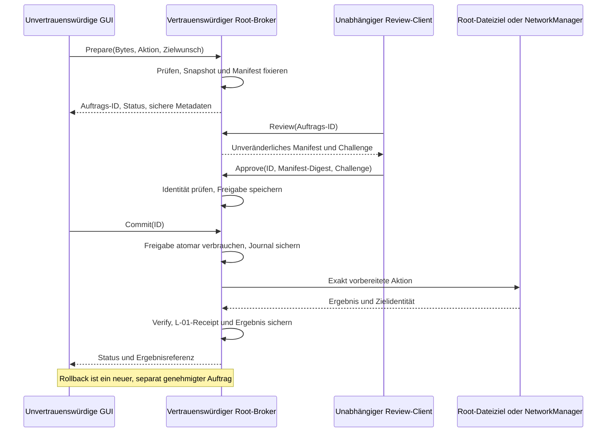

# L-04, Phase C1 – Unabhängige WireGuard-Import-Autorisierung

**Status: Konzept, nicht implementiert. L-04 bleibt TEILWEISE BEHOBEN.**

Repository: `Noogman4/dev-lab`, `main`,
`9944ce14650877848cb48a2ed531cd84424bcec3`.
Stand: 18. Oktober 2026. Diese Phase erstellt ausschließlich dieses Dokument.
Keine Tests, Installation, Berechtigungsänderung oder privilegierte Operation.

## 1. Ausgangslage und bestätigte Fakten

Kennzeichnung: **[R]** am Repository nachvollzogen; **[H]** vom Auftraggeber
mitgeteilter Hostnachweis; **[D]** vorgeschlagene Designentscheidung;
**[A]** notwendige Betriebsannahme; **[O]** noch zu prüfen/entscheiden.
Alle zukünftigen Schnittstellen, Dienste und Garantien sind [D], keine bereits
vorhandenen Produkteigenschaften. Dokumentierte alte Testergebnisse sind kein
neuer Testnachweis für diesen Entwurf.

- [R] `wireguard_import.ProfileSnapshot` liest begrenzt über verankerte FDs,
  prüft Symlinks/Dateityp/Identität und hält unveränderliche Bytes. Digest und
  Hooks beziehen sich auf diese Bytes. `vpn_controller` bestätigt Snapshots und
  übergibt sie per stdin an den festen geschützten Root-Helfer. Kein erneutes
  privilegiertes Öffnen des benutzereigenen Originalpfads.
- [R] `_owned_nm_command()` startet
  `sudo -n /usr/bin/python3 -I /usr/lib/netmon/netmon/core/nm_ownership.py OP`.
  Der Helfer prüft Root, Installationspfad und geschützte Dateirechte; nicht aber
  eine unabhängige menschliche Zustimmung zum konkreten Auftrag.
- [R] `checked_import_payload()` validiert `name/content/sha256/hooks`.
  Ein bereits autorisierter Aufrufer kann selbst konsistente Werte erzeugen.
  Der bestehende Test
  `test_authorized_helper_checks_bytes_but_cannot_attest_human_consent` beschreibt
  diese Grenze mit Fakes; er wurde hier nur gelesen.
- [R] `snapshot-profile` gibt den vollständigen Inhalt eines zulässigen Profils
  unter `/etc/wireguard` zurück, einschließlich vorhandener privater Schlüssel.
  Eine Importfreigabe darf nicht stillschweigend ein solches Leserecht bedeuten.
- [R] `install-profile` kann ein bereits bestehendes, rootkontrolliertes Ziel
  ersetzen. Root-Eigentum beweist dabei keine NetMon-Provenienz und keine
  Zustimmung zum Überschreiben.
- [R] L-01 bindet NM-Löschungen an Root-Receipts, UUID und Inkarnation. F-01
  trennt flüchtige Referenzen von Privacy-Einstellungen und ordnet Ergebnisse,
  Rollbacks und verspätete GUI-Callbacks einzelnen Jobs zu.
- [R/H] Der Helfer ist lokal nicht installiert; die Paketierung liefert keine
  NetMon-spezifische sudoers-Regel. Das Konzept behauptet keine vorhandene
  Brokerinstallation und keinen bereits wirksamen eingeschränkten Betriebsmodus.
- [H] Der Auftraggeber hat `sudo -l` ausgeführt und berichtet für `happy` auf
  `proglab`: `(ALL : ALL) ALL`. Das bestätigt eine allgemeine administrative
  Kommandoautorisierung. Es bestätigt weder NOPASSWD noch einen aktuell
  nutzbaren Zeitstempel. Dieser Befehl wurde in C1 nicht erneut ausgeführt.
- [O] Effektive Timestamp-, Polkit- und externe Policy-Einstellungen bleiben
  soweit in Phase B nicht lesbar ungeprüft. Die dort sichtbare NM-Regel für
  aktive lokale sudo-/netdev-Mitglieder ist ein möglicher unabhängiger
  Konfigurationspfad; ihre Gesamtwirkung ist nicht abschließend nachgewiesen.

Grundlagen: [L-04.md](L-04.md),
[L-04-authorization-review.md](L-04-authorization-review.md),
[L-01.md](L-01.md), [F-01.md](F-01.md).
Ältere Aussagen zu erlaubten Fallbacks gelten nicht anstelle des aktuellen
Produktionscodes: Dessen geschützter NM-Import bricht ohne Helfer ab.

## 2. Bedrohungsmodell und Sicherheitsziele

| Akteur | Schutzversprechen / Grenze |
| --- | --- |
| Legitimer Benutzer, unveränderte GUI | Erhält nachvollziehbare Vorschau, getrennte Zustimmung und ein eindeutig zugeordnetes Ergebnis. GUI allein kann keinen Commit autorisieren. |
| Manipulierte Datei derselben UID | Änderungen an Pfad, Inode, Inhalt oder benutzereigenem Staging können vorbereitete Bytes nicht ersetzen. Bestehendes L-04 bleibt erhalten. |
| Kompromittierte GUI ohne Root | Darf Anträge stellen und ihre Ergebnisse lesen. Darf weder Zustimmung herstellen noch ein fremdes/anderes Ziel einschleusen, Secrets aus Root-Profilen exportieren oder Altpfade nutzen. |
| Kompromittierte GUI mit potenziell nutzbarem sudo-Cache | Der Broker selbst vertraut keinem Cache. Falls der Cache zusammen mit `(ALL : ALL) ALL` tatsächlich beliebige Root-Kommandos ermöglicht, kann der Angreifer den Broker umgehen. Dann gilt ausdrücklich das Root-Angreifermodell. Eine bloße Möglichkeit eines Caches wird nicht als erwiesener Zugriff gewertet. |
| Andere Prozesse derselben UID | Können gegebenenfalls eigene Anträge erzeugen; UID/PID/Programmname allein sind keine menschliche Zustimmung. Fremde Anträge dürfen sie nicht übernehmen. Injektion in die GUI ist durch deren Modell bereits abgedeckt. |
| Angreifer mit uneingeschränkten Root-Rechten | Außerhalb des Schutzversprechens. Kann Broker, Regeln, Snapshot, Kernel oder Importziel ändern; NetMon kann ihn nicht mit einer internen Schranke einschränken. |

[A] Kernel, privilegierter Broker, Systembus, NM-Daemon, geschützte Installation
und unabhängiger Bestätigungskanal sind vertrauenswürdig. Der kompromittierte
Desktop darf weder dessen Administrationsidentität noch dessen Ein-/Ausgabe
kontrollieren. Andere legitime Root-Schreiber sind nicht Teil einer globalen
Transaktion und müssen als administrative Konkurrenz behandelt werden.

[D] Zwei Betriebsprofile müssen ausdrücklich unterscheidbar sein:

- **Administrativer Arbeitsplatz:** `happy` behält allgemeine sudo-Rechte.
  C schützt den vorgesehenen Importpfad und verhindert dessen bloßen GUI-Bypass.
  C kann keine systemweite Zustimmungsverpflichtung gegen einen bereits
  sudo-authentifizierten Angreifer garantieren. Dieser Modus ist keine Behebung
  des uneingeschränkten Same-UID-/Root-Schutzziels.
- **Eingeschränktes Zielprofil:** Die GUI läuft unter einer Identität ohne
  allgemeine Root-Freigabe und ohne direkte gleichwertige NM-/Datei-/Hookpfade.
  Die unabhängige Administrationsidentität ist getrennt. Nur hier kann das
  stärkere Versprechen gegen die kompromittierte GUI abgenommen werden.

Ein bereits in der GUI verfügbarer WireGuard-Private-Key kann durch diese
Architektur nicht nachträglich geheim werden. Geschützt wird insbesondere der
zusätzliche Zugriff auf bisher ausschließlich rootlesbare Profile.

## 3. Variantenvergleich A/B/C

| Variante | Gewinn | Erfüllt unabhängige Zustimmung? | Aufwand / Grenzen |
| --- | --- | --- | --- |
| A: Status quo, transparent dokumentiert | Erhält Snapshot-, Digest-, Hook- und Receiptprüfungen; keine neue Architektur. | Nein. Konsistente Payload und GUI-Dialog sind vom kompromittierten Prozess herstellbar. | Gering; für ein bewusst administratives Modell vertretbar, aber L-04 bleibt teilweise behoben. |
| B: Enger privilegierter Helfer | Explizite Operationen, keine allgemeine Shell, getrennte Import-/Lese-/Aktivierungsrechte; weniger Geheimnis- und Überschreibefähigkeiten. | Nein. Ein für `install-profile` autorisierter Prozess kann weiterhin seine eigenen konsistenten Bytes liefern. | Mittel; reine Argument-Allowlist bindet stdin nicht an menschliche Zustimmung. Allgemeines sudo und direkte NM-Rechte bleiben Umgehungswege. |
| C: Prepare/Approve/Commit-Broker | Root fixiert den Auftrag; unabhängiger Kanal bestätigt genau dessen Inhalt und Wirkung; Freigabe wird einmalig verbraucht. | Unter den Annahmen aus Abschnitt 2 und bei geschlossenem Bypass ja, als abzunehmendes Entwurfsziel. | Höher; benötigt Zustandsautomat, vertrauenswürdige Anzeige, Recovery und eine bewusste Berechtigungsmigration. Kein Schutz vor beliebigem Root. |

B ist sinnvolle Voraussetzung für C, kein Ersatz für C. B muss insbesondere den
öffentlichen Secret-Export von `snapshot-profile` vermeiden und bestehende
Ziele bei `install-profile` nicht allein wegen ihres Unix-Eigentümers ersetzen.
Ein Broker mit weiterhin direkt aufrufbarem alten Root-Import wäre wirkungslos.

## 4. Begründete Architekturentscheidung

[D] Empfohlen wird **C mit den Beschränkungen aus B**, zunächst ohne automatische
Aktivierung, ohne Überschreiben vorhandener Ziele und ohne wg-quick-Hooks im
Dateiinstallationsbackend. Das ist ein Zielentwurf, keine Installationsfreigabe.
Für das heutige allgemeine sudo-Modell bleibt der Schutzgewinn auf den
kontrollierten Importpfad begrenzt.

### Tatsächlich unabhängiger Bestätigungskanal

[D] Referenz für die erste Implementierung ist eine **separate administrative
Sitzung von einem vertrauenswürdigen zweiten Gerät**: administrativer SSH-Zugang
mit geprüftem Hostschlüssel, eigener Freigabeidentität und einem fest
installierten Review-Client. Dieser liest die Vorschau direkt vom Broker auf
dem Zielsystem, nicht aus einem GUI-Text oder einer von ihr generierten Datei.
Die Zugangsdaten bleiben außerhalb der Desktop-Sitzung; kein Agent-Forwarding,
keine Passwort-/Token-Eingabe in NetMon. Die Freigabeidentität braucht Zugriff
auf die Approval-Schnittstelle, nicht automatisch eine allgemeine Root-Shell.
Auswahl und Härtung dieses Zugangs sind [O] und werden hier nicht eingerichtet.

Eine separate lokale VT mit anderer Administrationsidentität und vertrauenswürdig
hergestelltem Konsolenzugang ist eine mögliche spätere Alternative. Sie ist
erst nach Nachweis der Ein-/Ausgabeisolation, des Loginpfads und des Schutzes
vor Prozessinjektion/TTY-Injektion gleichwertig. Eine gewöhnliche Terminal-App,
`sudo`-Passwortbox, root-eigene Binärdatei auf demselben Display oder ein zweiter
Dialog derselben UID ist kein solcher Nachweis. Für X11 oder Wayland wird
keine pauschale Unabhängigkeit behauptet; deren konkrete Sitzungsgrenzen sind [O].
Ein externes Signiergerät wäre nur mit eigener Anzeige der Transaktionsdaten
geeignet; ein bloßer Tastendruck ohne gebundenen Inhalt genügt nicht.

### Rolle von Polkit

Polkit kann berechtigte Rollen und Aktionen prüfen, ersetzt aber weder das
Transaktionsjournal noch eine vertrauenswürdige Vorschau. Eine positive
`CheckAuthorization`-Antwort ist kein eigenständiger Nachweis, dass ein Mensch
gerade Digest und Ziel geprüft hat. `AUTH_*_KEEP` kann für dieselbe Aktion und
dasselbe Subjekt auch bei geänderten Details wiederverwendet werden. Für diese
Aufträge deshalb keine solche Cachefreigabe und keine Interpretation von
`AllowUserInteraction` als erzwungene neue Zustimmung.
Siehe [Polkit-Regeldokumentation](https://polkit.pages.freedesktop.org/polkit/polkit.8.html).

[D] Der Broker führt einen eigenen Approval-Zustand. Nur der unabhängig
authentifizierte Freigeber darf die Freigabemethode aufrufen; die GUI darf
diese Rolle nicht erhalten. Ein optionaler Polkit-Check ist eine zusätzliche
Zugangsvoraussetzung, kein Ersatz für die Review-Bestätigung. Der ausgewählte
Kanal muss die tatsächliche Freigeberidentität binden; sie wird nicht aus einem
vom Antragsteller gelieferten `approver_uid` oder einem GUI-Boolean übernommen.

## 5. Vertrauensgrenzen und Autorisierungsablauf

### Prepare

Der Broker nimmt begrenzte Bytearrays entgegen, niemals einen beliebig als root
zu öffnenden Benutzerpfad. Ein übergebener FD ist im ersten Protokoll nicht
vorgesehen. Die vorhandene sichere Quelllesung in der GUI bleibt Vorprüfung;
der Broker validiert selbst unabhängig und berechnet Digest sowie Hookanalyse
erneut. GUI-Digest/Hookliste sind Vergleichswerte, keine Autorität.

Der Broker kopiert die vollständigen Bytes in eigenen Zustand, prüft reguläre
Datei, Rechte und Inhalt erneut und fixiert Aktion, normalisiertes Ziel,
Parser-/Transformationsversion und ausführbares Ergebnisartefakt. Einmal
veröffentlichte Prepare-Daten sind unveränderlich. Jede Änderung erzeugt einen
neuen Auftrag und erfordert neue Zustimmung.

Rootprofile werden nur innerhalb des Brokers über einen engen Selektor gelesen.
Es gibt kein öffentliches `GetRawProfile` und keinen zurückgereichten Snapshot
mit Secrets. Der unabhängige Freigeber bestätigt den internen Transfer aus dem
geschützten Profil. Unberechtigte Selektoren liefern keine Profilinhalte und
keine ausführlichen Existenzdiagnosen. Eine etwaige zusätzliche Leseberechtigung
ist von der Importberechtigung getrennt zu entscheiden, nicht implizit enthalten.

Die Vorschau benennt Antragsteller/Sitzung, Auftrags-ID, Backend, Aktion, exakten
Zielpfad bzw. neue NM-UUID, Profilname, Bytezahl, SHA-256, Ablauf, Zielzustand,
Adress-/Routing-/DNS-Wirkung und Hookbefund. Sie zeigt verbindlich
„keine Aktivierung“ und „Neuanlage, kein Ersetzen“. Steuerzeichen, ANSI/Bidi und
Verwechslungen werden eindeutig escaped oder abgelehnt; Secretfelder werden
nicht angezeigt. Eine bloße gekürzte Zusammenfassung reicht nicht als Freigabe.
Unklarheiten/zu große Vorschauen führen zur Verweigerung.

### Approve

Der Review-Client ruft das gespeicherte Manifest selbst ab. Die Anzeige entsteht
aus dessen strukturierten Daten, nicht aus GUI-Markup. Der Freigeber wählt genau
diesen Auftrag; keine automatische Popup-Freigabe allein durch Prepare.
Seine positive Eingabe bindet Manifest-Digest und kurzlebige Challenge an seine
vertrauenswürdig festgestellte Identität. Der Broker speichert die Freigabe
intern; die GUI erhält kein übertragbares Approval-Token. Auftrags-IDs sind
Bezeichner, keine Bearer-Berechtigung. Ablehnung oder Kanalfehler verweigert.

### Commit

Nur die noch lebende Antragstellerverbindung darf Commit anfordern. Der Broker
prüft Identität, Sitzung, Status, Ablauf, Policy-/Dienstgeneration,
Manifest-Digest und Zielvorbedingungen erneut. Unter Transaktions-/Zielsperre
wird die Frist nach etwaiger Wartezeit nochmals geprüft und
`APPROVED -> COMMITTING` einschließlich Verbrauch der Freigabe dauerhaft
festgeschrieben, bevor die externe Wirkung beginnt. Bei Speicher-/fsync-Fehler
kein Start. Keine Bytes, Aktion oder Zieländerung im Commit-Aufruf möglich.

Unmittelbar vor der Ausführung prüft der Broker sein eigenes Artefakt gegen den
gespeicherten Digest. Das Backend bekommt ausschließlich dieses Artefakt bzw.
seine vorab gebundenen typisierten Einstellungen. Es öffnet keinen GUI-Pfad neu.
Ein erneuter Commit während/nach Ausführung liefert Status, keine zweite Wirkung.

### Verify und Rollback

Nach Ausführung werden exakte Zielidentität, Inhalt und Backend geprüft,
L-01-Nachweise erstellt und Ergebnis samt Jobzuordnung vor einer GUI-Antwort
gesichert. Keine Erfolgsmeldung vor erfolgreichem Verify. Unklare Ergebnisse
heißen `RECOVERY_REQUIRED`, nicht „fehlgeschlagen, bitte erneut importieren“.

Rollback ist ein eigener Prepare/Approve/Commit-Auftrag für den exakt belegten
Kandidaten: UUID/Receipt/Inkarnation oder neu angelegte Datei samt Root-Nachweis.
Er enthält keine namensbasierte Löschung und keine automatische Löschfreigabe
als Nebenwirkung einer Importzustimmung. Bei fremden/geänderten Zielen wird
verweigert. Gescheiterte GUI-Callbacks dürfen Ergebnisse niemals aufheben.

## 6. Datenmodell und Schnittstellen – konzeptionell

### Geschützter Auftrag

| Feld | Bedeutung |
| --- | --- |
| `schema`, `policy_epoch`, `broker_generation`, `boot_id` | Versions- und Neustartgrenzen; alte Zustimmungen werden nicht still übernommen. |
| `operation_id` | 256 zufällige Bits aus OS-CSPRNG, kollisionsfrei geprüft. Keine Auswahl durch den Client. |
| `requester` | Vom IPC ermittelte UID, einzigartige Busverbindung, Prozessbindung und vertrauenswürdig ermittelte Sitzung; GUI-Angaben nur unverbindliche Labels. |
| `source_digest`, `source_length`, `artifact_digest` | Hash/Länge exakter Eingangsbytes und gegebenenfalls separat abgeleitetes Ausführungsartefakt. Keine verlustbehaftete Normalisierung unter demselben Digest. |
| `action`, `backend`, `target`, `precondition` | Geschlossene Operationsmenge, fester Zielbereich, neue UUID oder geprüfter Dateiname; Neuanlage verlangt Abwesenheit, Rollback exakt die belegte vorhandene Inkarnation. |
| `parser_version`, `transform`, `summary`, `manifest_digest` | Deterministische Interpretations-/Anzeigegrundlage; serverseitig normalisiertes, versioniert und eindeutig serialisiertes Manifest bindet auch Quelle, Wirkung und Ziel. |
| `created`, `expires`, `approved_until` | Broker-Uhren; keine Clientzeit. Freigabe gilt nur innerhalb derselben Dienst-/Bootgeneration. |
| `approval` | Manifest-Digest, Freigeberidentität, Challenge, Entscheidung, Zeitpunkt; nur vom Broker schreibbar. |
| `state`, `revision`, `consumed`, `result`, `recovery` | Atomare Übergänge, gespeichertes Ergebnis, Ownership-Belege und Diagnose ohne Konfigurationsinhalt. |

Das Manifest wird aus typisierten Feldern mit definierter Feldreihenfolge,
UTF-8-/Integerkodierung und ohne doppelte Schlüssel gebildet. Eine frei
zusammengefügte Zeichenkette oder beliebiges Client-JSON ist keine kanonische
Signaturgrundlage. Die Vorschau ist aus denselben Feldern abzuleiten; ihre
Version ist Teil des gebundenen Manifests. Auch Routingdaten sind vertraulich
und werden nur Antragsteller/Freigeber zugänglich gemacht.

Der Manifest-Digest bindet explizit Schema, Policy-/Dienst-/Bootgeneration,
Auftrags-ID, Antragstellerbindung, Quelle/Artefakt-Digests und -Längen, Aktion,
Backend, Zielvorbedingung, Parser/Transformation, Vorschauversion und Prepare-
Ablaufzeit. Veränderlicher Zustand, Ergebnis, Approval und der Digest selbst
gehören nicht zu seinem eigenen Hashinput. Die Approval-Challenge wird separat
an genau diesen Digest und Auftrag gebunden. Vorgeschlagene geschlossene
Aktionen sind `nm.create`, `wgfile.create`, `nm.delete-owned` und
`wgfile.delete-owned`. Die beiden Löschaktionen benötigen eigene Rollback-
Approvals und die jeweiligen Root-Nachweise. Kein `replace`, beliebiger Pfad,
Shellbefehl oder Aktivierungsauftrag wird dadurch mit freigegeben.

### IPC und Rollen

[D] Ein versionierter System-D-Bus-Dienst erhält getrennte Methoden:

| Rolle | Methoden / Grenzen |
| --- | --- |
| Antragsteller | `Prepare`, `GetOwnStatus`, `Commit`, `Cancel`. Kein Approve und kein Lesen fremder Aufträge. |
| Unabhängiger Freigeber | `GetReview`, `Approve`, `Reject`; getrennte administrativ festgelegte Identität, keine Ableitung aus bloßer GUI-UID. |
| Interner Backendadapter | Import/Installation/Verify/Receiptoperationen ohne öffentliches rohes Import-/Installations-RPC. |

Der Broker verwendet den tatsächlichen einzigartigen Nachrichtensender und
Systembus-Credentials. Prozesskennung nur mit gegen Wiederverwendung
abgesicherter Bindung (wo verfügbar pidfd); niemals eine vom Client übermittelte
PID. Fehlende verbindliche Identität führt zur Verweigerung, nicht zu UID-only.
Eine neue Busverbindung derselben UID erbt keinen Auftrag. UID identifiziert
keine vertrauenswürdige Anwendung; Prozessname und Executable-Pfad reichen
nicht gegen Injektion. Dies sind Designanforderungen, keine auf dem Host
nachgewiesenen API-Eigenschaften. Grundlagen:
[D-Bus-Credentials](https://dbus.freedesktop.org/doc/dbus-specification.html#bus-messages-get-connection-credentials),
[Polkit-Subjects](https://polkit.pages.freedesktop.org/polkit/eggdbus-interface-org.freedesktop.PolicyKit1.Authority.html).

### Speicherung und Ressourcen

[D] Dienst, Bibliotheken, Policy und Review-Client sind root-eigen und nicht
unprivilegiert schreibbar, außerhalb des Checkouts installiert. Eigener Root-
Zustandsordner, z. B. `/var/lib/netmon/wg-import-broker`, 0700; Dateien 0600,
stabile Locks, keine Symlinks/Hardlinks, begrenztes FD-Lesen, atomare vollständige
Schreibvorgänge und Verzeichnis-fsync. Ein transaktionales Journal muss Manifest,
Approval und Status gemeinsam konsistent halten. Snapshots gehören nicht in
Benutzereinstellungen oder allgemeine Logs. Secrets nicht auf D-Bus-Signale,
Kommandozeilen, Debug-Dumps, sudo-I/O-Logs oder unnötige Backups legen.
Transport-, Verbindungs- und Nachrichtengrößenlimits müssen bereits vor großen
Framework-Allokationen greifen; eine Prüfung erst in der Methodenlogik genügt
nicht als vollständiger Speicherbudgetnachweis. Die konkrete D-Bus-/Runtime-
Konfiguration und ihr isolierter Lastnachweis sind ein Deployment-Gate.

[D/O] Vorläufige, noch mit legitimen Paketen zu prüfende Budgets:

- Vorhandene Eingangsgrenzen erhalten: 1 MiB je Profil, 64 Profile bzw. 8 MiB
  je eingereichter Auswahl. Ein Auftrag bindet jeweils ein Profil, eine Aktion
  und ein Ziel; Batch-UI erzeugt einzeln sichtbare Aufträge.
- 8 offene Aufträge je UID, 64 global, zusammen höchstens 64 MiB offene
  Artefakte. Auch abgeleitete Artefakte, Eingänge während Prepare und Recovery-
  Restbestände zählen. Begründung: feste RAM-/Plattenobergrenze vor Zustimmung;
  größere Auswahlen müssen stückweise bestätigt werden, nicht Limits umgehen.
- Prepare höchstens 5 Minuten, Approval höchstens 60 Sekunden und nie länger
  als Prepare. Monotone Uhr plus Boot-/Dienstgeneration verhindert Verlängerung
  durch Uhrsprünge; neue Generation verwirft ausstehende Zustimmungen.
- Ein begrenzter Backendvorgang je Ziel; begrenzte Warteschlange und Rate pro
  UID, keine Dialogflut. Externe Operation mit festem Timeout, bei unklarem
  Timeout keine Wiederholung. Bestehende NM-Zeitgrenzen sind Ausgangspunkt,
  keine pauschale Zusage, dass nach Timeout kein Ergebnis mehr entsteht.
- Geheime Snapshots nach terminalem Zustand/kurzer Recoveryfrist löschen;
  begrenzte Metadatenaufbewahrung. Platz für Journal/Resultat vor Commit
  reservieren; bei voller Recoveryablage neue Aufträge sperren. Dauerhafte
  L-01-Receipts nicht zur Quotenbereinigung fremder/aktiver Verbindungen löschen.

Konkrete Retention, Journaltechnik und globale Rate sind vor Implementierung
festzulegen. Löschung bedeutet keinen sicheren Datenträger-Wipe; Swap, Dumps
und Systembackups benötigen eine gesonderte Betriebsbewertung.

## 7. Sicherheitsinvarianten und Backendregeln

1. Keine Wirkung ohne gültige, genau passende, noch nicht verbrauchte Approval-
   Entscheidung aus dem unabhängigen Kanal. Kenntnis einer ID genügt nie.
2. Bytes, Interpretation, Aktion, Ziel und Antragsteller sind nach Prepare
   unveränderlich; Policyänderung und Neustart erzwingen neue Zustimmung.
3. Nur Root-Snapshots überqueren die letzte Dateipfadgrenze zum Backend.
   Originalquelle und GUI-Staging sind nach Prepare keine Importquelle mehr.
4. Keine stille Erweiterung von Neuanlage zu Ersetzen, Import zu Aktivierung,
   Referenzimport zu Secret-Export oder Parentimport zu IPv4-Neuschreibung.
5. Für Löschen immer zusätzlich L-01-Receipt und aktuelle Inkarnation prüfen;
   Brokerjournal, Anzeigename oder UUID allein sind kein Ersatz.
6. Atomarer Freigabeverbrauch garantiert höchstens einen Ausführungsversuch.
   Er garantiert keine atomare Transaktion über Journal und NM-Daemon.
7. Fehlende Identität, Backendfähigkeit, Freigabekomponente oder widersprüchlicher
   Zustand bedeutet Verweigerung. Kein direkter sudo-/Legacy-Fallback.
8. Keine Rückgabe rootgelesener PrivateKeys an die GUI. Bestehende GUI-eigene
   Secrets und für den Import erforderliche Root-Verarbeitung bleiben getrennt.

### NetworkManager

[D] Nur Neuanlage einer vorher nicht vorhandenen UUID; vorhandene Namen sind
kein Besitznachweis. Der Broker fixiert vor Approve die neue UUID und die
typisierten Zielsettings. Die ursprünglichen Bytes und deren Digest bleiben
erhalten; notwendige Ableitungen/ignorierte Direktiven werden im Manifest benannt.
Für Commit ist ein vertrauenswürdiger Parser/Adapter nötig, der ein Profil
bereits mit `connection.autoconnect=false` und geeigneter Autoconnect-Sperre
anlegt. Kein erst importieren, dann ausschalten: Das ließe ein Aktivierungsfenster.
Vorgesehene NM-Schnittstelle ist `AddConnection2` mit dauerhaftem Speichern
und `block-autoconnect`, sofern die unterstützte Version dies nachweislich kann.
Bei fehlender Fähigkeit verweigern. Der heutige nmcli-Adapter genügt dafür
nicht unverändert; die spätere Adapteränderung muss L-01-Keyfile-/Receiptprüfungen
vollständig erhalten. Siehe [NM-Settings-API](https://www.networkmanager.dev/docs/api/latest/gdbus-org.freedesktop.NetworkManager.Settings.html)
und [Autoconnect](https://www.networkmanager.dev/docs/api/latest/settings-connection.html).

Auch NM selbst darf den ursprünglich nur rootlesbaren Schlüssel anschließend
nicht über eine andere Schnittstelle an die GUI-UID ausgeben. Ein unterbundenes
Broker-`snapshot-profile` allein genügt dafür nicht. Geschützte Referenzimporte
bleiben gesperrt, bis Zugriffsrechte auf neue NM-Profile, Secret-Methoden und
Secret-Agent-Verhalten unter der konkreten NM-/Polkit-Version nachgewiesen
sind. Keine erfundene Polkit-Regel wird als bereits verfügbare Trennung von
Aktivierungs- und Secret-Leserecht vorausgesetzt.

Hookdirektiven einer importierten Quelldatei werden nicht als Shellskript in
NM-Settings überführt. Die Vorschau kennzeichnet sie als nicht übernommen.
Parsingabweichungen oder unbekannte sicherheitswirksame Optionen verweigern
anstatt heimlich die Ausführung zu ändern. Parser-/Versionskompatibilität ist [O].
Aktivierung/Autoconnect-Freischaltung ist eine eigene zukünftige autorisierte
Aktion an der verifizierten Zielinkarnation, nicht Bestandteil des Imports.

### Dateiprofil und spätere wg-quick-Aktivierung

[D] MVP: ausschließlich neue Datei im festen `/etc/wireguard`-Zielbereich,
rootseitiges 0700-Staging und 0600-Datei. Atomare Veröffentlichung ohne Ersetzen
eines vorhandenen Namens ist erforderlich, z. B. Linux `RENAME_NOREPLACE`;
ein vorheriges `exists()` plus `os.replace()` genügt nicht. Zielverzeichnis-FD,
Rechte und veröffentlichte Datei werden verifiziert; eigener Root-Nachweis
bindet neu angelegte Datei und Inkarnation. Bestehende Dateien, auch root-eigene,
werden nicht automatisch als NetMon-eigen eingestuft.

Profile mit PreUp/PostUp/PreDown/PostDown werden für dieses Backend im MVP
abgelehnt. Das ist eine bewusste Kompatibilitätsgrenze, keine bloße Warnung.
Eine spätere Hook-Unterstützung braucht separate Genehmigung samt vollständiger,
sicher gerenderter Prüfung der tatsächlichen Skriptwirkung; eine Liste bloßer
Direktivnamen reicht dafür nicht. Auch andere ausführungsrelevante Optionen und
Semantik wie `SaveConfig` sind backendgerecht zu validieren. Eine Hookfreigabe
kann Root-Codeausführung erlauben und ist nicht nur ein Netzwerkrecht.
Siehe [wg-quick](https://git.zx2c4.com/wireguard-tools/about/src/man/wg-quick.8).

Eine spätere `wg-quick up/down`-Aktion müsste den aktuellen geschützten Inhalt,
Zielnamen, Hooks und die Inkarnation neu binden. Sie ist im MVP nicht angeboten.
Auch generierte IPv4-Profile müssen als eigenes Ergebnis oder ausdrücklich
gebundener Transformationsauftrag bestätigt werden; keine pauschale Ableitung
aus der Zustimmung zum Original. Bestehende automatische Start-/Ableitungswege
sind damit noch nicht kompatibel und dürfen nicht unbemerkt auf Altcode ausweichen.

## 8. Fehler-, Race- und Rollback-Verhalten

Zustandsautomat: `PREPARED -> APPROVED -> COMMITTING -> VERIFIED`;
zusätzlich `REJECTED`, `CANCELED`, `EXPIRED`, `FAILED_NO_EFFECT` und
`RECOVERY_REQUIRED`. Letzterer Zustand ist kein Erfolg und keine Löschfreigabe.
Ein Client darf keine Zustandsübergänge direkt setzen.

| Ereignis | Verbindliches Verhalten |
| --- | --- |
| Quelle ändert sich nach Prepare | Import verwendet ausschließlich fixierte Bytes. GUI kann den Antrag abbrechen, aber nicht dessen Inhalt ersetzen. Abweichende erneute Einreichung ist neuer Auftrag. |
| Zwei Commits / vertauschte Antworten | Atomare Zustandsrevision und Verbrauch; nur ein Versuch. Alle Antworten enthalten Auftrags-ID/Revision. Keine Zuordnung über „letzter Import“. |
| Ziel entsteht oder ändert sich zwischen Approve und Commit | Verweigerung bzw. atomarer No-Replace-Fehler. Neue Zielvorbedingung verlangt neuen Auftrag. |
| Antragsteller trennt Verbindung vor Verbrauch | Ausstehende Zustimmung verfällt. Anderer Prozess oder Neustart derselben GUI erbt sie nicht. |
| Trennung/Cancel nach Verbrauch | Wirksamen Versuch nicht rückwirkend als nie gestartet behandeln. Status weiter sichern; kein automatisches destruktives Aufräumen. |
| Broker-/Rechnerneustart | Noch nicht verbrauchte Approvals ungültig. COMMITTING wird Recovery, nicht automatisch erneut ausgeführt. |
| Fehler bei Journal oder fsync vor Wirkung | Abbruch ohne Backendaufruf. Approval darf nicht anhand einer ungeprüften Erinnerung wiederverwendet werden. |
| Import erfolgreich, Receipt oder Ergebnisspeicherung scheitert | Recoveryzustand. Externe Wirkung kann schon bestehen; weder Erfolg vortäuschen noch blind neu importieren/löschen. |
| Antwort/`app.after()` scheitert | Rootseitiger Ergebnisnachweis bleibt auffindbar; F-01 reservierter Jobslot hält erfolgreich empfangene Referenz zuerst fest. GUI-Scheduler ist kein Commit-Gate. |
| Batch teilweise erfolgreich | Jedes Profil behält eigenen Zustand. Keine automatische Rücknahme der schon importierten Profile. Separate Vorschau und Zustimmung für die belegten Rollback-Kandidaten. |
| Rollback trifft geänderte UUID/Datei oder fremde Namensgleichheit | Verweigern, Referenz zur Diagnose behalten. Nie namensbasiert löschen. |

Ein dauerhaftes Vorhabenjournal kann den erfolgreichen NM-Aufruf nicht atomar
mit dessen Rückmeldung festschreiben. Eine vorab reservierte UUID hilft bei der
Korrelation, beweist aber allein keine Erstellungsprovenienz. Nach Crash nur mit
vollständig überprüfbarem L-01-Nachweis als eigener Erfolg rekonstruieren;
sonst manuelle unabhängige Recovery, keine rückwirkende Übernahme beliebiger
passender Keyfiles. Gleiches gilt für einen Dateicrash zwischen Veröffentlichung
und Receipt. Externe Root-Schreiber im letzten NM-Spalt bleiben Restgrenze.

Der Brokerzustand ist getrennt von `privacy_config` und anderen persistenten
Benutzereinstellungen. Root-Receipts und minimales Recoveryjournal sind dauerhaft;
F-01-Referenzen bleiben flüchtig. Nach App-Neustart darf die GUI einen sicheren
Status abrufen, erhält aber keine automatisch wiederhergestellten Löschrechte.
Neue Recovery-/Rollbackaktion erfordert eigene unabhängige Zustimmung und
aktuelle Eigentumsprüfung. Ein alter Callback verändert weder neue Aufträge
noch deren Approval- oder Rollbackrechte.

## 9. Deployment- und Migrationsanforderungen

[D] Eine spätere Paketänderung installiert Broker, Review-Client und Bibliotheken
aus rootkontrolliertem Paket, nicht aus dem Checkout. Ein begrenzter Dienst mit
festen Pfaden/Backends und ohne allgemeine Shell gehört zur vertrauenswürdigen
Basis. Ein Backend läuft nur soweit nötig privilegiert; Codeoberfläche,
Diensthärtung, Abhängigkeiten und Angriffsfläche müssen vorab separat geprüft
werden. Kein clientbestimmter Befehl, Interpreterpfad, Plugin oder Environment.
Wo ein festes Tool nötig bleibt, nur absolute Executables und typisierte argv.

Für das eingeschränkte Zielprofil sind später ausdrücklich erforderlich:

- GUI-Identität von allgemeinem sudo und administrativer Freigeberidentität
  trennen. Die vorhandene `(ALL : ALL) ALL`-Freigabe kann ein Installer nicht
  stillschweigend einschränken. Ohne Betreiberentscheidung bleibt Root-Bypass
  außerhalb jeder Brokerzusage bestehen.
- Alte öffentliche Helferoperationen `import`, `import-checked`,
  `install-profile`, `snapshot-profile` und nicht unabhängig bestätigtes
  `cleanup/delete` als umgehbare Autorisierungseinstiege schließen. Interne
  L-01-Prüfbausteine bleiben erhalten. Kein argumentweiter Python-/Shell-Sudo.
- Antragsteller und Freigeber auf dem Systembus getrennt autorisieren.
  Optionale neue Polkit-Aktionen dürfen keine generischen YES-/KEEP-Regeln für
  die GUI-Gruppe erben. Konkrete IDs/Regeln erst nach Policy- und APIprüfung.
- Direkte NM-Systemänderungen, Secret-Abfragen, Autoconnectänderungen und
  Aktivierung über andere freigegebene Wege bewerten. Die in Phase B sichtbare
  NM-Gruppenregel kann den Broker umgehen. Keine unbewiesene Einschränkung
  auf bestimmte Profile anhand erfundener Polkit-Details versprechen.
- Schreibfähige Root-Tools und verwandte NetMon-Aktionen auf gleichwertige
  Umgehungen prüfen. Einzelne Helferrechte zu entziehen genügt nicht, wenn
  derselbe Prozess weiterhin beliebige Root-Kommandos ausführen kann.

Dies sind Anforderungen an eine separat freizugebende Deploymentphase, keine
in C1 ausgeführten Änderungen. Bestehende DNS-/Firewall-/sonstige Rootabläufe
werden hier nicht umgebaut; ihre Verträglichkeit ist ein offenes Abnahme-Gate.

Migration beginnt mit Policyinventar, separatem Administrationskanal und
isolierter Validierung. Erst dann werden GUI und Brokerprotokoll gemeinsam
versioniert umgestellt. Keine automatische Registrierung alter NM-Verbindungen;
L-01-Bestände bleiben unverändert. Neue Dateiprovenienz wird nur für nachweislich
neue Dateien erzeugt. Bestehende Dateien müssen zunächst unverändert bleiben.
Ersetzen/Legacy-Migration braucht ein eigenes späteres Konzept.

Fehlt Broker, Approver oder notwendige Backendfähigkeit, bleiben privilegierte
Importe gesperrt; harmlose Anzeige und Benutzerkopien können weiter funktionieren.
Kein Fallback auf den alten Helfer. Dark-/Quellinstallationen benötigen denselben
verifizierten Brokervertrag oder verweigern diese Aktionen. Ein Upgrade darf
keine offenen Aufträge oder Approvals auf eine andere Parser-/Policyversion heben.

Bei fehlerhaftem Upgrade bleiben importierte Profile und L-01-Receipts erhalten.
Ein Paketrollback reaktiviert **nicht** automatisch die alten Freigaben.
Im Zweifel Import gesperrt und administrativ reparieren. Wiederaufnahme des
alten Risikomodells wäre eine ausdrückliche Betreiberentscheidung, keine
stille Kompatibilitätsfunktion. Neues Journal darf eine alte Binärdatei nicht
als gültige Autorisierung interpretieren; Downgrade-Vertrag separat spezifizieren.

## 10. Adversariale Testmatrix – nur geplant

**Keine dieser Prüfungen wurde in C1 ausgeführt.**
U = unprivilegierte Unit-/Integrationstests mit temporären Dateien und Fake-NM,
Fake-IPC, Fake-Freigeber, injizierter Uhr/Zufall/Fehlern.
V = ausschließlich wegwerfbare VM mit synthetischen Schlüsseln/Profilen,
isoliertem Bus und erforderlichen Testidentitäten; keine Host-NM-/sudo-Proben.
K = zwei isolierte VMs für Desktop und unabhängigen Freigeberkanal.
Alle Prozessstarts brauchen einen Guard, der den vorhandenen Reboot-Schutz
erhält. Hooktests protokollieren lediglich einen Fake-Aufruf, niemals Root-Hooks.

| Fall | Erwartetes Ergebnis | Umgebung |
| --- | --- | --- |
| Profil nach Prepare ersetzt / gleicher Inode überschrieben | Nur ursprüngliche Brokerbytes ausführbar; erneute Bytes erfordern neuen Auftrag. | U, synthetische Profile |
| Symlink, FIFO, Hardlink oder wechselnde Quellkomponente | Bestehende L-04-Lesung verweigert; Broker bekommt keinen unkontrollierten Root-Pfad. | U |
| Digest oder Hookliste gefälscht | Serverberechnung maßgeblich; Widerspruch verweigert, kein Backendaufruf. | U |
| Nach Prepare Aktion, Backend, Ziel oder Transformationsparameter vertauscht | Commit nimmt nur ID an; kein passendes Approval, keine Wirkung. | U |
| Selbst konsistent konstruierter Auftrag aus kompromittierter GUI | Prepare möglich, Commit ohne unabhängiges Approve gesperrt. | U, K für Kanal |
| GUI sendet `approved=true` oder fremde Freigeber-UID | Schema-/Rollenfehler, keine Zustandsänderung. | U, V |
| Abgelaufene / fremde / erratene ID | Einheitliche Verweigerung ohne fremde Metadaten; keine Wirkung. | U, injizierte Uhr |
| Bereits verbrauchte Zustimmung wiederverwenden | Vorhandenes Ergebnis/Status, höchstens ein Ausführungsversuch. | U |
| Zwei parallele Commits desselben Auftrags | Genau ein atomarer Verbrauch und ein Backendversuch. | U, kontrollierte Threads |
| Parallele Profile, vertauschte Approval-/Commit-Antworten | Bindung über ID und Manifest; keine Berechtigung für das jeweils andere Profil. | U |
| Zwei Aufträge für dasselbe Ziel | Serialisierung und No-Replace; höchstens eine Neuanlage, keine Überschreibung. | U, V für FS-Primitive |
| Nicht berechtigter Same-UID-Prozess übernimmt GUI-Auftrag | Andere Busverbindung kann ihn nicht committen/approven. Eigener Antrag ohne Approver bleibt folgenlos. | V, zwei Prozesse |
| Gefälschte PID/Sitzung, PID-Reuse, Busneuverbindung | Identität aus Bus/Kernel; keine Übernahme alter Freigaben. | V |
| Polkit liefert gecachtes YES trotz anderer Details | Broker erzeugt daraus allein keine Approval. Neues Manifest benötigt unabhängige Review-Entscheidung. | U mit Fake-Authority, V |
| Gewöhnlicher Desktop-Agent oder GUI-Terminal als angeblicher unabhängiger Kanal | Kein Abnahmenachweis; nicht als unterstützter starker Kanal akzeptieren. | K, Kanalreview |
| Legitimer unabhängiger Review, Ablehnung, Verbindungsausfall | Nur bestätigtes Manifest freigeben; Ablehnung/fehlender Kanal verweigert. | U, K |
| Abbruch zwischen Approve und Commit / Timeout / Uhrsprung | Approval ungültig bzw. an monotone Frist gebunden; keine Wirkung. | U |
| Broker-/Bootneustart mit unbenutztem Approval | Neue Generation, alte Freigabe unbrauchbar. | U, V |
| Crash nach Freigabeverbrauch vor Backendstart | Recovery, keine automatische erneute Ausführung und kein Freigabereplay. | U, Fault Injection |
| Crash nach NM-Erstellung vor Antwort/Receipt | Kein doppelter Import; nur bei vollständig belegbarem Ergebnis verifiziert, sonst manuelle Recovery. | U, V mit Killpunkten |
| Teil-/Schreib-/fsync-/No-Replace-Fehler | Vor Wirkung Abbruch; nach möglicher Wirkung explizite Recovery, alte Ziele unverändert. | U, V |
| Erfolgreicher Import, `app.after()` oder Sitzungsupdate scheitert | Brokerergebnis auffindbar; F-01 hält empfangene Referenz, keine falsche Erfolgsmeldung. | U mit realer App-Speichermethode |
| Zweiter Import, verspäteter Callback / Rollback des ersten | Neuere Referenzen und Aufträge bleiben erhalten; exakte L-01-Zuordnung. | U, gesteuerte Jobfolge |
| App-Neustart, gefälschte Privacy-JSON und verlorene Referenz | Keine Wiederherstellung flüchtiger Löschrechte; Recovery verlangt neue Zustimmung plus Receipt. | U |
| Fremde Verbindung mit gleichem Namen / wiederverwendeter UUID / fehlendem Receipt | Keine Registrierung oder Löschung anhand des Namens/UUID allein. | U |
| Bestehendes Root-Dateiprofil kollidiert / Ziel wird spät angelegt | Create-only verweigert atomar; fremde Datei bleibt unverändert. | U, V |
| GUI versucht private Schlüssel über Profil-Leseoperation, Status oder Fehler abzurufen | Keine Raw-API und keine Secrets in Antwort/Log/Signal; rootinterner Transfer bleibt intern. | U mit markierten synthetischen Secrets |
| Hookprofil wird als Datei installiert / Import soll direkt aktivieren | MVP-Dateibackend lehnt Hooks ab; Importfreigabe erlaubt keine Aktivierung. | U, Fake-Backend |
| NM-Neuanlage bei aktivierbarem Gerät | Autoconnect ist vor Sichtbarkeit aus; kein implizites Aktivieren. Fehlende APIfähigkeit verweigert. | V ohne externe Netze |
| Parserdifferenz, doppelte Keys, unbekannte Direktive, Unicode-/Vorschautäuschung | Keine mehrdeutige Freigabe; exakte Vorschau oder Ablehnung. | U |
| Limit-/Dialog-/Recovery-Spam | Feste UID-/Globalbudgets, keine unbegrenzte Queue, keine fremden Secrets. | U |
| Alte sudo-/Helfer-/Polkit-/NM-Pfade im eingeschränkten Profil | Kein unabhängiger Import-/Schreib-/Secret-/Aktivierungs-Bypass. | V, eigene Testpolicy |
| Allgemeines sudo plus nutzbarer Cache bleibt aktiv | Kontrollversuch belegt erwartete Root-Umgehungsgrenze; nicht als Schutzleistung von C zählen. | V, nur wegwerfbares Testsystem |
| Paketupgrade/-downgrade mit offenen Aufträgen | Keine Approval-Migration oder automatische Freischaltung alter Pfade; Resultate/Receipts erhalten. | V |

Die vorhandenen L-01-/F-01-/L-04-Regressionen sind später unverändert als Basis
mitzuführen und um diese neuen Assertions zu erweitern. Die früheren
3.831/22 Gesamttestresultate bleiben historische Befunde der Testisolierung;
sie sind kein Sicherheitsnachweis für den noch nicht existierenden Broker.

## 11. Restrisiken und offene Architekturfragen

- [O] Entscheidung für administrativen Arbeitsplatz oder eingeschränktes
  Zielprofil; Umgang mit der bestätigten allgemeinen sudo-Freigabe. Ein
  nutzbarer ALL-Cache bedeutet Root-Bypass, nicht einen durch C gelösten Fall.
- [O] Vertrauenswürdiger Freigabekanal, getrennte Identität, Schlüssel-/Sitzungs-
  verwaltung und verständlicher Benutzerablauf. Ohne nachgewiesene Isolation
  keine Freigabe des starken Schutzziels; Polkit allein schließt diese Lücke nicht.
- [O] NM-/D-Bus-/Polkit-Mindestversionen, Parser/typisierte Ableitung,
  Autoconnect-Sperre, genaue Policydetails und unterstützte Distributionen.
- [O] Journaltechnik, Crashkonsistenz, sichere Root-Installation, Retention,
  Quoten und konkrete Recovery-Administration. Kein Exactly-once-Versprechen
  über NM und Dateisystem ohne belegbares Backendprotokoll.
- [O] Hook-/SaveConfig-Kompatibilität, Ersetzen vorhandener Dateiprofile und
  IPv4-Ableitungen. Die vorgeschlagenen MVP-Sperren sind bewusst sichtbar zu
  machen; Erweiterungen benötigen eigene Freigabe und Testnachweise.
- [O] Reichweite legitimer Aktivierungs-/DNS-/Firewallrechte und deren
  Umgehungsmöglichkeiten. Erforderliche Anpassungen sind gesonderte Arbeit,
  keine Erlaubnis für einen breiten Refactor in dieser Phase.
- [A] Keine kompromittierte Rootbasis oder kompromittierter Freigeber.
  Administratoren können das Modell bewusst umgehen. Ein Broker kann auch
  Social Engineering, absichtlich falsche menschliche Zustimmung oder bereits
  aus der GUI gestohlene PrivateKeys nicht rückgängig machen.
- [A/O] Secrets können in notwendigem Prozessspeicher, persistenten NM-Keyfiles,
  Swap/Backups/Dumps liegen. Keine Zusage vollständiger Speicherlöschung;
  Berechtigungen, Protokollierung und Betriebsmaßnahmen gesondert abnehmen.

## 12. Implementierungsphasen mit überprüfbaren Abnahmekriterien

Alle folgenden Phasen benötigen separate ausdrückliche Freigabe. C1 implementiert
keinen ihrer Bausteine und führt keine Testmatrix aus.

| Phase | Geplanter Umfang | Überprüfbares Gate |
| --- | --- | --- |
| C2: Modell-/Kanalentscheidung | Rollen, unabhängigen Kanal, Deploymentprofil und Bypassinventar verbindlich festlegen. | Die sechs Angreifermodelle haben explizite Zusagen/Ausschlüsse; bei verbleibendem ALL-Recht keine Behauptung systemweiter Brokerpflicht. Fehlender Kanal blockiert Implementierungsfreigabe für das starke Ziel. |
| C3: Protokoll und Zustandsautomat | Rootjournal/IPC als isolierten Prototyp ohne reale Systemwirkung entwickeln. | Replay, Rollenfälschung, Ablauf, Limits, Parallelität und Crashpunkte sind mit Fakes geprüft; keine Secrets in Metadaten; kein Backend vor atomarem Verbrauch. |
| C4: Review-Kanal | Verbindliche Manifestanzeige und unabhängige Approval-Identität integrieren. | Manipulierte GUI kann weder Freigabe erzeugen noch Anzeige/Manifest tauschen; Tests mit getrennten Identitäten/Geräten; normales Polkit-YES allein reicht nicht. |
| C5: Backends und L-01/F-01 | NM-Neuanlage ohne Autoconnect und Dateineuanlage ohne Ersetzen, Receipt-/Recovery-Integration. | Unveränderte Sicherheitsregressionen bestehen; exakte Snapshotbytes, fremde Ziele unangetastet, keine wiederhergestellten transienten Löschrechte, alle Fehlerpunkte geprüft. |
| C6: Paket-/Policymigration | Versionierte Pakete und Betriebsregeln ausschließlich in Wegwerf-VMs erproben. | Kein Altpfad-/Polkit-/sudo-Bypass im eingeschränkten Profil; Upgrade/Downgrade scheitern sicher; unabhängige Policyprüfung liegt vor. Keine automatische reale Rechteentziehung. |
| C7: Unabhängige Abnahme | Vollständige Testmatrix, isolierte Gesamtsuite, Code-/Policy-/Kanalreview. | Exakte Ergebnisse und Restrisiken dokumentiert; erst danach gesonderte Commit-/Deploymententscheidung. Ein grüner Unit-Testlauf ersetzt den Kanal-/Policy-Nachweis nicht. |

**Ergebnis von C1:** Variante C mit enger B-Delegation ist die empfohlene
Zielarchitektur. Die heutige Root-Autorisierung und der noch auszuwählende
unabhängige Kanal verhindern eine sofortige vollständige Sicherheitszusage.
Nur diese Konzeptdatei wird neu erstellt; sämtliche vorhandenen Änderungen,
insbesondere About-Dateien, Testisolierung und bestehender Auditbericht,
bleiben unverändert. Kein Commit, Push, Dienststart oder Deployment.
**L-04 bleibt TEILWEISE BEHOBEN.**
